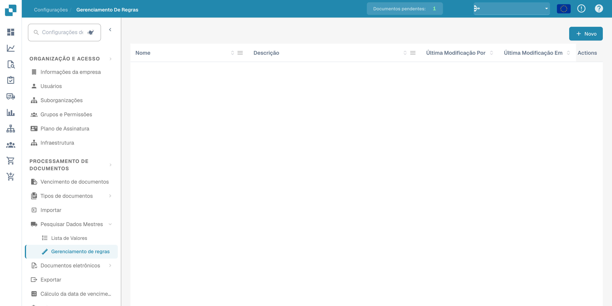
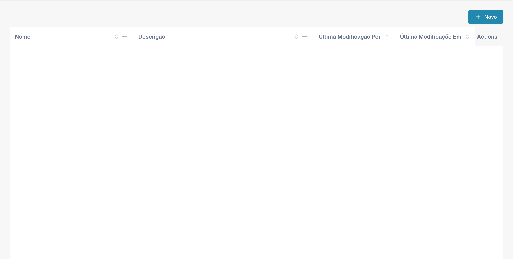
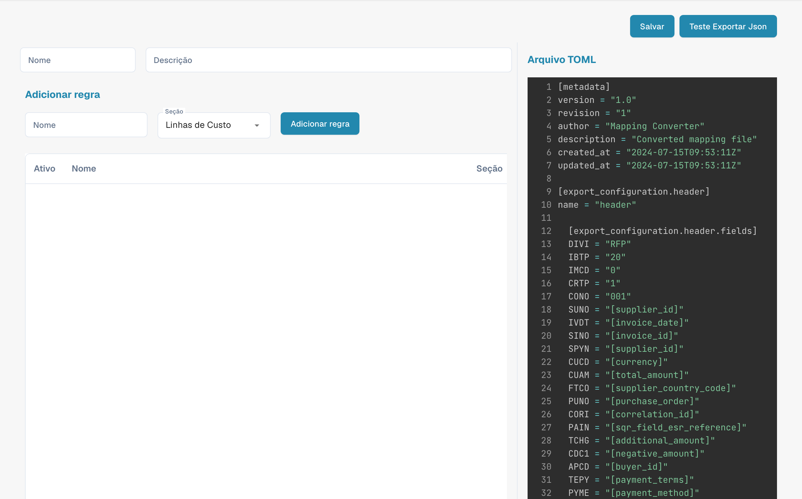

# Gestão de regras

<figure><figcaption>
Gestão de regras com nomes configurados ocultos. Alguns cabeçalhos da aplicação permanecem em inglês.
</figcaption></figure>

O Rule Management permite criar e gerenciar regras de resolução de conflitos baseadas em TOML, usadas durante o PO Matching e a exportação de documentos. Cada conjunto de regras define como o DocBits trata as divergências entre os dados da fatura e os dados do pedido de compra.

## Lista de regras

A tabela principal mostra todas as configurações de regras:

| Coluna | Descrição |
|--------|-------------|
| **Nome** | O nome do conjunto de regras. Itens marcados como **padrão** são modelos fornecidos pelo sistema. |
| **Descrição** | Um resumo do que o conjunto de regras trata. |
| **Última modificação por** | O usuário que editou este conjunto de regras pela última vez. |
| **Última modificação em** | Data e hora da última alteração. |
| **Ações** | Menu de três pontos para editar, copiar ou excluir. |

Clique em **+ New** para criar um novo conjunto de regras ou clique no nome de um existente para abrir o editor de regras.

---

## Referência da estrutura das regras

Esta seção apresenta uma explicação detalhada das regras de resolução de conflitos usadas no sistema de faturamento do DocBits. Essas regras foram criadas para tratar automaticamente as divergências entre os detalhes da fatura e os dados do pedido de compra (PO), garantindo uma conciliação financeira precisa. O sistema aplica essas regras para processar linhas de fatura, encargos e impostos e, quando necessário, gera os ajustes ou as notas apropriados.

## Estrutura das regras

### 1. Metadados

• version: identifica a versão do arquivo de mapeamento.

• revision: número de revisão para o controle de alterações.

• author: indica o criador do arquivo de mapeamento.

• description: uma breve descrição da finalidade do arquivo.

• created_at & updated_at: datas e horas de criação e da última atualização do arquivo.

### 2. Configuração da exportação

A seção de configuração de exportação define o mapeamento entre os campos de dados do sistema e os campos correspondentes nos arquivos de exportação.

• Header: define os campos de cabeçalho dos dados de fatura exportados.

• Tax Lines: especifica os campos dos itens de linha de imposto na exportação.

• Order Header Charges: mapeia os campos relacionados a encargos adicionais no nível do cabeçalho do pedido.

• Receipt Lines: mapeia os campos de cada item de linha de um recebimento.

• Order Line Charges: define os campos de encargos relacionados a linhas de pedido específicas.

• Cost Lines: especifica os campos das linhas de alocação de custos.

• Debit Note & Credit Note: define os campos para gerar notas de débito e de crédito em caso de divergências.

### 3. Regras de resolução de conflitos

Essas regras tratam as divergências entre os dados da fatura e os dados correspondentes do pedido de compra. Cada regra é composta por vários componentes:

• Name: o nome descritivo da regra, que indica o tipo de divergência tratado.

• Section: indica a qual parte da fatura (por exemplo, receipt_lines, line_charges) a regra se aplica.

• Active: valor booleano (true ou false) que indica se a regra está ativa no momento.

• Match Criteria: condições que acionam a regra com base em comparações entre os dados reais da fatura e os dados esperados do pedido de compra.

• Actions: define o que o sistema deve fazer quando a regra é acionada, incluindo ajustar valores, aplicar encargos ou gerar notas de crédito/débito.

## Elementos comuns nas regras

### Operadores de comparação

Esses operadores definem como os valores reais da fatura são comparados com os valores esperados do pedido de compra:

• igual a

• maior que

• maior ou igual a

• menor que

• menor ou igual a

• dentro da tolerância

• fora da tolerância

### Status de aprovação

Indica se uma divergência foi aprovada ou não:

• aprovada

• rejeitada

• qualquer

### Tipos de ação

Define as ações específicas a executar quando uma divergência é detectada:

• linha de recebimento

• linha de custo

• encargo de cabeçalho

• encargo de linha

• linha de imposto

• linha de recebimento de nota de débito

• linha de custo de nota de débito

• encargo de cabeçalho de nota de débito

• encargo de linha de nota de débito

• linha de recebimento de nota de crédito

• linha de custo de nota de crédito

• encargo de cabeçalho de nota de crédito

• encargo de linha de nota de crédito

• linha de imposto de nota de crédito

### Exemplos de regras

#### [Casos 1, 2, 3: quantidade e preço unitário dentro da tolerância](transactionconfig-pro-template/case-1-2-3-quantity-and-unit-price-within-tolerance.md)

• Finalidade: trata cenários em que a quantidade e o preço unitário da fatura estão dentro dos limites de tolerância aceitos em comparação com o pedido de compra.

• Ação: o sistema aceita os valores da fatura e calcula o valor total.

#### [Casos 4, 5: quantidade dentro da tolerância, preço unitário fora da tolerância (aprovado)](./#caso-4-5-quantidade-dentro-da-tolerancia-preco-unitario-fora-da-tolerancia-aprovado)

• Finalidade: aplica-se quando a quantidade está dentro da tolerância, mas o preço unitário está fora da tolerância e foi aprovado.

• Ação: o sistema ajusta o preço unitário para corresponder ao pedido de compra e aplica os encargos de linha necessários.

#### [Caso 6: quantidade dentro da tolerância, preço unitário fora da tolerância negativa (rejeitado)](transactionconfig-pro-template/case-6-quantity-within-tolerance-unit-price-outside-negative-tolerance-rejected.md)

• Finalidade: trata casos em que o preço unitário é menor que o esperado e está fora da faixa de tolerância, resultando em rejeição.

• Ação: o sistema ajusta o preço unitário para corresponder ao pedido de compra, gera uma nota de crédito pela diferença e aplica encargos de cabeçalho conforme necessário.

### Tratamento de encargos e impostos

### Tolerância de encargo por unidade

• As regras desta categoria tratam divergências nos encargos por unidade, com ações específicas conforme o encargo esteja dentro ou fora da tolerância e tenha sido aprovado ou rejeitado.

### Ajustes de linhas de imposto

• Essas regras gerenciam divergências de impostos, ajustando as linhas de imposto ou gerando as notas de crédito ou débito correspondentes com base nas diferenças entre os dados de imposto da fatura e do pedido de compra.

### Enums e opções

• Enums: listas predefinidas de valores que garantem consistência entre as regras (por exemplo, operadores de comparação, tipos de aprovação).

• Opções: escolhas predefinidas para o tratamento de quantidades ou preços unitários, que oferecem flexibilidade na definição das regras.

## Explicação das capturas de tela

### Captura de tela 1: interface do Rule Management

<figure><figcaption>
Resumo da gestão de regras e ações disponíveis. Alguns cabeçalhos da aplicação permanecem em inglês.
</figcaption></figure>

Esta captura de tela mostra a interface do Rule Management, na qual os administradores podem visualizar e gerenciar todas as regras de resolução de conflitos. Os principais elementos incluem:

• Botão Add Rule: permite adicionar novas regras.

• Lista de regras: exibe todas as regras ativas com detalhes como nome, seção e status de ativação.

• Lista suspensa Section: filtra as regras com base na seção à qual se aplicam (por exemplo, Receipt Lines, Line Charges).

### Captura de tela 2: edição detalhada de regras

<figure><figcaption>
Editor de regras TOML com um exemplo técnico de configuração.
</figcaption></figure>

Esta captura de tela ilustra a visualização detalhada de uma regra específica em edição. Os principais elementos incluem:

• Seção Criteria: define as condições em que a regra é acionada. Por exemplo, os critérios podem especificar que, se a quantidade e o preço unitário diferirem do pedido de compra, mas estiverem dentro da tolerância, a regra deve ser aplicada.

• Seção Actions: especifica as ações que devem ser executadas quando os critérios são atendidos. Isso pode incluir ajustar as linhas da fatura, gerar notas de crédito ou débito ou aplicar encargos adicionais.

• Document Type e Costing Elements: permite que o administrador associe ações específicas a tipos de documento e elementos de custo, oferecendo flexibilidade para tratar diferentes cenários.
