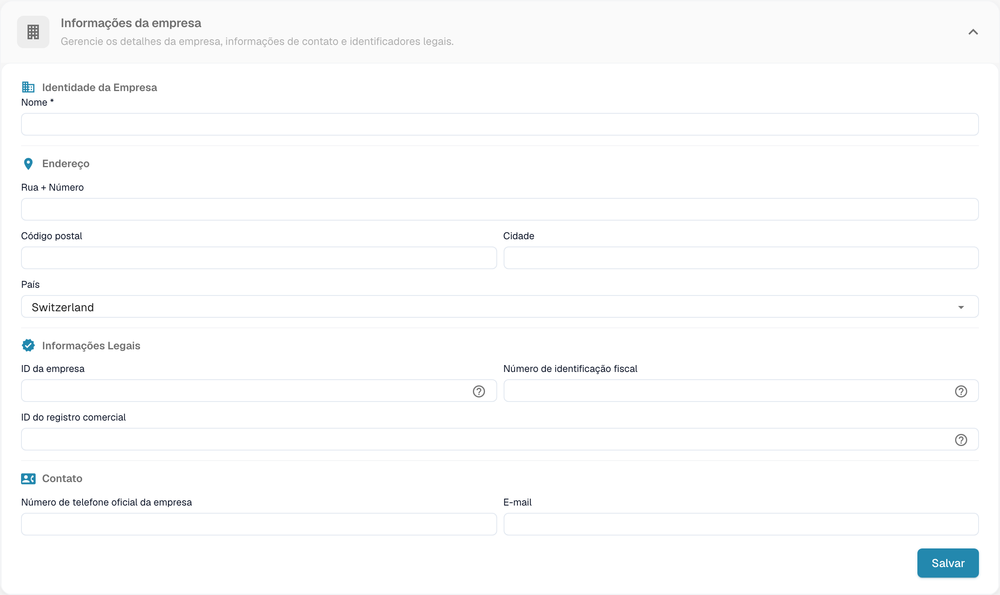
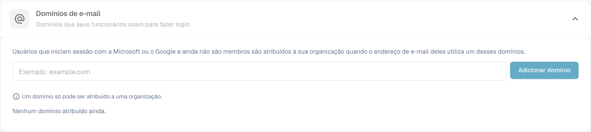

# Informações da empresa

<figure><figcaption>
Dados da empresa com valores da organização ocultos.
</figcaption></figure>

A página Company Information permite gerenciar o perfil da sua empresa, as preferências e os detalhes da assinatura. Ela é organizada nas seguintes seções:

## Informações da empresa

Esta seção contém os dados principais da sua empresa, agrupados em quatro áreas:

### Identidade da empresa

* **Nome** *(obrigatório)*: o nome legal da sua empresa.

### Endereço

* **Rua + Número**: o endereço (rua) da sua empresa.
* **Código postal**: CEP ou código postal.
* **Cidade**: nome da cidade.
* **País**: selecione o seu país na lista suspensa.

### Informações legais

* **ID da empresa**: um identificador exclusivo da sua empresa, usado para integrações e como referência interna.
* **Número de identificação fiscal**: seu número de identificação fiscal para relatórios financeiros.
* **ID do registro comercial**: seu número de registro comercial para a documentação legal.

### Contato

* **Telefone oficial da empresa**: o telefone principal da sua empresa.
* **E-mail**: o endereço de e-mail principal usado para comunicações oficiais.

Depois de inserir ou atualizar qualquer campo, clique em **Salvar** para aplicar as alterações. Os ícones **?** ao lado dos identificadores legais mostram orientações adicionais sobre o campo. Selecione o título da seção para expandir ou recolher o formulário.

## E-mail domains

Os administradores da organização podem abrir **Definições → Informações da empresa → Domínios de correio eletrónico** para gerenciar os domínios usados na atribuição automática à organização. Quando alguém entra com Microsoft ou Google e ainda não é membro de uma organização, o DocBits pode atribuí-lo a esta organização se o endereço de e-mail dessa pessoa usar um dos domínios listados. Um domínio pode pertencer a apenas uma organização.

<figure><figcaption>
Configuração dos domínios de e-mail da empresa.
</figcaption></figure>

Insira apenas o domínio, como `example.com`, no campo e selecione **Adicionar domínio** ou pressione Enter. O primeiro domínio se torna o domínio principal. Se houver mais domínios listados, use **Faça o primário** em outra linha para alterá-lo ou o ícone de lixeira para remover um domínio. Erros como domínio inválido, provedor de e-mail pessoal ou domínio já atribuído a outra organização aparecem abaixo do campo. **Ainda não existem domínios atribuídos** significa que esta organização não tem nenhuma regra de domínio.

Antes de adicionar um domínio, verifique qual organização deve receber os novos logins. Para gerenciar as associações existentes, continue em [Users](../groups-users-and-permissions/users/README.md).

## Preferências da empresa

Configure as definições padrão válidas para toda a empresa:

* **Padrão de data**: escolha como as datas são exibidas em todo o DocBits (por exemplo, `%m/%d/%Y`, `%d.%m.%Y`).
* **Formatação de Quantidade**: selecione o formato numérico dos valores (por exemplo, Deutsch para `1.000,00`, English para `1,000.00`).
* **Caixa de diálogo de informações da nova versão**: define se os usuários veem uma notificação quando uma nova versão do DocBits é lançada.

Clique em **Salvar** depois de fazer as alterações.

## App-Color

Personalize a cor primária da interface do DocBits. Isso é útil para distinguir visualmente diferentes ambientes (por exemplo, dev e produção).

* **Cor**: insira um código de cor hexadecimal (por exemplo, `#2388AE`) ou use o seletor de cores.
* Clique em **Salvar** para aplicar ou em **Reiniciar** para restaurar a cor padrão.

## Plano de subscrição

Veja seus planos de assinatura ativos e os respectivos detalhes:

* **Nome do plano**: o nome de cada plano ativo (por exemplo, DocBits, DocFlow Users, DocSearch).
* **dias restantes**: quantos dias faltam para o plano expirar.
* **Start Date / End Date**: o período da assinatura.
* **Número de utilizadores**: número total de usuários na sua organização.
* **Número de suborganizações**: número de suborganizações configuradas.
* **Número de fornecedores**: número de fornecedores cadastrados.

## Utilização da subscrição

Acompanhe seu consumo mensal de tokens e de workflows:

| Coluna | Descrição |
|--------|-------------|
| **Tipo** | O tipo de uso (Document ou Workflow). |
| **From / To** | As datas do período de faturamento. |
| **Tokens utilizados** | Número de tokens consumidos no período atual. |
| **Tokens restantes** | Tokens ainda disponíveis no período atual. |

Use o botão **Selecione** para filtrar por intervalos de datas específicos.
