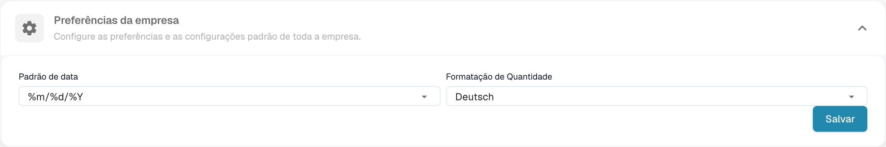
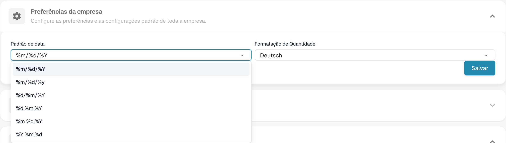

# Preferências da empresa

Abra as preferências nos dados da empresa para definir os formatos de data e montante da organização.

<figure><figcaption>
Preferências da empresa e formatos de montante e data.
</figcaption></figure>

Escolha um formato de data adequado aos documentos. Os símbolos %d, %m e %Y são códigos técnicos de formato.

<figure><figcaption>
Seleção do formato de data nas preferências da empresa.
</figcaption></figure>

O formato de montante é uma definição separada; o nome configurado pode permanecer inalterado. Verifique ambos os formatos antes de guardar. A antiga janela de informação da versão não faz parte da vista atual. Não foram alteradas preferências para estas imagens.
