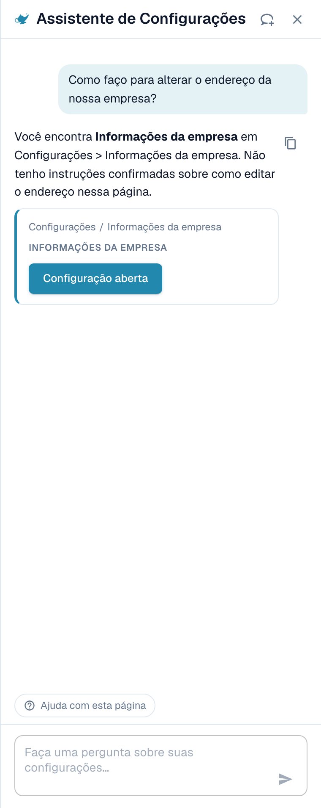
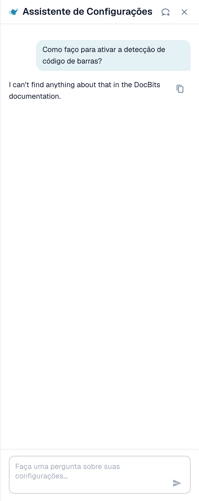
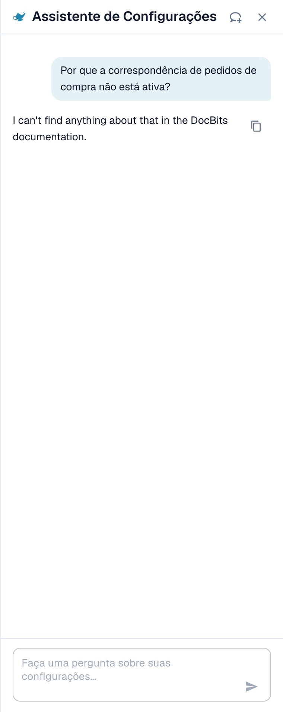
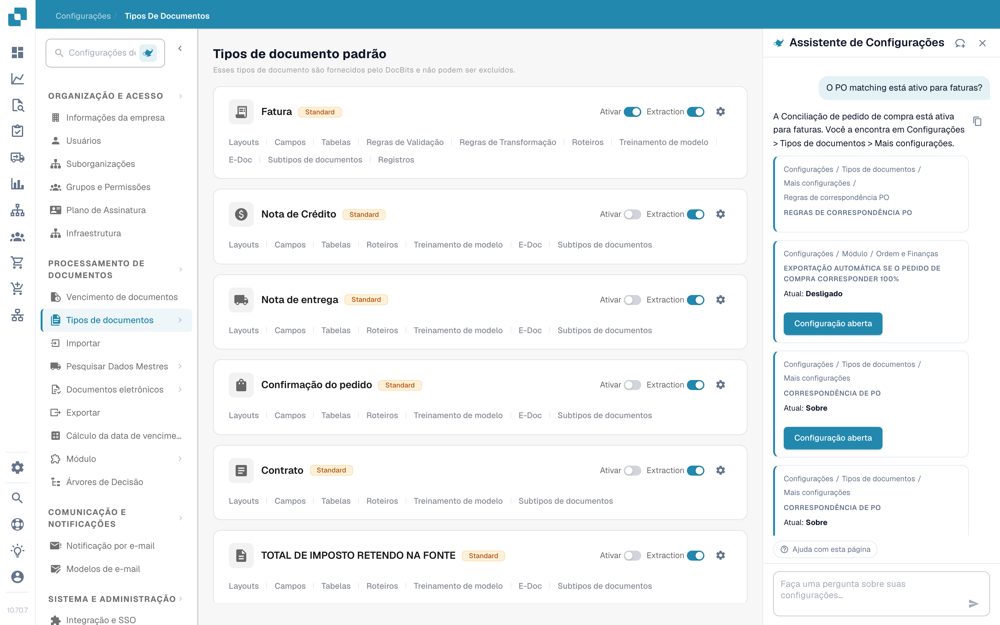
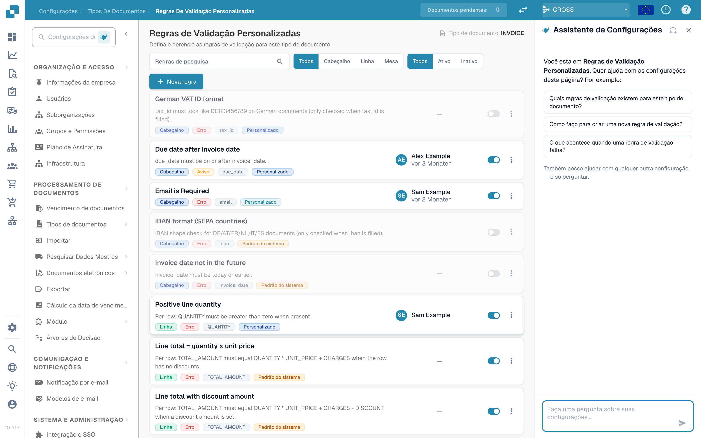
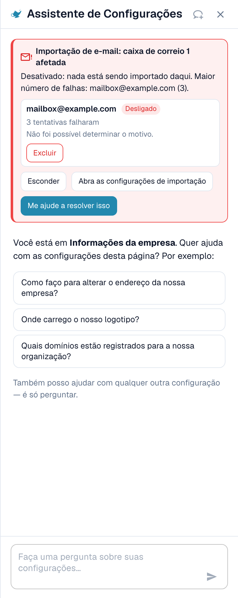

# Assistente de Configurações: o que o chat pode fazer

## Visão geral

O chat do **Assistente de Configurações** responde a perguntas sobre as suas configurações, avisa quando uma importação para de funcionar e, com a sua confirmação, altera uma configuração para você. Antes de usá-lo, um administrador precisa [ativar o assistente](settings-assistant.md).

### O que ele pode fazer

| Você quer… | Exemplo | O que você recebe |
| --- | --- | --- |
| Encontrar uma configuração | "Onde encontro as configurações de importação de e-mail?" | O caminho (por exemplo, Settings / Import) e um botão **Open setting** (Abrir configuração) que leva até a configuração e a destaca |
| Entender uma configuração | "Como habilito a detecção de código de barras?" | Uma explicação curta de cada configuração correspondente: quando ativá-la e quando deixá-la desativada |
| Verificar a sua configuração | "Por que o PO Matching não está ativo?" | O valor atual de cada configuração relacionada na sua organização (**Current: On** ou **Current: Off**) e qual delas bloqueia você |
| Detectar uma importação com defeito | Um cartão vermelho no topo do painel | Qual caixa de e-mail ou conexão FTP falha, com que frequência e um provável motivo |
| Alterar uma configuração com segurança | **Switch off** (Desativar) em uma caixa de e-mail com falha, em um cartão de alerta | Uma pré-visualização da alteração. Nada é salvo até você confirmar. Toda alteração pode ser desfeita. |
| Conhecer uma página | **Watch video explanation** (Assistir à explicação em vídeo) | Um vídeo curto sobre a página em que você está (disponível para páginas selecionadas) |


O assistente roda no nível de IA **Fast** (rápido). Não há uma configuração da organização para escolher outro modelo.


## Faça perguntas

Digite uma pergunta no campo na parte inferior ("Ask a question about your settings…") e pressione **Enter**. O assistente mostra o que está fazendo ("Reading configuration…", "Searching documentation…", "Writing answer…") e você pode interrompê-lo a qualquer momento com **Stop** (Parar).

### O painel sabe em qual página você está

Quando você abre o painel em uma página de configurações, ele cumprimenta você **por aquela página** e oferece três perguntas que combinam com ela. Estes são exemplos reais:

| Página | Perguntas de exemplo |
| --- | --- |
| Informações da empresa | "Como altero a morada da nossa empresa?", "Onde carrego o nosso logótipo?", "Que domínios estão registados para a nossa organização?" |
| Importação | "A importação por e-mail está ativa para nós?", "Para que endereço de e-mail enviamos os documentos?", "Como configuro uma importação por FTP ou SFTP?" |
| Classificar e extrair | "Que modelo de IA é utilizado para a extração?", "A divisão de documentos por códigos de barras está ativa para nós?", "Posso utilizar outro modelo de IA para um fornecedor?" |
| Usuários | "Como convido um novo utilizador?", "Como atribuo a um utilizador o papel de administrador?", "Como desativo um utilizador?" |
| Visão geral das configurações | "Como ativo a deteção de códigos de barras?", "Porque não está ativa a correspondência de encomendas?", "Onde encontro as definições de importação por e-mail?" |

Clique em uma pergunta e ela é enviada imediatamente. Abaixo das três perguntas, o painel diz *I can also help with any other setting — just ask.* Durante uma conversa, o atalho **Help with this page** (Ajuda com esta página) permanece na parte inferior e pergunta "What can I configure on this page?".

### Exemplo 1: encontrar uma configuração

Você pergunta **"Como altero a morada da nossa empresa?"** (Como altero o endereço da empresa?).

<figure><figcaption>
A resposta indica o local, e o cartão mostra o caminho exato e um botão <strong>Open setting</strong>.
</figcaption></figure>

A resposta diz onde o endereço fica. O cartão abaixo mostra o caminho (**Settings / Company Settings**) e o botão **Open setting**. Clique nele: o DocBits abre a página, rola até a configuração e a destaca por alguns segundos.

### Exemplo 2: entender uma configuração com vários nomes

Você pergunta **"Como ativo a deteção de códigos de barras?"** (Como habilito a detecção de código de barras?).

<figure><figcaption>
Quando uma palavra corresponde a várias configurações, o assistente lista cada uma com <strong>Enable when</strong> e <strong>Leave off when</strong>.
</figcaption></figure>

"Detecção de código de barras" pode significar três configurações diferentes. Por isso o assistente pergunta *Did you mean: QR Code Extraction, Barcode Assignment, or Split Document on Barcode?* e explica cada uma:

* **QR Code Extraction**: lê automaticamente códigos de barras e QR codes compatíveis durante o processamento. Ative-a quando os seus documentos trouxerem códigos úteis.
* **Barcode Assignment**: permite que um revisor atribua manualmente, durante a validação, os valores de código de barras decodificados a campos. Ela precisa que a extração detecte o código antes e não torna o processamento touchless.
* **Split Document on Barcode**: divide um arquivo enviado em documentos separados nas páginas separadoras. Use-a somente quando os códigos separadores forem confiáveis.

### Exemplo 3: descobrir por que algo não acontece

Você pergunta **"Porque não está ativa a correspondência de encomendas?"** (Por que o PO Matching não está ativo?).

<figure><figcaption>
Em uma pergunta do tipo "por que", o assistente lê a sua configuração e mostra cada configuração com o seu valor <strong>Current</strong> (atual).
</figcaption></figure>

O assistente lê as configurações da sua organização e informa o que encontrou. Neste exemplo, o PO Matching está **On** (ativado) para os quatro tipos de documento, e a configuração **Auto export if PO matched 100%** está **Off** (desativada), então o matching e a exportação automáticos não são executados. Cada cartão mostra **Current: On / Off** e um botão **Open setting**, para que você possa corrigir na hora.

### Exemplo 4: PO Matching

Você abre **Configurações → Tipos de documento** e pergunta **"Is PO matching active for invoices?"** (O PO Matching está ativo para faturas?). Esta pergunta também é uma das três sugestões nessa página.

<figure><figcaption>
A página <strong>Document Types</strong> com o assistente à direita. A resposta diz <strong>PO Matching is active for invoices in your organization</strong> e mostra três configurações relacionadas: <strong>PO Matching</strong> (Current: On), as <strong>PO match rules</strong> e <strong>Auto export if PO matched 100%</strong> (Current: Off).
</figcaption></figure>

O assistente lê a configuração do tipo de documento e acrescenta as configurações que pertencem a ela. Neste exemplo, o matching está ativado, mas a exportação automática após um match de 100 % está desativada, então as faturas com match continuam esperando por uma pessoa. Cada cartão tem um botão **Open setting**.

* Para as **regras e tolerâncias de matching**, use a página [Regras de matching de pedidos de compra](../document-types/more-settings/purchase-order/purchase-order-matching-rules.md).
* Para ver **por que os documentos de um fornecedor não têm match**, abra [Touchless Intelligence: diagnóstico de PO Matching](../../../touchless-po-matching-diagnosis.md). Ela mostra o motivo, os documentos afetados e o fluxo de decisão.

### Exemplo 5: validação de campos (regras de validação personalizadas)

Na página **Configurações → Tipos de documento → Regras de validação personalizadas**, o painel cumprimenta você por essa página e sugere três perguntas.

<figure><figcaption>
A página <strong>Custom Validation Rules</strong> com o assistente à direita. A lista de regras fica no meio, e as três sugestões do painel são: <strong>Which validation rules exist for this document type?</strong>, <strong>How do I create a new validation rule?</strong> e <strong>What happens when a validation rule fails?</strong>
</figcaption></figure>

Use o assistente aqui para **encontrar** a configuração certa e para saber o que uma regra faz. Para **criar ou alterar** uma regra, trabalhe na própria página: veja [Regras de validação personalizadas](../document-types/custom-validation-rules.md) e [Duplicar uma regra de validação personalizada](../document-types/duplicate-a-custom-validation-rule.md). Se o assistente criar uma regra para você, ela sempre é criada **inativa**, e é você quem a ativa.


Não confunda **Regras de validação personalizadas** (regras para os campos de um tipo de documento) com **E-Invoice Validation** (a verificação de arquivos XRechnung, ZUGFeRD e Factur-X). São duas páginas diferentes.


### Exemplo 6: mais perguntas para experimentar

* "Que modelo de IA é utilizado para a extração?"
* "A divisão de documentos por códigos de barras está ativa para nós?"
* "Como desativo um utilizador?"
* "Where do I set how long documents are kept?"
* "Which settings affect the touchless rate?"
* "Show me a screenshot of the supplier portal settings."


Se uma pergunta estiver fora da área de configurações, ou se o assistente não encontrar nada sobre ela nas informações do DocBits de que dispõe, ele diz isso. Por exemplo, uma pergunta sobre algo que não é uma configuração retorna *I can't find anything about … in the DocBits information available here*, junto com um link para a página mais próxima. Ele não adivinha.


### Links e capturas de tela nas respostas

* As respostas podem conter links **View documentation** (Ver documentação). Eles apontam somente para docs.docbits.com e abrem em uma nova aba. Os links de documentação aparecem quando a busca na documentação está disponível para o seu ambiente.
* As respostas podem mostrar **capturas de tela** da documentação. Clique em uma miniatura para ampliá-la.
* **Copy answer** (Copiar resposta, o pequeno ícone de cópia ao lado de uma resposta) copia o texto.

## Alertas: o assistente avisa você

Quando algo na sua configuração para de funcionar, um **cartão vermelho** aparece no topo do painel. Você não precisa perguntar. O assistente verifica de novo sempre que você abre o painel e sempre que volta para a aba do navegador.

<figure><figcaption>
Um alerta expandido: a caixa de e-mail, o seu estado (<strong>Switched off</strong>), o número de tentativas com falha e o motivo.
</figcaption></figure>

Atualmente há duas verificações:

| Verificação | Título do cartão | O que ela conta |
| --- | --- | --- |
| Importação de e-mail | "Email import: 1 mailbox affected" / "Email import: 3 mailboxes affected" | Caixas de e-mail com falhas de login |
| Importação FTP | "FTP import: 1 connection affected" / "FTP import: 2 connections affected" | Conexões com falhas de conexão ou de login |

Cada cartão tem três botões:

* **Show errors** (Mostrar erros, depois **Hide**): lista as caixas de e-mail ou conexões afetadas, até dez, com o estado (**Switched off** ou **Retrying**), o número de tentativas com falha e o motivo.
* **Open import settings** (Abrir configurações de importação): abre **Configurações → Importação**.
* **Help me fix this** (Ajude-me a corrigir): inicia um chat. O assistente pergunta a si mesmo "My email import has stopped working. Can you help me fix it?" e conduz você pelo motivo.

A linha de resumo diz qual é a gravidade:

| Linha de resumo | Significado |
| --- | --- |
| *Switched off: nothing is being imported from here.* | Todas as caixas de e-mail afetadas estão desativadas. Nada chega. |
| *Still being retried, but imports are probably failing.* | O DocBits continua tentando, mas o login não funciona. |
| *1 switched off, 2 still being retried.* | Uma mistura dos dois. |

### Motivos que você pode ver

O assistente traduz o erro técnico em um destes motivos:

| Motivo exibido | O que fazer |
| --- | --- |
| Sign-in blocked by policy (e.g. basic authentication disabled, or an app password/MFA is required) | Peça ao administrador de e-mail uma senha de aplicativo ou mude a caixa de e-mail para a autenticação moderna |
| Sign-in rejected (check username and password) | A senha mudou. Digite a nova nas configurações de importação |
| Mailbox or path not found | A caixa de e-mail foi renomeada ou excluída. Verifique o endereço ou a pasta |
| Server not reachable | Verifique o nome do servidor e o seu firewall |
| Timeout while connecting | O servidor está lento ou bloqueado. Tente novamente mais tarde |
| Certificate or TLS connection failed | Verifique a configuração de criptografia e o certificado do servidor |
| Reason could not be determined | Abra as configurações de importação e teste a conexão |

### Desativar ou excluir uma conexão com falha

Em uma linha expandida, você pode usar **Switch off** (exibido somente se a conexão ainda estiver ativa) ou **Delete** (Excluir). Ambos seguem o mesmo fluxo seguro:

1. Você clica no botão. O assistente pergunta *Switch off (name)? Nothing will be imported from this mailbox until it is switched on again.* ou *Delete (name)? It is removed permanently and cannot be undone.*
2. Você confirma com **Yes, switch off** ou **Yes, delete**, ou clica em **Cancel** (Cancelar).
3. A linha de resultado aparece: *(name) was switched off.* com um botão **Undo** (Desfazer). Uma conexão excluída não tem **Undo**, porque a exclusão é permanente.

Se outra pessoa alterou a caixa de e-mail nesse meio-tempo, você vê *This mailbox was changed in the meantime. Please check it and try again.* Nada é alterado.

## Alterar configurações com segurança

O assistente nunca altera nada por conta própria. Toda alteração segue os mesmos quatro passos:

1. **Preview** (Pré-visualização): você vê a configuração, o seu escopo (**Organization**) e o valor **atual → proposto**. Nada é salvo ainda.
2. **A sua confirmação**: você clica em **Confirm** (ou **Yes**). Somente um administrador da organização pode fazer isso.
3. **Linha de resultado**: o chat mostra **Changed: (setting) → (value)**.
4. **Undo**: um botão com contagem regressiva ("14 min left") permite desfazer a alteração. A alteração também fica registrada no log.

**Exemplo (ilustrativo).** Um cartão de recomendação para uma configuração que o assistente pode gravar mostra um botão **Apply** (Aplicar) ao lado de **Open setting**. Digamos que o cartão seja sobre **Auto export if PO matched 100%**. Você clica em **Apply**. A caixa de diálogo **Apply this change?** mostra *Current: Off → Proposed: On*. Você clica em **Confirm**. Uma mensagem **Setting updated.** aparece com um botão **Undo**. Se você notar um erro em cerca de 15 minutos, clica em **Undo** e o valor antigo volta. Cartões sem o botão **Apply** servem somente para navegação: use **Open setting** e altere o valor você mesmo.

Se o valor mudou desde que você abriu a caixa de diálogo, você vê *This setting changed since you opened this dialog. Preview it again.* e nada é aplicado.

### O que o assistente pode alterar

| Alteração | Pedido de exemplo (ilustrativo) |
| --- | --- |
| Uma única configuração da organização (**Apply** em uma recomendação) | "Switch on automatic PO match and export" |
| Ativar ou desativar tipos de documento | "Deactivate document type Delivery Note" |
| Renomear um grupo de acesso | "Rename the group Buyers to Purchasing" |
| Modo de busca de um campo de consulta (Auto ou Manual) | "Search suppliers manually instead of automatically" |
| Excluir um campo | "Delete the field Cost Center" |
| Criar uma regra de validação inativa a partir de um catálogo | Abra a página **Regras de validação personalizadas** e descreva a verificação |
| Criar uma regra de transformação inativa | "Create a rule that removes dashes from the supplier VAT number" |
| Desativar ou excluir uma conexão de importação | Use os botões no cartão de alerta |

### Rascunhos de regras

Se você pedir uma **regra de transformação**, o assistente mostra primeiro um **Rule preview** (pré-visualização da regra):

* o nome da regra e uma frase simples ("Remove dashes from the supplier VAT number"),
* o destino (campo de cabeçalho, coluna de uma tabela, linhas de uma tabela, atributo do documento),
* um teste em documentos de exemplo: **Applies to 4 of 5 samples**, com cada documento marcado como **Applies**, **Does not apply** ou **Applies, no change**.

Com **Create rule** (Criar regra) você a salva. A regra é criada **inativa**: você mesmo a ativa depois de verificá-la. Você pode desfazer a criação por **15 minutos**. Depois disso, exclua a regra na lista de regras. No máximo **10 regras por hora** podem ser criadas por meio do assistente.

## Explicações em vídeo

Em páginas selecionadas (atualmente **Layouts**, **Usuários** e **Sub-Organizations**), o assistente oferece **Watch video explanation**. O vídeo é reproduzido no painel, tem legendas e uma transcrição (**Show transcript**), e usa o seu idioma quando existe uma versão.

## Limites e mensagens

| Mensagem | Significado |
| --- | --- |
| Too many requests. Please wait a moment. | Você enviou muitas perguntas rapidamente. **Retry** (Tentar novamente) fica ativo após uma curta espera. |
| Available to administrators only. | A sua conta não é de administrador da organização. |
| The assistant is temporarily unavailable. | Tente novamente em alguns minutos. |
| The assistant is taking too long to respond. | A resposta não começou a tempo. Clique em **Retry**. |
| Something went wrong. Please try again. | Um erro geral. O **Error ID** pode ser copiado para o suporte. |
| The assistant is being set up | O recurso ainda não está disponível no seu ambiente. |
| You've switched organizations — this response no longer applies here. | Você mudou de organização enquanto uma resposta ou uma alteração estava aberta. |

Uma conversa mantém as últimas 50 interações no seu navegador. Uma pergunta pode ter até 4000 caracteres.

## Dicas

* Pergunte **uma coisa de cada vez**. "Where is the email import and is it on?" funciona melhor como duas perguntas.
* Use a **saudação da página**. As três perguntas foram escritas para a página em que você está e são o começo mais rápido.
* Diga **o que você quer alcançar**, não o nome de uma configuração. "I want invoices to be exported without anyone looking at them" encontra as configurações certas.
* Confira a **pré-visualização** antes de confirmar, principalmente os valores **atual → proposto**.
* Não tem certeza? Use **Open setting** e olhe a página. O assistente nunca esconde onde fica uma configuração.

## Páginas relacionadas

* [Assistente de Configurações: como ativá-lo](settings-assistant.md)
* [Painel de Análises](../../../analytics-dashboard.md)
* [DocBits MCP](../../../../advanced-functions-and-tools/docbits-mcp/README.md)

<!-- Source notes (not shown): the assistant answers for custom validation rules and for PO tolerance / "why not matched" questions are weak on dev (tracked in the CORE project, CORE-6433), so this page shows only the greeting for validation and the PO matching status answer. Re-test and add answer screenshots after the fix. facts read from the doc2app code on dev (SettingsAssistant, AssistantChat components) and checked in the dev UI on 14 Oct 2026. "Fast tier, no organisation switch" and "documentation search not configured on Sandbox yet" come from the feature team (CORE-6379). Strings for the apply/action cards not verified in the UI are described, not quoted. -->
