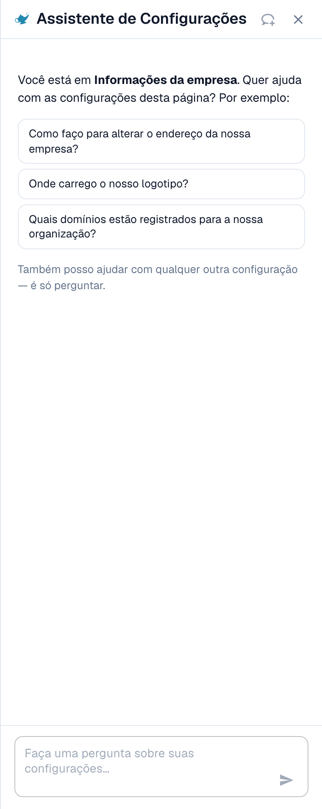
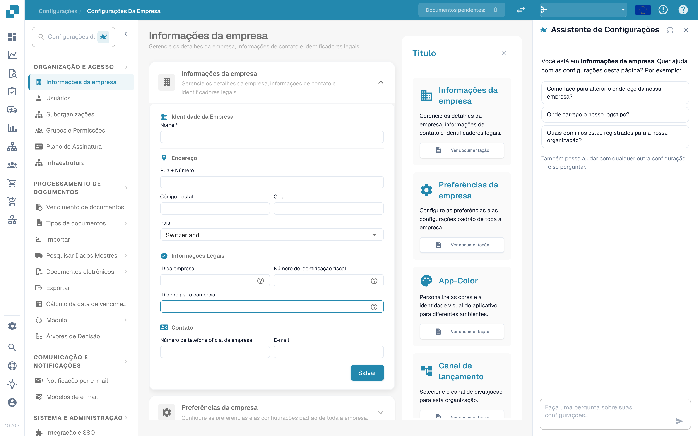

# Assistente de Configurações: como ativá-lo

O **Assistente de Configurações** é um painel de chat dentro da área de Configurações. Você faz uma pergunta em linguagem simples, e ele lê a configuração da sua organização, responde e leva você direto à configuração certa. Ele também pode avisar quando algo na sua configuração parou de funcionar e, com a sua confirmação, alterar uma configuração para você.

Ele ajuda mais quando você sabe **o que** quer ("parar de dividir documentos por código de barras"), mas não sabe **onde** fica a configuração, ou quando você se pergunta **por que** algo não acontece ("Por que o PO Matching não está ativo?").

<figure><figcaption>
O Assistente de Configurações na página Informações da empresa: uma saudação para a página atual, três perguntas de exemplo e o campo de pergunta. Um cartão de aviso aparece acima da saudação quando uma importação parou de funcionar (veja <a href="settings-assistant-chat.md#alertas-o-assistente-avisa-voce">Alertas</a>).
</figcaption></figure>

O assistente vem **desativado por padrão**. Esta página mostra onde ativá-lo e como abri-lo. O que você pode perguntar e o que ele pode alterar está descrito na página [Assistente de Configurações: o que o chat pode fazer](settings-assistant-chat.md).

## Quem pode usá-lo

* O **administrador da organização** ativa ou desativa o assistente para toda a organização.
* Depois de ativado, todo administrador que pode abrir **Configurações** pode mostrar ou ocultar o painel para si mesmo.
* As alterações (aplicar uma recomendação, desativar ou excluir uma conexão de importação, criar uma regra) são limitadas aos **administradores da organização**. Os demais usuários recebem a mensagem _Available to administrators only._ (disponível somente para administradores).

## Ativar

1. Acesse **Configurações → Configurações globais → Informações da empresa**. O cabeçalho da página mostra **Company Settings** (Configurações da empresa).
2. Abra a seção **Assistants** (Assistentes).
3. Ative **Enable the settings assistant** (Habilitar o assistente de configurações).

<figure><figcaption>
A seção Assistentes. O assistente de configurações tem a sua própria chave. O assistente de validação e a locução do vídeo explicativo são recursos separados.
</figcaption></figure>

Uma mensagem curta confirma **Settings assistant enabled** (assistente de configurações habilitado). A configuração vem desativada por padrão. Enquanto estiver desativada, o painel e o seu botão não aparecem em nenhum lugar.


O **Validation assistant** (assistente de validação) na mesma seção é outro recurso. Ele explica campos bloqueantes dentro de um documento e não pode alterar nenhuma configuração. Ativar ou desativar um dos dois não afeta o outro.


## Abrir e fechar o painel

Em todas as páginas da área de Configurações há um pequeno **botão em forma de lâmpada de gênio** ao lado do campo de busca de configurações. Clique nele para **mostrar** ou **ocultar** o assistente.

<figure><figcaption>
O assistente fica no <strong>lado direito</strong> de cada página de Configurações: navegação à esquerda, a página no meio e o assistente ao lado dela. Aqui em <strong>Company Settings → Company Information</strong>. O botão para mostrá-lo ou ocultá-lo é o ícone de lâmpada ao lado de <strong>Search Settings</strong>, no topo da navegação.
</figcaption></figure>

* O painel lembra a sua escolha por usuário, então ele continua aberto na próxima vez que você voltar.
* Em uma tela larga (1280 pixels ou mais), ele fica ao lado da página. Você pode arrastar a borda para alterar a largura.
* Em uma tela estreita, ele abre como uma sobreposição. **Esc** ou um clique fora dele o fecha.
* **New chat** (Novo chat, o ícone de balão de fala no cabeçalho) limpa a conversa. A conversa também sobrevive a um recarregamento da página, mas não a uma aba do navegador fechada.

## O que fazer em seguida

* Faça a sua primeira pergunta: veja [Assistente de Configurações: o que o chat pode fazer](settings-assistant-chat.md).
* O assistente roda no nível de IA **Fast** (rápido). Não há uma configuração da organização para escolher outro modelo.

## Solução de problemas

| Problema                                                                                | Causa e solução                                                                                                            |
| --------------------------------------------------------------------------------------- | -------------------------------------------------------------------------------------------------------------------------- |
| Não há botão de lâmpada de gênio na área de Configurações                               | A chave da organização está desativada. Um administrador da organização a ativa em **Informações da empresa → Assistants** |
| A seção **Assistants** não aparece em Informações da empresa                            | Somente administradores da organização a veem                                                                              |
| O painel mostra **The assistant is being set up** (o assistente está sendo configurado) | O recurso ainda não está disponível no seu ambiente                                                                        |
| O painel está lá, mas as respostas dizem _Available to administrators only._            | A sua conta não é de administrador da organização                                                                          |

## Páginas relacionadas

* [Assistente de Configurações: o que o chat pode fazer](settings-assistant-chat.md)
* [Preferências da empresa](../company-preferences.md)
