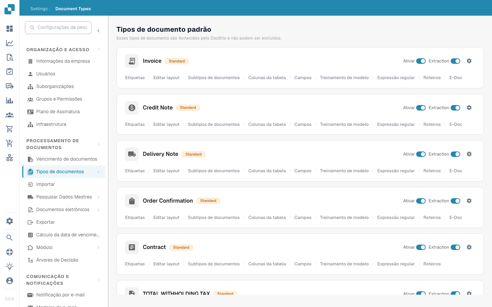

# Document Types


DocBits Document Types explicado: criar, configurar e atribuir configurações de processamento


<figure><figcaption>
Página Document Types
</figcaption></figure>

## Visão geral

A página Document Types lista todos os tipos de documento reconhecidos e processados pelo DocBits. Ela é dividida em duas seções:

* **Default Document Types**: tipos pré-configurados fornecidos pelo DocBits (Invoice, Credit Note, Delivery Note, Order Confirmation, Contract, ZUGFeRD etc.). Eles não podem ser excluídos.
* **Custom Document Types**: tipos que você cria para as necessidades específicas do seu negócio. Eles podem ser editados e excluídos.

## Controles por tipo de documento

Cada card de tipo de documento mostra:

| Controle | Descrição |
|---------|-------------|
| **Activate** | Chave para ativar ou desativar este tipo de documento para processamento. |
| **Extraction** | Chave para ativar ou desativar a extração de dados baseada em IA para este tipo. |
| **Settings** (ícone de engrenagem) | Abre opções de configuração adicionais para o tipo de documento. |

## Guias de configuração

Abaixo de cada tipo de documento, você pode acessar as seguintes guias de configuração:

| Guia | Descrição |
|-----|-------------|
| **Labels** | Gerencie os rótulos de exibição e as traduções do tipo de documento. |
| **Edit layout** | Modifique como o documento aparece na tela de validação, incluindo a posição dos campos. |
| **Document Sub Types** | Configure subcategorias para este tipo de documento (por exemplo, diferentes formatos de fatura). |
| **Table columns** | Personalize quais colunas de dados aparecem na tabela de itens de linha. |
| **Fields** | Gerencie os campos de dados extraídos do documento (adicionar, editar ou remover campos). |
| **Model Training** | Configure e treine o modelo de IA usado para reconhecer e extrair dados. |
| **Regex** | Configure expressões regulares para a extração de dados baseada em padrões. |
| **Scripts** | Escreva scripts de processamento personalizados que são executados durante o processamento de documentos. |
| **E-Doc** | Configure padrões de documentos eletrônicos (XRechnung, ZUGFeRD, EDI, FatturaPA). |

## Custom Validation Rules

Abra um tipo de documento e selecione **Custom Validation Rules** para gerenciar as regras de validação próprias desse tipo. Para reutilizar uma regra existente sem recriá-la, siga [Duplicar uma regra de validação personalizada](duplicate-a-custom-validation-rule.md). O guia explica o nome da regra, a chave da regra e os controles de confirmação.

## Criar um tipo de documento personalizado

1. Role a página para baixo até a seção **Custom Document Types**.
2. Clique em **+ New**.
3. Insira um nome para o novo tipo de documento.
4. Configure os campos, o layout e as configurações de extração conforme necessário.


Consulte [Setup Document Type](../../../setup/document-types/) para ver instruções de configuração detalhadas.

