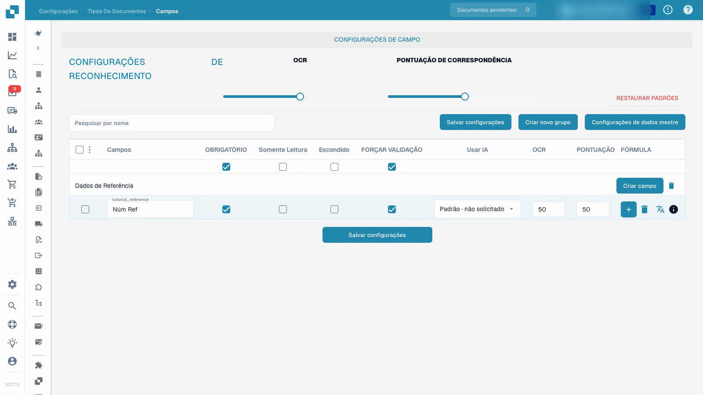

# Tipos de documento

Configurar o campo de referência de um tipo de teste personalizado, guardar as opções e confirmá-las após recarregar a página.


Tipos de documento


[Ver com legendas](https://docbits-videos.fra1.cdn.digitaloceanspaces.com/settings-assistant/document-types-fields-admin/v1/pt.html)

A gravação mostra a interface real. Alguns textos do produto podem ainda não estar traduzidos.

## Visão geral

Os tipos de documento definem os campos e as definições de processamento de cada categoria de documentos. O DocBits fornece tipos predefinidos, como faturas e notas de crédito. Um administrador pode configurar tipos personalizados para outras categorias. Os tipos predefinidos não podem ser eliminados; a gestão dos tipos personalizados depende das permissões da organização.

## Controlos de cada cartão

| Controlo | Função |
| --- | --- |
| Ativar | Ativa ou desativa o processamento deste tipo de documento. |
| Extraction | Seleciona o modo de extração apresentado no controlo: Flex ou Fix. Esta escolha é independente do interruptor de ativação. |
| Roda dentada | Abre outras definições deste tipo de documento. |

As ligações disponíveis dependem do tipo, das permissões e dos módulos ativos. Podem incluir disposições, campos, tabelas, scripts, treino de modelos e subtipos de documento. As regras de transformação, as regras de validação e as definições de documentos eletrónicos surgem quando as respetivas funcionalidades se aplicam. Outras opções podem encontrar-se dentro das definições do tipo de documento.

## Configurar campos e dados obrigatórios

O vídeo utiliza um tipo de documento de teste personalizado, criado previamente e separado das definições de faturas existentes. As alterações apresentadas aplicam-se ao seu campo de referência.

1. Abra o tipo de documento e selecione os respetivos campos.
2. Verifique o grupo e o nome técnico do campo. A designação apresentada pode ser alterada sem criar um novo identificador técnico.
3. Defina a referência como campo obrigatório, mantendo-o visível e editável. É necessário fornecer um valor; esta definição não preenche um valor em falta nem garante uma extração correta.
4. Configure separadamente a confirmação explícita da verificação do campo. As opções só de leitura e oculto, bem como os limiares de OCR e Match Score, têm funções distintas.
5. Guarde as definições, volte a abrir a página e confirme a designação e as opções guardadas.

<figure><figcaption>
Opções de campo guardadas num tipo de documento de teste separado.
</figcaption></figure>

O vídeo demonstra a gravação e o recarregamento da configuração. Antes da utilização em produção, teste documentos representativos e o fluxo previsto com uma conta de utilizador normal. O treino de modelos, a aprovação de faturas e a exportação têm procedimentos próprios.

## Regras de validação personalizadas

Se a funcionalidade estiver disponível, abra as regras de validação do tipo de documento. Para reutilizar uma regra, consulte [Duplicar uma regra de validação personalizada](duplicate-a-custom-validation-rule.md). Estas regras são configuradas separadamente das opções de cada campo apresentadas no vídeo.

## Criar um tipo de documento personalizado

Abra a secção de tipos personalizados, escolha Novo e indique um nome claro. Complete os passos apresentados para o modo de extração, os campos, os grupos e, quando aplicável, as tabelas. A configuração do tipo e o eventual treino de modelos são procedimentos distintos da gravação de uma opção de campo obrigatório.


Consulte [Configurar um tipo de documento](../../../setup/document-types/) para conhecer o procedimento de configuração.


## Vídeo adicional


Tipos de documento

