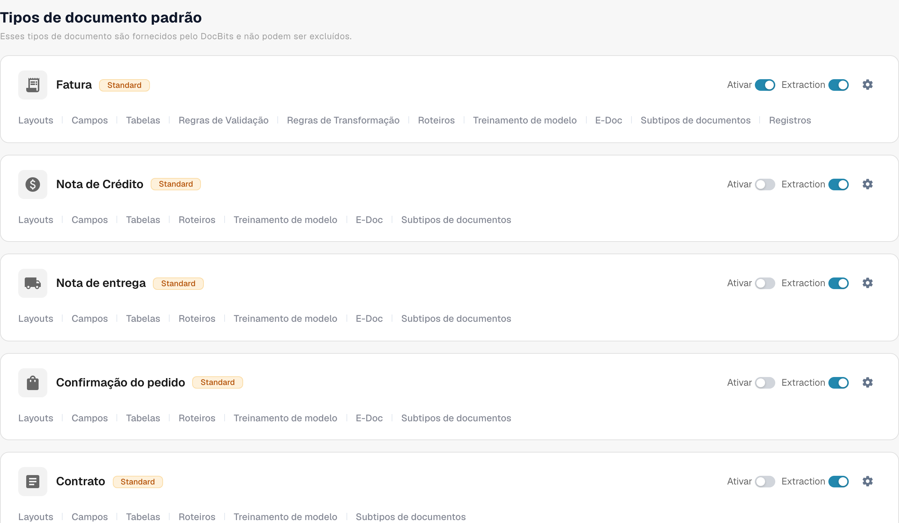

# Ativar ou desativar um tipo de documento

Os administradores podem escolher quais tipos de documento ficam disponíveis para a organização. Você pode alterar isso na página **Tipos de documentos** sem excluir o tipo nem a configuração dele.

1. Abra **Definições → Tipos de documento**.
2. Encontre o tipo de documento, por exemplo **Fatura**, em **Tipos de documento padrão** ou **Tipos de documentos personalizados**.
3. Use a chave chamada **Ativar** no card desse tipo. Uma chave colorida significa que o tipo está ativo; uma chave cinza significa que ele está inativo. Aguarde a mensagem de confirmação antes de sair da página. Não há um botão Save separado para essa chave.

<figure><figcaption>
Tipos de documentos e opções de ativação.
</figcaption></figure>

A chave **Extração** ao lado de **Ativar** é uma configuração diferente. Ela seleciona o modo de extração (Flex ou Fix); não ativa nem desativa o tipo de documento. O ícone de engrenagem abre mais configurações para esse tipo. Os links abaixo do nome do tipo abrem seus layouts, campos, tabelas, scripts e outras áreas de configuração disponíveis.

O DocBits fornece os tipos de documento padrão, que não podem ser excluídos. Você também pode criar e gerenciar tipos personalizados. Consulte [Adding and Editing Document Types](adding-editing-document-types.md) para ver os próximos passos da configuração e [Table Columns](table-columns/README.md) para configurar os itens de linha extraídos.
