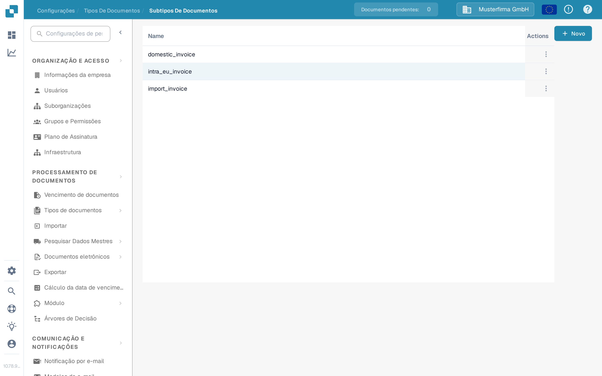
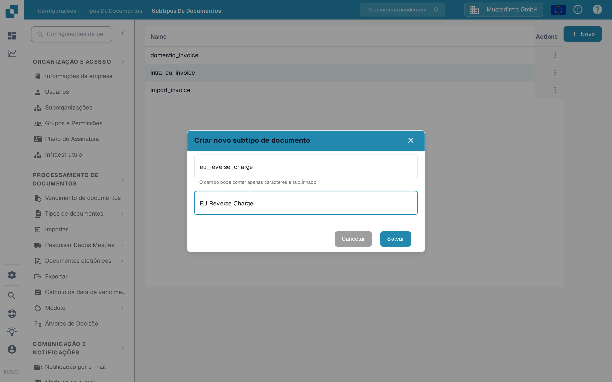

# Criando um novo Subtipo

Crie um subtipo de documento quando um tipo de documento precisar de configurações de campo próprias, de um layout de validação diferente ou de scripts próprios. Você precisa de acesso a **Configurações → Tipos De Documentos**.

## 1. Abra o tipo de documento

Abra **Configurações → Tipos De Documentos**. No cartão do tipo de documento relevante, selecione **Subtipos De Documentos**. O exemplo abaixo usa o tipo **Fatura**; escolha o tipo que corresponde aos seus documentos. Os outros links do cartão levam às configurações do tipo de documento inteiro.

<figure><figcaption>
Abra os subtipos do tipo de documento que deseja configurar.
</figcaption></figure>

## 2. Inicie um novo subtipo

Em **Subtipos De Documentos**, selecione **Novo**. Os subtipos existentes aparecem na lista; o menu **Actions** (três pontos) serve para uma linha existente. Se **Novo** não responder ao clique do mouse, coloque o foco no botão com o teclado e pressione **Enter**.

<figure><figcaption>
A organização de teste da documentação contém apenas um subtipo de exemplo.
</figcaption></figure>

## 3. Dê um nome e salve

Insira um **Name** usando letras e sublinhados e, em seguida, insira um **Title** descritivo. Ambos os campos são obrigatórios. Os nomes nesta captura de tela são apenas exemplos. Selecione **Salvar** para criar o subtipo ou **Cancelar** para sair sem criá-lo.

<figure><figcaption>
Somente Name e Title são preenchidos no momento da criação.
</figcaption></figure>

Depois de salvar, o novo subtipo aparece na lista. Para definir seus campos, layout ou scripts, abra o menu **Actions** dele e siga [Configurar subtipos](configure-subtypes.md). Essas configurações são feitas após a criação, não na janela **Novo**.
