# Regras de Validação Personalizadas

## Visão Geral

As regras de validação personalizadas permitem que um administrador defina **suas próprias verificações** nos dados que o DocBits extrai de um documento — sem escrever um script e sem esperar por uma alteração no produto.

Uma regra responde a três perguntas:

1. **Onde** o problema é exibido? Em um campo de cabeçalho ou em uma célula de uma linha de tabela.
2. **Quando** a regra se aplica? Sempre, ou somente para documentos (ou linhas) que atendem a uma condição — veja [Condições da Regra (Applies when)](rule-conditions-applies-when.md).
3. **O que** deve ser verdadeiro? Um campo deve estar preenchido, corresponder a um formato, estar dentro de um intervalo, corresponder a uma lista, ser comparado corretamente com outro campo ou fechar a soma.

Quando a verificação falha, o DocBits marca o campo ou a célula na **tela de validação** e exibe a sua mensagem — exatamente como uma verificação nativa. Com a severidade **Erro**, o documento não pode ser validado até que o problema seja corrigido; com **Aviso**, o usuário vê apenas uma dica.

As regras são definidas por **tipo de documento** e são executadas em todos os documentos desse tipo: durante o processamento e sempre que o documento é salvo.

### Problemas que elas resolvem

| Requisito de negócio | Sem regras personalizadas | Com uma regra personalizada |
| --- | --- | --- |
| Faturas alemãs acima de 250 EUR devem exibir o número de identificação fiscal do fornecedor | um script, ou os usuários precisam se lembrar | **Obrigatório** em Supplier Tax ID, *applies when* a origem é DE e o valor total é maior que 250 |
| Os números de fatura de um fornecedor sempre têm o formato `INV-123456` | erros de digitação chegam ao ERP | **Padrão** `^INV-\d{6}$` em Invoice Number para esse fornecedor |
| Toda linha de artigo precisa de uma quantidade maior que zero | linhas com quantidade 0 são exportadas | **Faixa** (mínimo 0,01) na coluna Quantity |
| A data de vencimento não pode ser anterior à data da fatura | execuções de pagamento incorretas | **Comparar campos**: Due Date na data da fatura ou depois dela (Invoice Date) |
| As linhas devem somar o valor líquido | apenas a verificação nativa fixa | **Fórmula** `sum(row.NET_AMOUNT) == header.total_net_amount` com a sua própria tolerância |
| Somente moedas conhecidas pelo seu ERP são permitidas | erros de exportação no ERP | **Lista de Valores** em Currency |
| Avisar os usuários sobre valores incomuns sem bloqueá-los | não é possível | qualquer regra com a severidade **Aviso** |

## Ativar as regras de validação personalizadas

As regras de validação personalizadas são ativadas **por tipo de documento**. Não existe uma chave geral para toda a organização.

1. Acesse **Definições → Definições gerais → Tipos de documento**.
2. No cartão do tipo de documento, clique no ícone de **configurações** (engrenagem).
3. Abra a seção **Regras de Validação Personalizadas** e ative o alternador.
4. Clique em **Gerenciar regras de validação** para abrir a lista de regras.

<figure>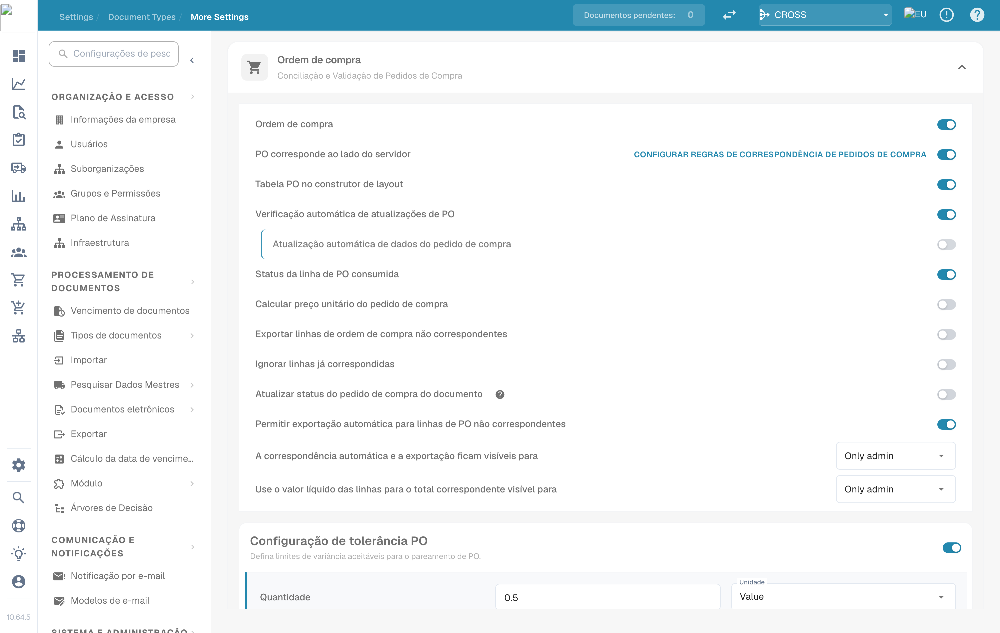<figcaption>
Os alternadores de Manage Layouts, Custom Validation Rules e Transformation Rules
</figcaption></figure>

A partir de agora, o cartão do tipo de documento também mostra um link **Regras de Validação**.

<figure>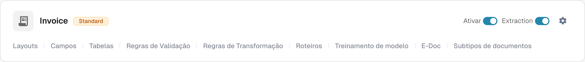<figcaption>
Os links no cartão do tipo de documento
</figcaption></figure>


**O alternador substitui as verificações de valores nativas.** Enquanto as regras de validação personalizadas estiverem ativadas para um tipo de documento, as verificações fixas "valor total = valor líquido + valor do imposto" e as verificações de valor de linha / desconto **não** são executadas para ele; as regras configuráveis tomam o lugar delas. Recrie como regras as verificações nas quais você confia (veja as [receitas](#receitas)) antes de ativá-lo. Desativar o alternador restaura as verificações nativas. Todas as outras validações de campo (campos obrigatórios, formatos, dados mestres) continuam sendo executadas.


## A lista de regras

**Tipos de documento → (tipo de documento) → Regras de validação** lista todas as regras do tipo de documento.

<figure>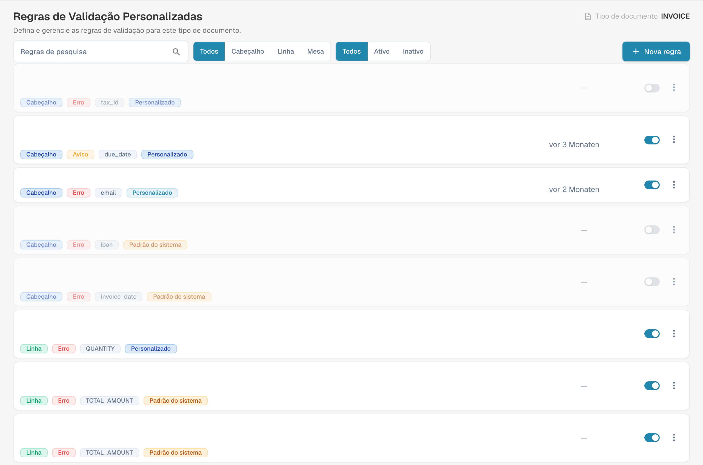<figcaption>
Gestão de regras de validação com nomes configurados ocultos. Algumas datas relativas continuam em alemão; Mesa significa aqui tabela de dados.
</figcaption></figure>

Cada cartão mostra o nome e a descrição da regra, além dos selos de seu **nível** (Header / Line / Table), **severidade** (Error / Warning), do **campo** ao qual o erro está associado e de sua **origem**. Use o interruptor à direita para ativar ou desativar uma regra e o menu **⋮** para duplicá-la ou excluí-la. Filtre a lista por nível (**All / Header / Line / Table**) e por estado (**All / Active / Inactive**), ou pesquise nela.

### Regras System default, Customized e Custom

| Origem | O que é | O que você pode fazer |
| --- | --- | --- |
| **Padrão do sistema** | Uma regra fornecida com o DocBits para todas as organizações. | Ela não pode ser editada diretamente — o construtor exibe "This is a system default rule and cannot be edited." Clique em **Personalizar** para criar sua própria cópia editável, ou desative-a para que deixe de valer para a sua organização. |
| **Personalizado** | Uma regra padrão do sistema que a sua organização alterou ou desativou. | Edite-a como uma regra própria. **Restaurar padrões de fábrica** exclui a sua cópia e restaura a original. |
| **Personalizado** | Uma regra criada pela sua organização. | Editar, **Duplicar**, **Excluir**. |

As alterações nas regras padrão do sistema nunca afetam outras organizações.

## Criar uma regra

Clique em **Nova regra**. O construtor tem três etapas. **Regra de teste** e **Salvar** ficam no canto superior direito.

### Etapa 1 — Nome e escopo

<figure>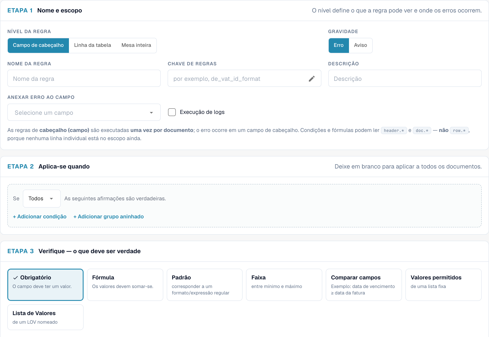<figcaption>
Etapa 1 para uma regra de campo de cabeçalho
</figcaption></figure>

| Configuração | O que faz |
| --- | --- |
| **Nível da regra** | O que a regra analisa e onde o erro é exibido — veja [Níveis de regra](#niveis-de-regra). |
| **Gravidade** | **Erro** marca o campo como inválido e bloqueia a validação. **Aviso** mostra a mensagem, mas nunca bloqueia. |
| **Nome da regra** | Exibido na lista e para os administradores. Faça com que descreva a regra ("Supplier tax ID required for German invoices"). |
| **Chave da regra** | Uma chave técnica gerada a partir do nome. Ela permanece a mesma quando você renomeia a regra mais tarde. Clique no lápis para escolher sua própria chave antes do primeiro salvamento; depois disso, ela fica fixa. |
| **Descrição** | Explicação opcional para outros administradores. |
| **Nome da tabela** | *Somente para linha de tabela.* A tabela cujas linhas são verificadas, por exemplo `INVOICE_TABLE`. |
| **Attach error to field / column** | O campo (ou, para linhas de tabela, a coluna) que exibe o erro na tela de validação. |

#### Níveis de regra

| Nível | Executa | O erro é exibido em | Pode ler | Regra típica |
| --- | --- | --- | --- | --- |
| **Campo do cabeçalho** | uma vez por documento | um campo de cabeçalho | `header.*`, `doc.*` | "O número de identificação fiscal do fornecedor é obrigatório para faturas alemãs" |
| **Linha da tabela** | uma vez para cada linha da tabela selecionada | a célula da linha com falha | `row.*` (a linha atual), `header.*`, `doc.*` | "A quantidade deve ser maior que zero" |
| **Tabela completa** | uma vez por documento, analisando todas as linhas em conjunto | um campo de cabeçalho | totais sobre as linhas (`sum()`, `count()`, `min()`, `max()`), `header.*`, `doc.*` | "Os valores líquidos das linhas devem somar o valor líquido" |

<figure>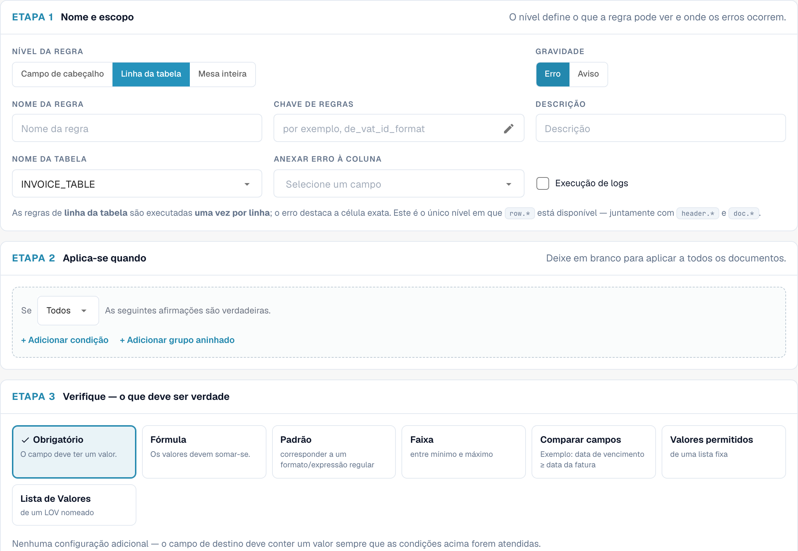<figcaption>
Uma regra de linha de tabela: a tabela e a coluna que exibe o erro
</figcaption></figure>

### Etapa 2 — Applies when

Decida se a regra é executada para todos os documentos ou apenas para alguns. Deixe vazio para verificar todos os documentos. Caso contrário, adicione linhas de condição — por exemplo "Document Origin is Deutsch" e "Total Amount greater than 250" — e combine-as com **Todos** / **ANY** e grupos aninhados.

<figure>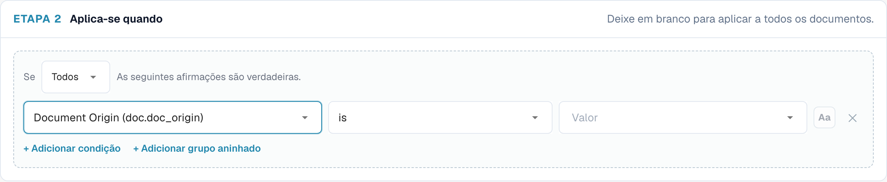<figcaption>
A verificação só é executada para documentos alemães acima de 250 com EUR ou sem moeda
</figcaption></figure>

Para regras de linha de tabela, a condição também pode usar as colunas da linha atual e é avaliada **linha por linha**: as linhas que não correspondem simplesmente não são verificadas.

<figure>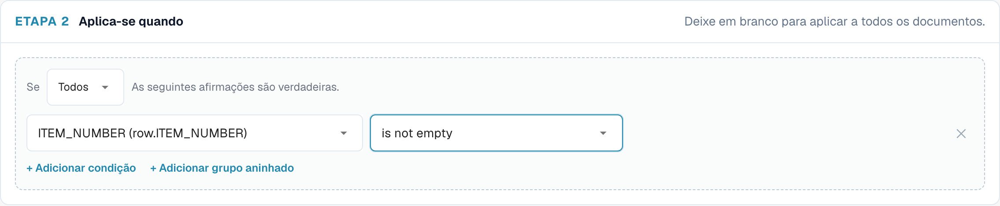<figcaption>
Somente as linhas de artigo (linhas com número de item) são verificadas
</figcaption></figure>

As condições são explicadas em detalhes — cada campo, operador e regra de comparação, com muitos exemplos — em [Condições da Regra (Applies when)](rule-conditions-applies-when.md).

### Etapa 3 — Verificação: o que deve ser verdadeiro

Escolha uma verificação. As configurações abaixo dos cartões mudam conforme a verificação escolhida.

<figure>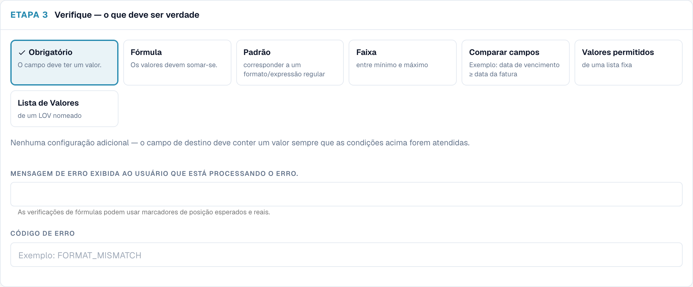<figcaption>
As sete verificações. Required não precisa de configurações adicionais
</figcaption></figure>

#### Required — o campo deve ter um valor

<figure><figcaption>
Uma verificação Required: sem configuração adicional
</figcaption></figure>

Falha quando o campo está vazio (ausente ou contendo apenas espaços). Sem configurações adicionais.

Use-a junto com **Aplica-se quando** para tornar um campo obrigatório **condicionalmente**. Um campo que deve estar sempre preenchido é melhor configurado como campo obrigatório nas configurações do campo.

> *Supplier Tax ID é obrigatório* — aplica-se quando *Document Origin is Deutsch* e *Total Amount greater than 250*.

#### Formula — os valores devem fechar a soma

Uma comparação aritmética. A expressão contém exatamente **uma** comparação (`==`, `!=`, `>`, `>=`, `<`, `<=`); ambos os lados podem usar `+ - * /`, números, parênteses e referências a campos.

<figure>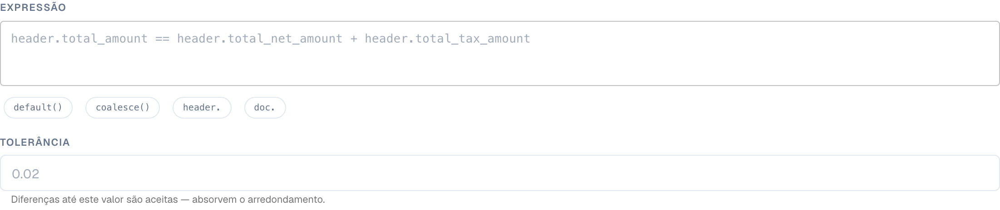<figcaption>
Uma fórmula de tabela inteira com tolerância e marcadores de posição na mensagem
</figcaption></figure>

* Clique nos chips abaixo da expressão para inserir funções e prefixos de campo: `sum()`, `count()`, `min()`, `max()`, `default()`, `coalesce()`, `header.`, `doc.`. Enquanto você digita o nome de um campo, uma lista de campos correspondentes é aberta.
* `sum(row.NET_AMOUNT)`, `count(row.ITEM_NUMBER)`, `min(...)`, `max(...)` funcionam sobre todas as linhas e só estão disponíveis no nível **Tabela completa**. `count()` conta as linhas em que a coluna está preenchida.
* `default(header.discount, 0)` usa `0` quando o campo está vazio; `coalesce(header.a, header.b, 0)` usa o primeiro valor preenchido.
* **Tolerância**: para `==` e `!=`, diferenças de até este valor são consideradas iguais. Use `0.01` ou `0.05` para absorver arredondamentos. Não tem efeito em `<`, `>`, `<=` e `>=`.
* Valores vazios ou ilegíveis contam como `0`. Uma divisão por zero ignora a regra em vez de gerar um erro.
* Na mensagem de erro, `{actual}` é substituído pelo resultado do lado esquerdo e `{expected}` pelo resultado do lado direito.

Exemplos:

| Finalidade | Nível | Expressão | Tolerância |
| --- | --- | --- | --- |
| Os totais do cabeçalho são consistentes | Header field | `header.total_amount == header.total_net_amount + header.total_tax_amount` | 0.01 |
| As linhas somam o valor líquido | Whole table | `sum(row.NET_AMOUNT) == header.total_net_amount` | 0.05 |
| Valor da linha = quantidade × preço unitário | Table line | `row.NET_AMOUNT == row.QUANTITY * row.UNIT_PRICE` | 0.01 |
| Imposto não superior a 19 % do valor líquido | Header field | `header.total_tax_amount <= header.total_net_amount * 0.19` | – |
| Pelo menos uma linha | Whole table | `count(row.ITEM_NUMBER) >= 1` | 0 |

#### Pattern — corresponder a um formato / regex

<figure><figcaption>
Uma verificação Pattern com uma expressão regular
</figcaption></figure>

O valor deve corresponder a uma **expressão regular**. A expressão procura dentro do valor; portanto, ancore-a com `^` (início) e `$` (fim) quando o valor inteiro precisar corresponder. Marque **correspondência que não diferencia maiúsculas de minúsculas** se a diferença entre maiúsculas e minúsculas não importar.

| Formato | Expressão regular |
| --- | --- |
| `INV-` seguido de seis dígitos | `^INV-\d{6}$` |
| Número de IVA alemão (VAT ID) | `^DE\d{9}$` |
| Pedido de compra começando com 45 e com 10 dígitos | `^45\d{8}$` |
| Somente dígitos | `^\d+$` |
| IBAN (verificação aproximada) | `^[A-Z]{2}\d{2}[A-Z0-9]{11,30}$` |

#### Range — entre mínimo e máximo

O valor deve ser um número entre **Mínimo** e **Máximo** (ambos incluídos). Preencha um deles ou ambos. Um valor que não seja um número falha. Valores formatados como `1.234,56` são compreendidos.

<figure>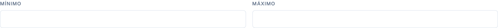<figcaption>
Range somente com mínimo: as quantidades devem ser de pelo menos 0,01
</figcaption></figure>

#### Compare fields — por exemplo, vencimento ≥ data da fatura

<figure>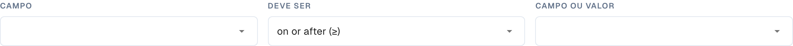<figcaption>
Compare fields: comparar um campo com outro campo, com hoje ou com um valor fixo
</figcaption></figure>

Compara o valor de um campo com outro campo, com **hoje** ou com um valor fixo, usando *igual a*, *diferente de*, *maior que*, *menor que*, *na data ou depois (≥)* ou *na data ou antes (≤)*. Números são comparados como números e datas como datas.

* Due Date **na data ou depois (≥)** de Invoice Date
* Invoice Date **na data ou antes (≤)** de hoje — sem faturas com data futura
* Discount **menor que** 100

#### Allowed values — a partir de uma lista fixa

<figure>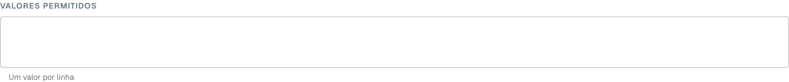<figcaption>
Allowed values: um valor por linha, opcionalmente sem diferenciar maiúsculas de minúsculas
</figcaption></figure>

O valor deve ser um dos valores que você digitar, **um valor por linha**. Opcionalmente sem diferenciar maiúsculas de minúsculas. Bom para listas curtas e estáveis (`EUR`, `CHF`, `USD`).

#### List of Values — a partir de uma LOV nomeada

<figure>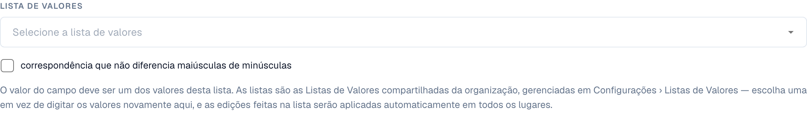<figcaption>
List of Values: os valores vêm de uma lista nomeada nas configurações
</figcaption></figure>

Como *Allowed values*, mas os valores vêm de uma **Lista de Valores** compartilhada, gerenciada em **Settings › List of Values**. Escolha a lista em vez de digitá-la novamente; quando a lista muda, a regra passa a usar os novos valores (após um breve atraso de cache). Contam apenas os valores das entradas da lista, não os seus rótulos.


Exceto **Obrigatório**, toda verificação **é aprovada quando o valor está vazio**. Uma regra Pattern no Purchase Order não reclama de faturas sem pedido de compra. Se um valor vazio também for um problema, adicione uma regra Required ou limite a regra com *Applies when … is not empty*.


#### Mensagem de erro e código de erro

* **Mensagem de erro exibida ao usuário que está processando o erro.** — o texto na tela de validação. Diga o que está errado **e** o que fazer: "Supplier tax ID is missing. German invoices over 250 EUR must show it."
* **Código de erro** — um código técnico curto, por exemplo `REQUIRED_CONDITIONAL`, `FORMAT_MISMATCH`, `OUT_OF_RANGE`, `DATE_ORDER`, `LINES_HEADER_MISMATCH`, `VALUE_NOT_ALLOWED`. Ele aparece nas exportações e permite agrupar erros.

## Test rule

Clique em **Regra de teste** para executar a versão atual da regra — salva ou não — em um documento. Informe um **ID do documento** ou mude para **Por documento JSON** e cole os dados extraídos. **Nada é salvo** e o documento não é alterado.

O resultado é um destes três desfechos:

| Resultado | Significado |
| --- | --- |
| **Regra falhou — erro detectado** | A condição correspondeu e a verificação falhou. A mensagem é exibida exatamente como o usuário a veria. |
| **Regra aprovada** | A condição correspondeu e a verificação foi aprovada. As regras de linha de tabela mostram o resultado por linha ("4 of 4 checked rows passed"). |
| **Regra ignorada — escopo não correspondido** | A condição *Applies when* era falsa para este documento; portanto, nada foi verificado e nenhum erro foi gerado. |

<figure>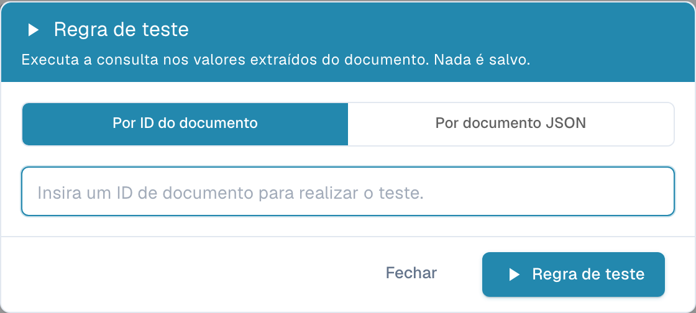<figcaption>
A fatura alemã não tem número de identificação fiscal do fornecedor: a regra falha com a mensagem configurada
</figcaption></figure>

<figure>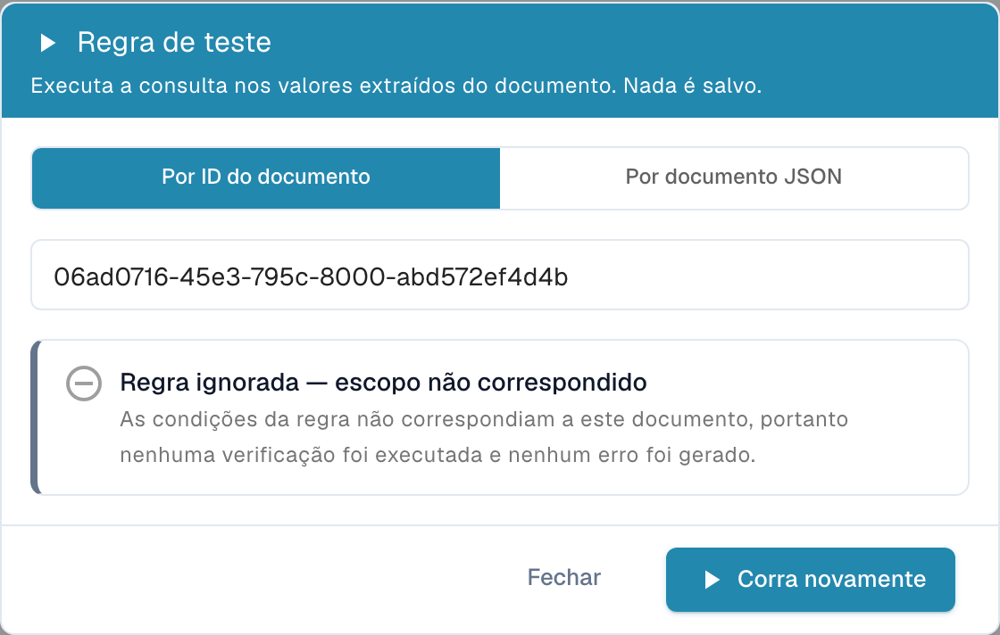<figcaption>
A mesma regra com o limite elevado para 1000: a fatura (469,18) não está no escopo; portanto, a regra é ignorada
</figcaption></figure>

<figure>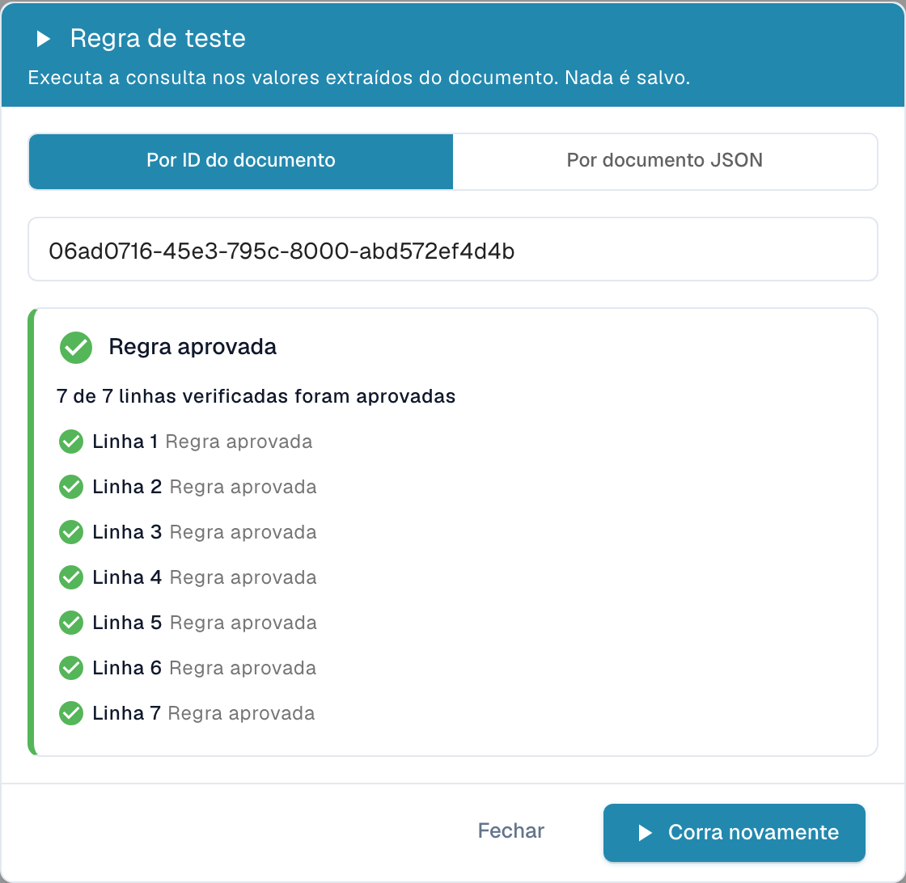<figcaption>
Uma regra de linha de tabela informa cada linha verificada
</figcaption></figure>

Teste cada nova regra em pelo menos um documento que deva falhar, um que deva ser aprovado e um que deva ser ignorado.

## Quando as regras são executadas

* **Durante o processamento**, junto com as outras validações, após a extração e as regras de transformação.
* **A cada salvamento** do documento na tela de validação.
* **Após uma alteração de regra**, os documentos existentes **não** são reverificados de uma só vez. Cada documento é reverificado com as novas regras na próxima vez em que for salvo ou reprocessado. Documentos que já foram exportados não são afetados.
* As regras são executadas por ordem de prioridade (depois pela chave). Um campo exibe **um** erro: se duas regras falharem no mesmo campo, a primeira prevalece; as regras seguintes não a sobrescrevem.
* Os avisos são coletados separadamente e nunca ocultam um erro.
* Se uma regra não puder ser avaliada — por exemplo, uma divisão por zero em uma fórmula — ela é ignorada. Uma regra com defeito nunca marca um documento como inválido por engano.

## Receitas

Copie estas regras como ponto de partida. As chaves de campos e colunas são as do tipo de documento **Fatura** padrão; ajuste-as aos seus tipos de documento.

**1. Número de identificação fiscal do fornecedor para faturas alemãs acima de 250 EUR**
Header field · Error · associar a *Supplier Tax ID* · Applies when **Todos**: *Document Origin* is *Deutsch*, *Total Amount* greater than *250* · Verificação **Obrigatório** · Mensagem "Supplier tax ID is missing. German invoices over 250 EUR must show it." · Código `REQUIRED_CONDITIONAL`.

**2. Os totais do cabeçalho fecham a soma** (substitui a verificação nativa)
Header field · Error · associar a *Total Amount* · sempre · **Fórmula** `header.total_amount == header.total_net_amount + header.total_tax_amount`, tolerância `0.01` · Mensagem "Total {actual} does not equal net plus tax ({expected})."

**3. As linhas somam o valor líquido** (substitui a verificação nativa)
Whole table · Error · associar a *Total Net Amount* · sempre · **Fórmula** `sum(row.NET_AMOUNT) == header.total_net_amount`, tolerância `0.05` · Mensagem "Line net amounts add up to {actual}, but the invoice net amount is {expected}." · Código `LINES_HEADER_MISMATCH`.

**4. A quantidade deve ser positiva nas linhas de artigo**
Table line · Error · tabela `INVOICE_TABLE`, coluna `QUANTITY` · Applies when *row.ITEM_NUMBER* is not empty · **Faixa** mínimo `0.01` · Código `OUT_OF_RANGE`.

**5. Valor da linha = quantidade × preço unitário**
Table line · Warning · coluna `NET_AMOUNT` · sempre · **Fórmula** `row.NET_AMOUNT == row.QUANTITY * row.UNIT_PRICE`, tolerância `0.01`.

**6. Formato do número de fatura de um fornecedor**
Header field · Error · *Invoice Number* · Applies when *Supplier ID* is *20723* · **Padrão** `^INV-\d{6}$`.

**7. Vencimento não anterior à data da fatura**
Header field · Error · *Due Date* · sempre · **Comparar campos** Due Date *na data ou depois (≥)* de Invoice Date · Código `DATE_ORDER`.

**8. Sem faturas com data futura**
Header field · Error · *Invoice Date* · sempre · **Comparar campos** Invoice Date *na data ou antes (≤)* de hoje.

**9. Somente moedas aprovadas (apenas como dica)**
Header field · **Aviso** · *Currency* · sempre · **Lista de Valores** *approved_currencies* · Código `VALUE_NOT_ALLOWED`.

**10. Pedido de compra obrigatório acima de 5.000**
Header field · Error · *Purchase Order* · Applies when *Total Amount* greater than *5000* · **Obrigatório**.

## Boas práticas

* **Comece como aviso.** Salve uma nova regra com a severidade **Aviso**, acompanhe-a por alguns dias (Test rule) e depois mude-a para **Erro**.
* **Uma regra, uma mensagem.** Várias regras pequenas com mensagens claras são mais fáceis de entender do que uma fórmula grande.
* **Use Applies when em vez de cópias.** Uma regra com uma condição é melhor do que cinco cópias para cinco fornecedores.
* **Seja tolerante com valores monetários.** Sempre defina uma tolerância nas fórmulas de valores.
* **Dê às regras o nome da regra de negócio**, não da técnica ("Vencimento não anterior à data da fatura", e não "Regra de comparação 3").

## Solução de problemas

| Sintoma | O que verificar |
| --- | --- |
| A regra nunca gera um erro | O recurso está ativado para o tipo de documento e a regra está **Ativo**? Execute **Regra de teste** no documento: "skipped" significa que *Applies when* era falso. |
| Um campo vazio não é reportado | Somente **Obrigatório** reporta valores vazios. Adicione uma regra Required. |
| As verificações de total nativas desapareceram | Esperado enquanto as regras personalizadas estão ativadas. Recrie-as como regras Formula (receitas 2 e 3). |
| Uma regra alterada não tem efeito em um documento | Os documentos são reverificados no próximo salvamento. Salve ou reprocesse o documento. |
| Um Pattern corresponde a valores que não deveria | Os padrões procuram dentro do valor. Ancore com `^` e `$`. |
| Apenas um de dois erros é exibido em um campo | Um campo exibe somente a primeira regra com falha. Ajuste as prioridades ou associe uma das regras a outro campo. |
| Colunas de tabela ausentes em *Applies when* | Elas só estão disponíveis no nível **Linha da tabela**. |
| A regra padrão do sistema não pode ser alterada | Clique em **Personalizar** para criar sua própria cópia. |

## Relacionado

* [Condições da Regra (Applies when)](rule-conditions-applies-when.md) — condições em detalhe
* [Transformation Rules](transformation-rules.md) — corrija os valores antes de serem validados
* [Layout Selection Rules](layout-manager/layout-selection-rules.md) — escolha o layout que um documento usa
* [Setting Validation and Match Score](fields/setting-validation-and-match-score.md) — configurações de validação por campo
