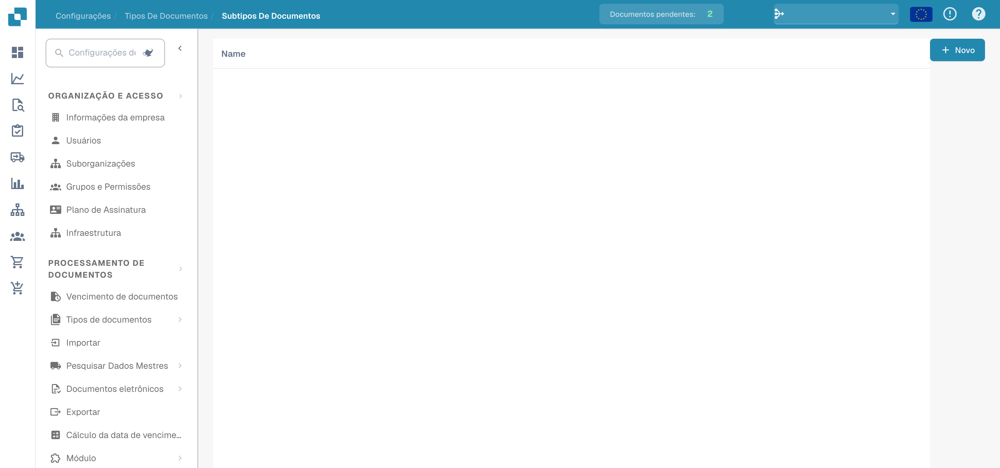
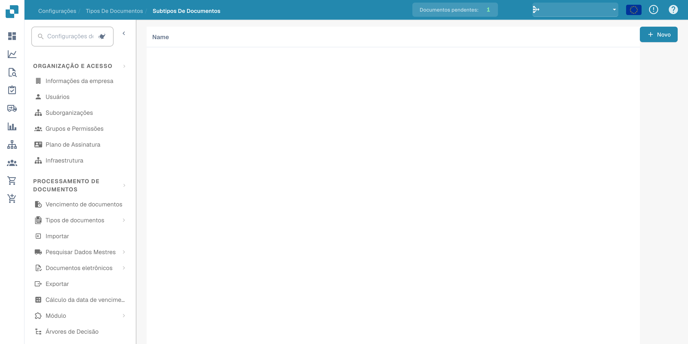

# Subtipos de documentos

Os subtipos distinguem categorias dentro de um tipo de documento. Abra os tipos de documentos nas definições e escolha a ligação aos subtipos do tipo pretendido.

<figure><figcaption>
Resumo dos subtipos de documentos. Alguns cabeçalhos da aplicação permanecem em inglês.
</figcaption></figure>

A lista mostra os subtipos configurados. Alguns cabeçalhos de coluna podem permanecer em inglês no produto.

<figure><figcaption>
Lista de subtipos de documentos nas definições. Alguns cabeçalhos da aplicação permanecem em inglês.
</figcaption></figure>

Ao criar um subtipo, verifique o nome e a configuração antes de guardar. Os exemplos mostram o resumo e a lista; não comprovam a criação de um subtipo nem definições guardadas.
