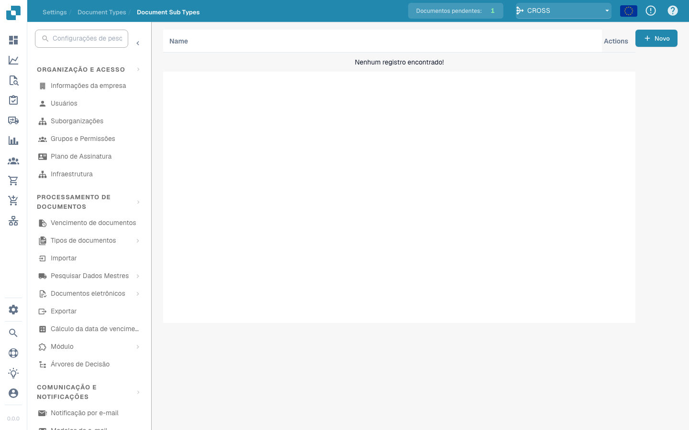

# Tipos de Documentos Secundários

<figure><figcaption></figcaption></figure>

#### Visão Geral

Os Tipos de Documentos Secundários são essencialmente versões especializadas dos principais tipos de documentos. Por exemplo, sob o tipo de documento principal "Fatura," pode haver subtipos como "Fatura Padrão," "Fatura Pro-forma" e "Fatura de Crédito," cada um com requisitos de dados ligeiramente diferentes ou regras de processamento.

#### Recursos e Opções Principais

1. **Lista de Subtipos**:

* Cada linha representa um subtipo de um tipo de documento principal.
* Inclui o nome do subtipo e um conjunto de ações que podem ser realizadas nele.

2. **Ações**:

* **Campos**: Configure quais campos de dados estão incluídos no subtipo e como eles são gerenciados.
* **Editar Layout**: Modifique o layout visual para como as informações são exibidas e inseridas para este subtipo.
* **Scripts**: Anexe ou edite scripts que executam operações específicas quando documentos deste subtipo são processados.
* **Copiar**: Duplicar uma configuração de subtipo existente para usar como base para uma nova.
* **Excluir**: Remover o subtipo se não for mais necessário.

3. **Adicionar Novos Subtipos**:

* O botão "+ Novo" permite que os administradores criem novos subtipos, definindo propriedades e regras exclusivas conforme necessário.

Os Tipos de Documentos Secundários no DocBits fornecem uma maneira flexível e poderosa de lidar com uma variedade de documentos dentro de um único sistema, garantindo que cada tipo e subtipo seja processado com precisão e eficiência de acordo com suas especificações exclusivas.


