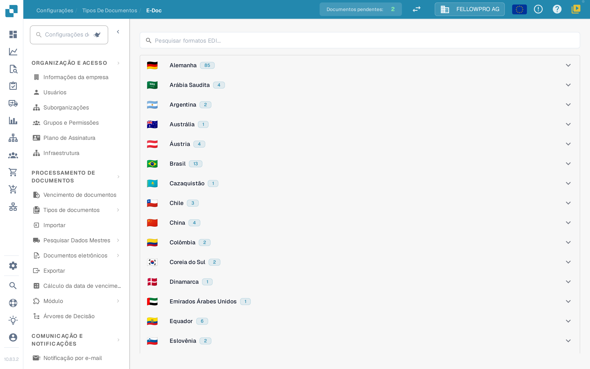
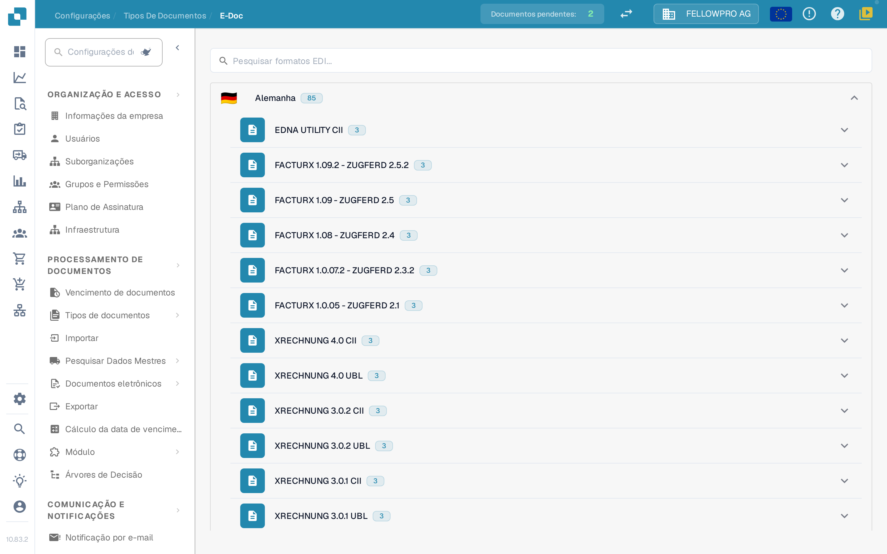
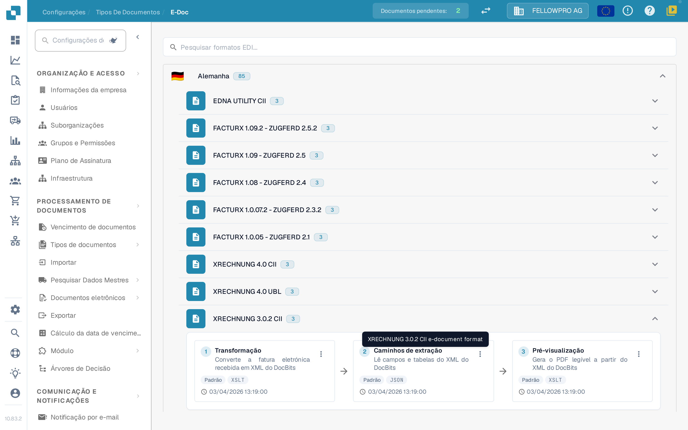
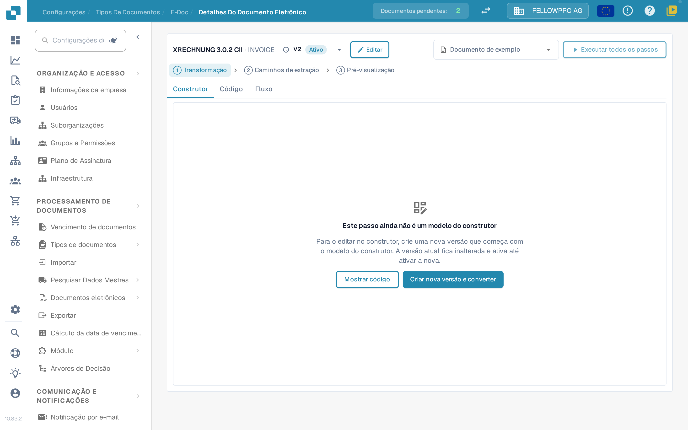
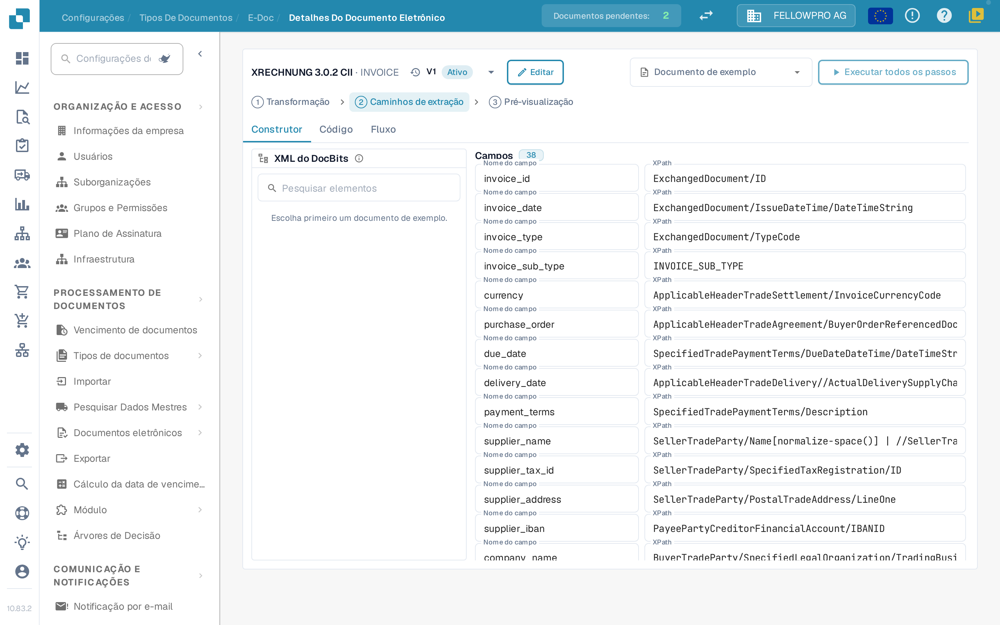

# e-docs

Documentos eletrónicos como XRechnung, ZUGFeRD/Factur-X, CFDI ou FatturaPA chegam como XML ou como PDF híbrido. O DocBits lê o ficheiro, extrai os dados da fatura e gera um PDF legível. As definições de **E-Doc** contêm as regras de cada formato que a sua organização utiliza.

## Abrir a administração de E-Doc

1. Abra **Definições → Tipos de documento**.
2. Selecione o tipo de documento, por exemplo **Fatura**, e abra **E-Doc**.

Os formatos estão agrupados por país. Cada país mostra a sua bandeira, o seu nome e quantos formatos contém.

<figure><figcaption>
Os formatos estão agrupados por país e fechados no início.
</figcaption></figure>

Selecione um país para abrir os seus formatos. Dentro de um país, a versão mais recente vem primeiro. Formatos combinados como Factur-X / ZUGFeRD ficam sob a Alemanha. O campo de pesquisa procura simultaneamente nomes de formatos e de países.

<figure><figcaption>
Abra um país para ver os seus formatos.
</figcaption></figure>

## Formatos e os seus passos

Cada formato mostra os seus passos como três cartões ligados por setas, pela ordem em que o DocBits os executa:

| Passo | O que faz |
| --- | --- |
| **Transformação** | Mapeia o XML recebido para o XML do DocBits. |
| **Caminhos de extração** | Define os valores que o DocBits retira do XML transformado. |
| **Pré-visualização** | Define o esquema do PDF legível que o DocBits gera. |

Os outros atributos do formato estão listados sob os cartões.

<figure><figcaption>
Os três passos de um formato: Transformação, Caminhos de extração e Pré-visualização.
</figcaption></figure>

Selecione um cartão para abrir esse passo.

## Editar um passo

A página de detalhe tem a mesma estrutura para os três passos:

* O cabeçalho mostra o formato e um menu pendente com as suas versões, incluindo o estado de cada uma. A partir do menu pendente pode ativar, editar ou eliminar uma versão.
* **Construtor**, **Código** e **Fluxo** alternam entre o editor visual, a folha de estilos ou o JSON subjacente, e o resultado do pipeline.
* **Documento de exemplo** oferece os documentos mais recentes deste formato; também pode colar um ID ou um URL de documento.
* **Executar todos os passos** executa transformação, extração e pré-visualização para o documento de exemplo de uma só vez.
* **Ctrl + S** guarda um rascunho.

Editar uma versão ativa ou já utilizada não a altera: o DocBits cria uma cópia de rascunho e abre essa. Um rascunho não utilizado é editado diretamente. Um passo escrito à mão permanece em **Código** até o construtor o poder assumir sem alterações.

<figure><figcaption>
A página de detalhe: menu pendente de versões no cabeçalho, separadores Construtor, Código e Fluxo, documento de exemplo e o próprio passo.
</figcaption></figure>

### Transformação

O **Construtor** mostra o XML de origem à esquerda, o mapeamento ao centro e o XML resultante à direita. Selecione um elemento na árvore de origem e arraste-o para um campo, ou adicione um valor de texto fixo.

Um campo pode ser construído a partir de várias partes, e cada parte pode ter uma condição: **existe**, **falta**, **igual a**, **diferente de** ou uma expressão XPath livre, combinadas com **todos** ou **qualquer**. Os três painéis podem ser redimensionados, e a área de resultado tem uma lista **Campos** e a vista **XML**.

### Caminhos de extração

O construtor de caminhos de extração mostra o XML do DocBits à esquerda, os campos ao centro e o caminho que cada campo utiliza à direita. Selecione um campo e defina o seu caminho; as entradas existentes, incluindo entradas planas antigas, continuam a funcionar.

<figure><figcaption>
O construtor de caminhos de extração: XML do DocBits, campos e os seus caminhos.
</figcaption></figure>

### Pré-visualização

O construtor de pré-visualização organiza o PDF com blocos de arrastar e largar e mostra o resultado ao lado. Tamanho da página, margens, tamanho da letra, cores e espaçamento dos blocos são definidos para todo o documento e aplicam-se a cada bloco.

### Fluxo

O **Fluxo** mostra todo o pipeline para o documento de exemplo escolhido: o que a transformação produziu, os valores que os caminhos de extração encontraram e como a pré-visualização os apresenta. Use-o para verificar uma alteração de ponta a ponta sem sair da página.

## Páginas relacionadas

* [Formatos, versões e guias por país para eDocs](supported-electronic-documents/README.md)

As capturas de ecrã desta página mostram a interface em português.
