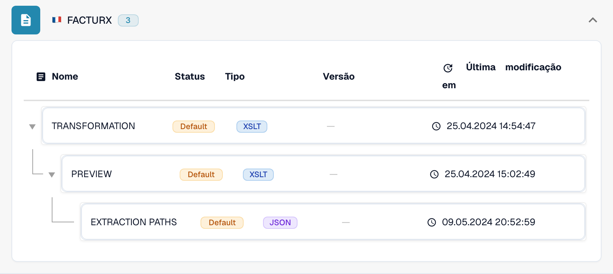
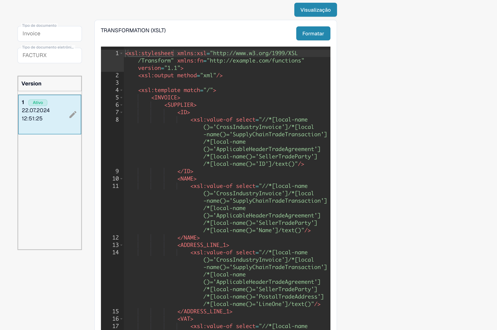

# Nota de crédito eletrónica reconhecida como fatura

Uma nota de crédito eletrónica pode aparecer como **Invoice** mesmo que o XML original contenha um código de nota de crédito. Verifique a configuração efetiva antes de considerar que se trata de um defeito do produto. Uma **TRANSFORMATION** específica da organização tem prioridade sobre a predefinição desse formato eDoc. Assim, uma constante como `<INVOICE_TYPE>Invoice</INVOICE_TYPE>` pode sobrepor-se à classificação predefinida.

## Verificar a classificação das notas de crédito eletrónicas


Verificar a classificação das notas de crédito eletrónicas



WebVTT


## Verificar o código do documento

Consulte o código do tipo no XML original, e não apenas no PDF ou no título do documento. A localização depende da sintaxe XML. O CII utiliza `ExchangedDocument/TypeCode`; o UBL utiliza `InvoiceTypeCode` ou `CreditNoteTypeCode`. Tenha em conta os espaços de nomes XML ao verificar um XPath.

| Código | Significado | Verificação da classificação |
| --- | --- | --- |
| `380` | Fatura comercial | Invoice |
| `381` | Nota de crédito | Credit Note |
| `261` | Nota de crédito emitida por autofaturação | Credit Note no mapeamento predefinido (FACTURX/ZUGFeRD) |
| `383` | Nota de débito | Não mapear para Credit Note apenas por ajustar uma fatura |
| `384` | Fatura corrigida | Não mapear para Credit Note apenas por corrigir uma fatura |

O mapeamento predefinido de notas de crédito FACTURX/ZUGFeRD inclui **381 e 261**. Um requisito de negócio que mencione apenas o código 381 não faz dos códigos 383 ou 384 códigos de nota de crédito. Confirme qualquer desvio pretendido com o responsável pela integração contabilística.

## Identificar onde o valor muda

1. **Identifique o formato real.** Abra **Configurações → Tipos de documento → Invoice → E-Doc**. Selecione o formato detetado para o documento afetado, por exemplo, **FACTURX**. Um PDF ZUGFeRD pode conter XML Factur-X; verificar as regras de outro formato não explica o comportamento deste documento.
2. **Verifique a origem efetiva e a versão.** Examine a **TRANSFORMATION**. A lista distingue **Default** e **Custom**. Abra a regra e registe a versão ativa e o respetivo código-fonte. Um rascunho mais recente não está necessariamente ativo. Para um documento histórico, identifique a origem e a versão utilizadas naquele processamento; a versão ativa atual pode ser diferente. Compare o código-fonte personalizado da organização com o predefinido; não pressuponha que está a ser utilizada a predefinição.

<figure><figcaption>O estado identifica a origem de cada regra. Este exemplo utiliza predefinições.</figcaption></figure>

3. **Examine o XML transformado.** Para FACTURX/ZUGFeRD, procure `INVOICE_TYPE` no XSLT efetivo. Para um código original 381, uma saída fixa de `<INVOICE_TYPE>Invoice</INVOICE_TYPE>` constitui um problema de configuração. Teste a transformação proposta e examine a saída; o resultado pretendido para uma nota de crédito é `Credit Note`. Preserve todos os outros mapeamentos específicos de que a organização necessita.
4. **Verifique os Extraction Paths.** Confirme que o campo do DocBits com o ID `invoice_type` lê o nó de classificação pretendido no **XML transformado**. FACTURX/ZUGFeRD utiliza frequentemente `INVOICE_TYPE`; XRechnung pode manter `TypeCode` (CII), `InvoiceTypeCode` ou `CreditNoteTypeCode` (UBL). Examine a origem efetiva e a saída antes de escolher um caminho. Após uma reestruturação do XML, os caminhos que apontavam para o ficheiro original podem deixar de ser válidos. Consulte o [guia de Extraction Paths](edi/edi-extraction-paths-file-guide.md).
5. **Verifique o processamento posterior.** Examine os scripts que podem atribuir um valor a `invoice_type` e compare o campo guardado, o painel e o conteúdo da exportação. Uma transformação correta, por si só, não garante que um script posterior mantenha o valor. Uma **Preview** renderizada mostra a apresentação; não comprova a classificação guardada.

<figure><figcaption>Examine o código-fonte e a versão selecionados antes de criar ou ativar uma alteração.</figcaption></figure>

As [ferramentas MCP para eDocs](../../../../../advanced-functions-and-tools/edocs-mcp/README.md) permitem efetuar as mesmas verificações: `list_edoc_custom_attributes`, `get_edoc_attribute_source` e `list_edoc_attribute_versions` identificam a origem; `compare_edoc_extraction` compara o comportamento predefinido, personalizado e proposto. Utilize `test_electronic_document` para realizar um teste sem aplicar alterações antes da ativação.

## Corrigir e ativar em segurança

1. Registe a versão atualmente ativa e conserve o respetivo código-fonte para poder repor essa versão.
2. Crie um **rascunho** através do ícone de lápis. Altere a condição de classificação ou o caminho de extração identificado no diagnóstico. Evite substituir toda a transformação para corrigir apenas um campo.
3. Selecione o rascunho e **guarde-o (Save)**. Guardar um rascunho **não** o ativa.
4. Teste o rascunho numa organização de desenvolvimento ou de teste com documentos representativos: códigos 380 e 381. Inclua 261, 383 e 384 quando o formato detetado e o seu fluxo de trabalho os aceitarem. Verifique a classificação, os montantes e os restantes campos personalizados. Compare os resultados com os da versão ativa.
5. Quando as verificações forem bem-sucedidas, utilize a **marca de verificação** do rascunho para o ativar. Confirme que a versão pretendida apresenta agora o estado **Active**. Com MCP, a ativação utiliza `activate_edoc_attribute_version`; é uma alteração distinta do teste sem aplicação de alterações.
6. Processe um novo documento de teste. Verifique o valor guardado de `invoice_type`, o painel, os montantes e a exportação para **Infor ERP / SAP** ou para o seu sistema de destino. Mantenha a versão anterior disponível para reposição.


Não reponha as regras de uma organização para as predefinições sem antes comparar e preservar as personalizações necessárias. Não reinicie documentos históricos em massa. Um reinício elimina os dados extraídos e os registos de exportação e pode repetir o processamento de aprovação ou de exportação. Verifique o estado de exportação, as aprovações e as alterações manuais de cada documento antes de decidir como o reprocessar.


## Verificar o sinal dos montantes separadamente

A classificação e o sinal dos montantes são verificações relacionadas. A opção [Set Negative Sign for Credit Notes](../../../document-processing/module/set-negative-sign-for-credit-notes.md) está ativada por predefinição, mas pode ser desativada. Quando está ativa, guarda os montantes das notas de crédito como valores negativos. Verifique a definição efetiva da organização e a convenção de sinais do sistema recetor; não deduza o tipo de documento apenas pelo sinal.

Se o resultado continuar incorreto com o código-fonte ativo verificado, conserve o XML original, o formato detetado, os IDs das versões, a saída transformada, o mapeamento de extração e quaisquer alterações efetuadas por scripts posteriores para análise pelo suporte. Estes elementos permitem determinar se a discrepância resulta da configuração ou se exige uma investigação adicional do produto.

<!-- Evidência interna: TRL-72. A constante específica da organização é uma causa provável; os scripts posteriores e as versões históricas efetivamente utilizadas não foram excluídos de forma conclusiva. -->
