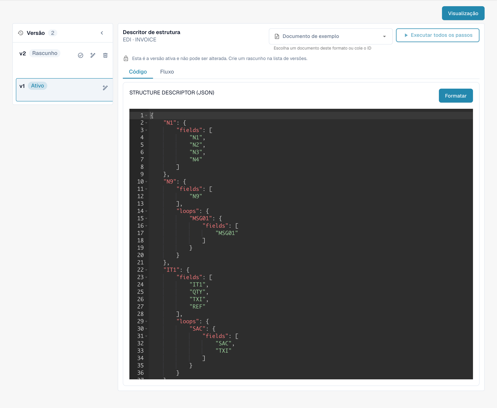

# Guia do Arquivo de Descritor de Estrutura EDI

## **1. Visão Geral**

O **Arquivo de Descritor de Estrutura** define como segmentos EDI repetidos (por exemplo, `N1`–`N4`) são agrupados em JSON estruturado. Ele garante:

* **Análise precisa** de elementos relacionados como unidades únicas.
* **Saída consistente** para sistemas downstream.

_Para um exemplo completo com detalhes de segmento, consulte_ [_Exemplo de Descritor de Estrutura_](edi-structure-descriptor.md)_._

## **2. Acesso e Edição Básica**

#### **Acessando o Arquivo**

1.  **Configurações** → **Tipo de Documento** → \[Seu Documento (por exemplo, _Ordem de Compra_)] → **E-Doc.**

    
2. Em **E-Doc**, selecione seu formato (por exemplo, _EDI_ ).
3.  Clique em **Descritor de Estrutura**.

    

#### **Gerenciamento de Rascunho**

* **Criar um Rascunho**: Clique no ícone de lápis ✏️ para começar a editar.
* **Excluir Rascunhos**: Use o ícone de lixeira 🗑️ para remover rascunhos não utilizados.
* **Ativar Alterações**: Clique no ícone de marca de seleção ✅ para aprovar e publicar suas alterações.
  * **Nota**: Ativar uma nova versão irá **desativar automaticamente** a anterior.

## 3. Função de Visualização (Visualizar XML Analisado)

A **Função de Visualização** permite testar e visualizar como um arquivo EDI enviado é analisado usando o Arquivo de Descritor de Estrutura atual.

#### Uso

* Envie um arquivo EDI via fluxo de envio padrão.
* Copie o **ID do Documento** do arquivo enviado.
* Navegue até a interface do **Arquivo de Descritor de Estrutura**.
*   Abra a **Função de Visualização**.\

    

* Insira o **ID do Documento** no campo e pressione **Testar**.
* A saída **XML estruturado resultante** será exibida.

Isso é especialmente útil para depurar mapeamentos e validar agrupamentos estruturais em tempo real.

## 6. Vídeo Tutorial

Um guia em vídeo para este tipo de arquivo está disponível na [página de Vídeos.](https://docs.docbits.com/administration-and-setup/settings/global-settings/document-types/edi/edi/edi-videos) Use-o para acompanhar a configuração, edição e visualização.

<figure><figcaption>
Formato EDI existente com os seus quatro atributos configurados.
</figcaption></figure>

<figure><figcaption>
Atributo STRUCTUREDESCRIPTOR ativo: descritor de estrutura JSON no editor só de leitura.
</figcaption></figure>

As vistas mostram uma configuração e uma versão existentes. As definições variam consoante o tipo de documento e o formato. Valide as alterações num rascunho antes da ativação.

As imagens mostram as etapas em português e a versão ativa da configuração em modo só de leitura. Os nomes técnicos dos editores, os identificadores de atributos e o código de configuração mantêm-se como na versão ilustrada.
