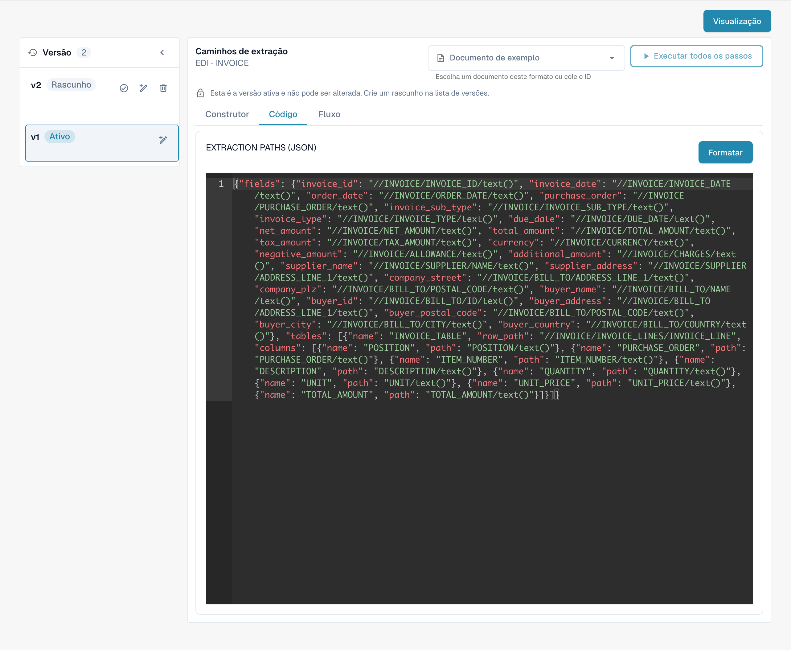

# Configurando Modelos EDI

## Aqui estão as instruções passo a passo para configurar modelos EDI:

<figure><figcaption>
Formato EDI existente com os seus quatro atributos configurados.
</figcaption></figure>

**Defina o descritor de estrutura:**

* Identifique o tipo de mensagem EDI com o qual você está trabalhando, por exemplo, ANSI X12, EDIFACT ou um formato personalizado.
* Determine os segmentos, elementos e subelementos dentro da estrutura EDI.
* Crie um descritor de estrutura que reflita com precisão a hierarquia e a organização da mensagem EDI. Isso pode ser feito usando uma sintaxe especial, como XML ou JSON.

<figure><figcaption>
Atributo STRUCTUREDESCRIPTOR ativo: descritor de estrutura JSON no editor só de leitura.
</figcaption></figure>

**Configure as transformações:**

* Use uma ferramenta ou software apropriado que suporte transformações EDI, como um tradutor EDI.
* Defina as regras para converter a mensagem EDI para o formato interno do seu sistema e vice-versa.
* Configure as transformações para interpretar e processar segmentos, elementos e subelementos de acordo com os requisitos do seu sistema. Teste as transformações minuciosamente para garantir que os dados sejam interpretados e formatados corretamente.

<figure><figcaption>
Atributo TRANSFORMATION ativo: código-fonte XSLT para transformar o XML intermédio.
</figcaption></figure>

**Configure os caminhos de extração para uma extração e formatação de dados ideais:**

* Identifique os campos de dados a serem extraídos e transferidos para o seu sistema interno.
* Defina caminhos ou regras de extração para extrair os campos de dados relevantes das mensagens EDI.
* Considere as diferentes variações e formatos que podem ocorrer nas mensagens EDI recebidas e garanta que os caminhos de extração sejam flexíveis o suficiente para acomodá-los.
* Valide os resultados da extração para garantir que os campos de dados corretos sejam extraídos e formatados corretamente.

<figure><figcaption>
Atributo EXTRACTIONPATHS ativo: configuração JSON que contém expressões XPath de extração.
</figcaption></figure>

Ao definir cuidadosamente o descritor de estrutura, configurar as transformações e configurar os caminhos de extração, você pode garantir que a extração e a formatação de dados sejam realizadas de forma ideal em seus modelos EDI. Isso ajudará a melhorar a eficiência e a precisão de suas comunicações comerciais eletrônicas.

As vistas mostram uma configuração e uma versão existentes. As definições variam consoante o tipo de documento e o formato. Valide as alterações num rascunho antes da ativação.

As imagens mostram as etapas em português e a versão ativa da configuração em modo só de leitura. Os nomes técnicos dos editores, os identificadores de atributos e o código de configuração mantêm-se como na versão ilustrada.
