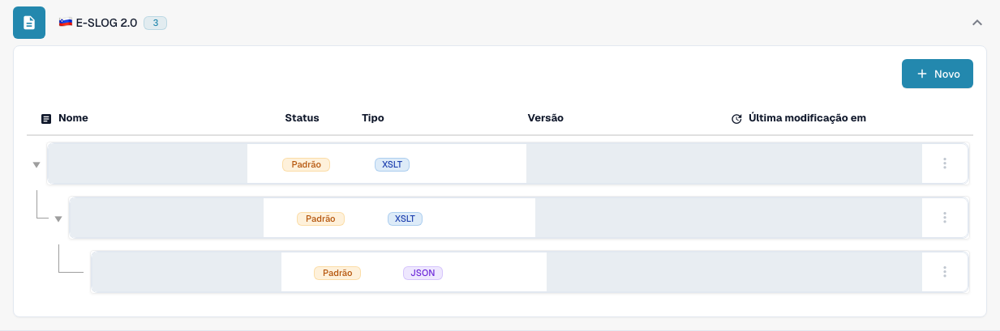

# eSLOG 1.6 e 2.0

**eSLOG 1.6** e **eSLOG 2.0** aparecem como formatos de fatura eletrônica separados no DocBits. Escolha a versão usada pela sua fatura eslovena recebida. As capturas de tela abaixo mostram a interface real do DocBits em português em uma visualização de teste; elas não comprovam que uma fatura de qualquer uma das versões foi processada com sucesso.

## Encontre as configurações

1. Vá para **Configurações → Tipos de documentos → Fatura → E-Doc**.
2. Expanda **E-SLOG 1.6** ou **E-SLOG 2.0**. Cada formato tem suas próprias três entradas.

<figure><figcaption>E-SLOG 1.6: de cima para baixo, transformação, pré-visualização e caminhos de extração. O exemplo tem duas entradas padrão e uma entrada personalizada existente. Nomes, versões e datas estão ocultos.</figcaption></figure>

<figure><figcaption>E-SLOG 2.0: entradas separadas para as mesmas três etapas, aqui todas marcadas como Padrão. Nomes, versões e datas estão ocultos.</figcaption></figure>

| Entrada | O que ela controla | Próximo guia |
| --- | --- | --- |
| **TRANSFORMATION (XSLT)** | Converte os dados de origem do formato em XML estruturado. | [Transformação](edi/edi-transformation-file-guide.md) |
| **PREVIEW (XSLT)** | Define a visualização legível do documento. | [Pré-visualização](edi/edi-preview-file-guide.md) |
| **EXTRACTION PATHS (JSON)** | Mapeia valores XML para campos e colunas de tabela do DocBits. | [Caminhos de extração](edi/edi-extraction-paths-file-guide.md) |

Clique em uma linha para ver suas versões e a configuração. **Padrão** identifica a entrada fornecida; **Personalizado**, uma variante própria. **Última modificação em** mostra quando essa entrada foi alterada pela última vez. O botão **Novo** abre o formulário para uma entrada de configuração adicional. O menu de três pontos em uma linha padrão oferece **Personalizar**, que cria imediatamente uma cópia específica da organização, e **Excluir**; revise com atenção a linha selecionada antes de usar Excluir.

Dentro de uma configuração, o lápis ao lado de uma versão ativa cria um rascunho. Verifique um rascunho com o painel de teste **Preview** e o ID de um documento representativo enviado antes de ativá-lo com a marca de seleção. O ícone de lixeira de um rascunho remove esse rascunho. Os nomes reais dos campos e os caminhos XML dependem do seu arquivo eSLOG; use o guia correspondente acima para ver os detalhes do editor.
