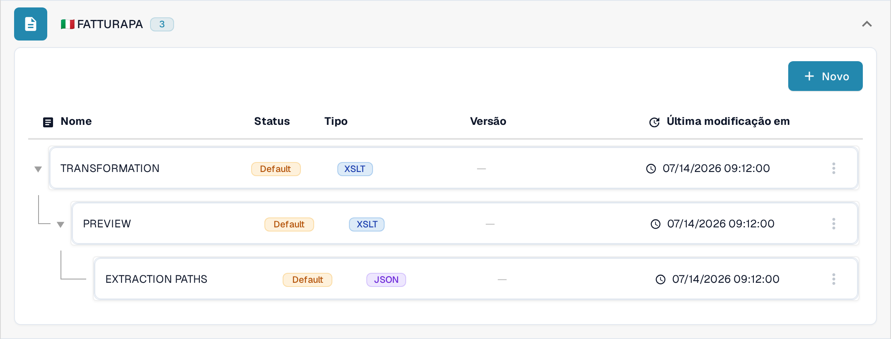
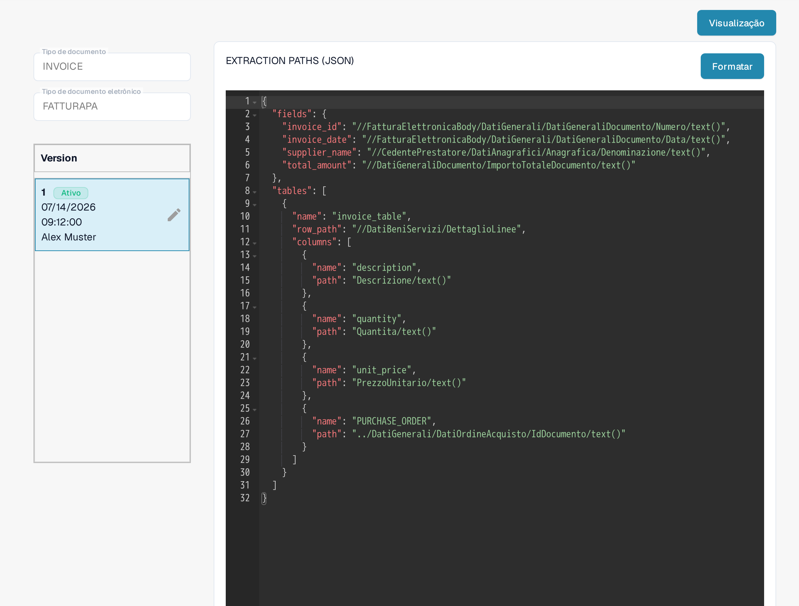
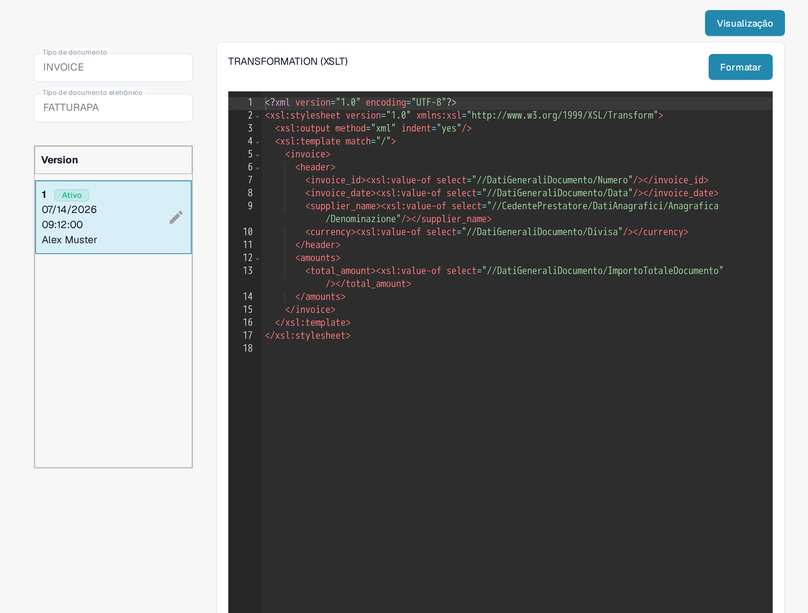
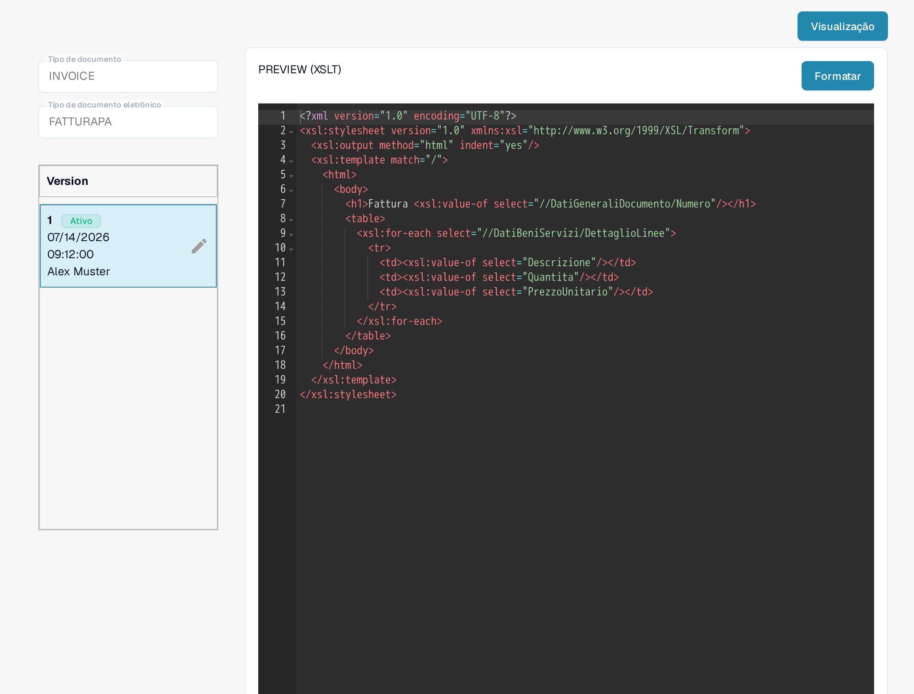

# FatturaPA: exibir um atributo nas linhas da fatura

O FatturaPA é o formato italiano de fatura eletrônica. Esta página explica onde verificar um atributo de linha, como um número de Pedido de Compra, antes de alterar seu mapeamento ou a visualização da fatura. **Não adicione uma segunda coluna `PURCHASE_ORDER` sem antes verificar o mapeamento ativo:** o mapeamento atual da Sandbox já contém uma.

## Encontrar os três arquivos FatturaPA

Abra **Configurações → Tipos De Documentos → E-Doc**, selecione **Invoice** e depois expanda **FATTURAPA**. A lista atual tem três arquivos diferentes:

* **TRANSFORMATION (XSLT)** lê o XML FatturaPA de origem e produz os dados normalizados da fatura.
* **PREVIEW (XSLT)** constrói a visualização visual da fatura (estilo HTML/PDF) a partir desses dados.
* **EXTRACTION PATHS (JSON)** mapeia os valores normalizados para os campos do DocBits e as colunas da tabela.

<figure><figcaption>
A lista atual de arquivos FATTURAPA na Sandbox em português.
</figcaption></figure>

## Verificar o valor de linha extraído

Abra **EXTRACTION PATHS (JSON)**. Na versão ativa, encontre o array `tables` e suas `columns`. A versão visível na Sandbox já inclui `{"name": "PURCHASE_ORDER", "path": "PURCHASE_ORDER"}`. Verifique o valor em uma fatura de teste real antes de editá-lo. Se você precisar de outro atributo, identifique o valor dele nos dados normalizados e depois adicione um nome de coluna distinto e o caminho correspondente em uma versão de rascunho.

<figure><figcaption>
O mapeamento de extração JSON ativo já tem uma coluna de pedido de compra.
</figcaption></figure>

## Alterar a transformação ou a visualização apenas quando necessário

Se o valor normalizado estiver ausente, inspecione **TRANSFORMATION (XSLT)** e o caminho do XML de origem que deveria produzi-lo. Uma alteração aqui afeta os dados usados pelas etapas posteriores de mapeamento e visualização. Se o valor for extraído corretamente, mas estiver ausente na fatura visual, inspecione **PREVIEW (XSLT)** e a linha de tabela relevante nesse modelo. Os dois arquivos XSLT têm finalidades diferentes.

<figure><figcaption>
A transformação lê o XML de origem e constrói os campos normalizados da fatura.
</figcaption></figure>

<figure><figcaption>
A visualização controla a saída visual da fatura.
</figcaption></figure>

Use o lápis em um cartão de versão para preparar uma alteração. Revise o rascunho e use **Visualização** com uma fatura FatturaPA representativa antes de ativá-lo. As capturas de tela mostram as versões ativas atuais; nenhum rascunho foi salvo nem teste de visualização executado nesta sessão da Sandbox.

A instrução anterior de que todos os documentos eletrônicos têm a Grã-Bretanha como origem não é uma regra geral segura. Verifique o país, a moeda e o formato numérico da fatura em relação ao documento de origem e à configuração da sua organização.
