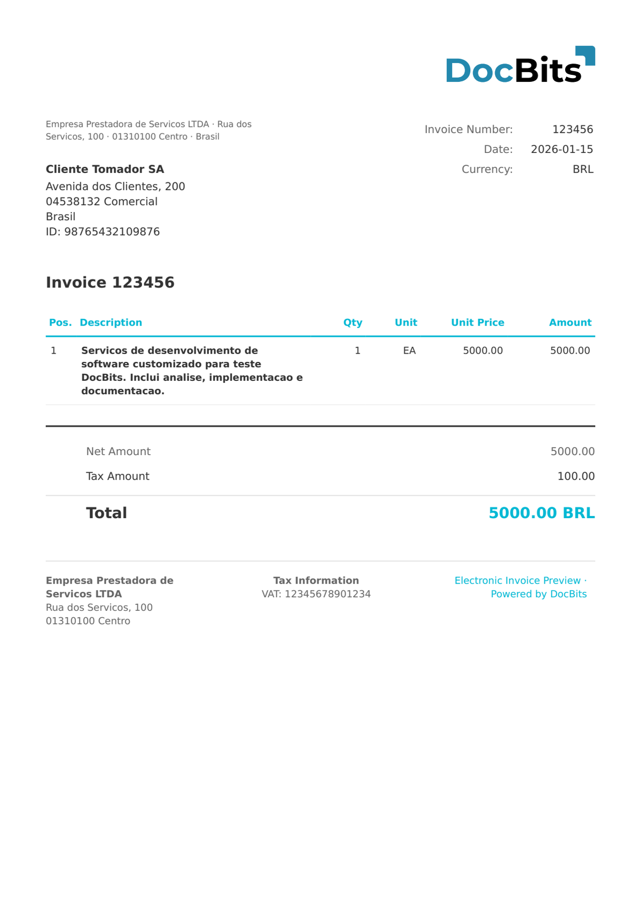

# 🇧🇷 BRAZIL NFS-E

| Propriedade | Valor |
| --- | --- |
| **País / Região** | Brasil |
| **Tipos de documento** | Fatura de serviços (Nota Fiscal de Serviços Eletrônica) |
| **Formato** | XML |
| **Padrão** | NFS-e 2.04 (padrão nacional ABRASF para notas fiscais de serviços municipais) |
| **Idioma** | `pt_BR` |

A NFS-e (Nota Fiscal de Serviços Eletrônica) é a nota fiscal eletrônica brasileira para serviços, emitida em nível municipal. O DocBits oferece suporte ao esquema padrão da ABRASF (Associação Brasileira das Secretarias de Finanças das Capitais). Os documentos NFS-e usam uma estrutura XML diferente da NF-e: o principal imposto é o ISS (Imposto Sobre Serviços) em vez do ICMS, e o fornecedor/comprador são chamados de `PrestadorServico` / `TomadorServico`. O elemento `Discriminacao` contém a descrição do serviço em texto livre.

## Status de suporte

| Componente | Status |
| --- | --- |
| Visualização | ✅ Suportado |
| Extração de campos | ✅ Suportado |
| Transformação | ✅ Suportado |

## Visualização padrão

<figure><figcaption><p>Visualização padrão do DocBits para um documento BRAZIL NFS-E</p></figcaption></figure>

## Mapeamento de campos

### Campos de cabeçalho

| Campo DocBits | XPath de origem | Observações |
| --- | --- | --- |
| `invoice_id` | `//*[local-name()='Numero']` | Número da NFS-e |
| `invoice_date` | `//*[local-name()='DataEmissao']` | Data de emissão ISO 8601 |
| `currency` | Fixo: `BRL` | Sempre real brasileiro |
| `total_amount` | `//*[local-name()='ValorServicos']` | Valor bruto dos serviços |
| `net_amount` | `//*[local-name()='ValorLiquidoNfse']` | Valor líquido após deduções |
| `tax_amount` | `//*[local-name()='ValorIss']` | ISS (imposto municipal sobre serviços) |
| `supplier_name` | `//*[local-name()='PrestadorServico']//*[local-name()='RazaoSocial']` | Nome do prestador de serviços |
| `supplier_id` | `//*[local-name()='PrestadorServico']//*[local-name()='Cnpj']` | CNPJ do prestador |
| `buyer_name` | `//*[local-name()='TomadorServico']//*[local-name()='RazaoSocial']` | Nome do tomador do serviço |
| `buyer_id` | `//*[local-name()='TomadorServico']//*[local-name()='Cnpj']` | CNPJ do tomador |

> A NFS-e descreve um único serviço no elemento `Discriminacao` em vez de itens de linha. Nenhuma `INVOICE_TABLE` é extraída.

## Regra de classificação

O DocBits detecta documentos BRAZIL NFS-E por meio do namespace:

```
http://www.abrasf.org.br/nfse.xsd
```

## Relacionado

* [BRAZIL NF-E](brazil-nfe.md)
* [BRAZIL NFC-E](brazil-nfce.md)
* [BRAZIL CT-E](brazil-cte.md)
* [Documentos Eletrônicos Suportados](./)
