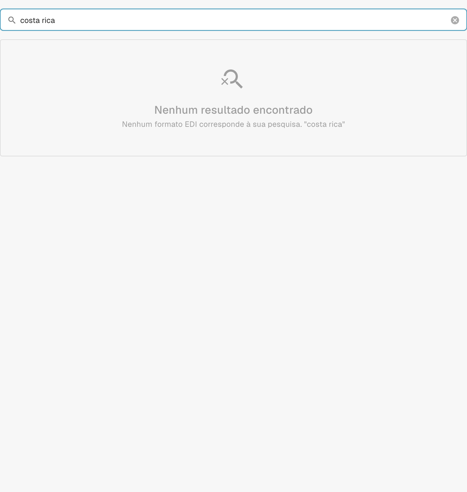

# Costa Rica

Utilize este guia para identificar a família configurada e o âmbito das versões antes de testar um ficheiro de origem.

[Todos os países e âmbito do suporte](../README.md)

## Vídeo explicativo do país

A narração e as legendas WebVTT traduzidas explicam a seleção do formato, a configuração e as verificações de aceitação.

Este percurso apenas de leitura mostra a configuração existente do país no DocBits. Verifique a fonte utilizada e a versão ativa e teste faturas, notas de crédito e exportações representativas na sua organização.



[Costa Rica — Vídeo explicativo do país](https://docbits-videos.fra1.cdn.digitaloceanspaces.com/settings-assistant/edocs_country_costa_rica/v2/pt.mp4)

[WebVTT](https://docbits-videos.fra1.cdn.digitaloceanspaces.com/settings-assistant/edocs_country_costa_rica/v2/pt.vtt)

## Variantes e limites das versões

A documentação anterior menciona a Costa Rica, mas não foi encontrada nenhuma entrada de classificação ou de configuração correspondente no catálogo de desenvolvimento examinado.

**Sintaxe:** Não confirmado

Esta verificação não confirma o processamento incorporado atual. Peça ao suporte que verifique o mapeamento implementado e teste um ficheiro de origem representativo antes da implementação.

As tabelas registam uma verificação do catálogo de desenvolvimento realizada em 17 de outubro de 2026 e o código de processamento correspondente. Descrevem as regras e os componentes de configuração disponíveis; não certificam todos os ficheiros, requisitos legais ou implementações em produção. A sua organização pode sobrepor-se às predefinições.

## Matriz de regras e componentes examinados

Não foi encontrada nenhuma entrada de classificação ou de configuração correspondente. Esta verificação não confirma o suporte incorporado atual.

## Encontrar o mapeamento no DocBits

<figure><figcaption>
Interface real de desenvolvimento: a pesquisa pelo nome deste país não devolveu nenhuma entrada de configuração correspondente no catálogo examinado.
</figcaption></figure>

## Verificações de aceitação

Uma verificação de componentes confirma a presença da configuração. Não é um teste de processamento de ponta a ponta de todas as versões. Teste o conteúdo exato e o caminho de fatura ou nota de crédito exigido pela sua integração.

## Verificar um formato na sua organização

1. Conserve o XML original ou o PDF com o XML incorporado. Consulte o espaço de nomes, o esquema ou o identificador de personalização e a versão ou o perfil declarados.

2. Abra Definições → Tipos de documento → E-Doc para o documento de negócio aplicável. Procure o formato de documento eletrónico exato indicado no guia.

3. Verifique a origem efetiva, Default ou Custom, e a respetiva versão de configuração ativa. Examine Transformation, Preview e Extraction Paths. Guardar um rascunho não o ativa.

4. Teste ficheiros de origem representativos de cada sintaxe, versão e documento de negócio de que necessita. Verifique os campos principais, os montantes, os impostos, a classificação como fatura ou nota de crédito e a exportação para o ERP.

5. Confirme separadamente a política de validação e a transmissão. Preserve os mapeamentos personalizados e verifique as aprovações e o histórico de exportação antes de reiniciar documentos existentes.

## Referência de formato relacionada

- [🇨🇷 COSTA RICA](../costa-rica.md)
