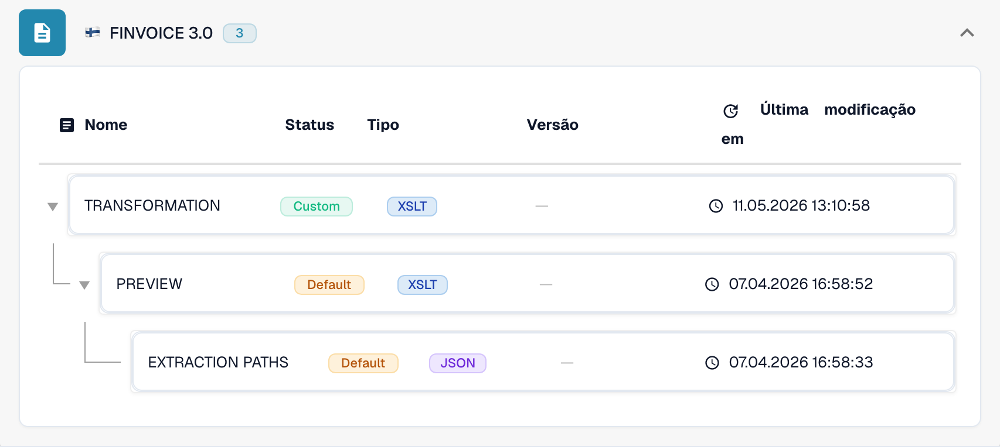

# Finlândia

Utilize este guia para identificar a família configurada e o âmbito das versões antes de testar um ficheiro de origem.

[Todos os países e âmbito do suporte](../README.md)

## Variantes e limites das versões

Finvoice 1.3, 2.0, 2.01 e 3.0 têm entradas distintas. TEAPPSXML é outra família.

**Sintaxe:** XML

Verifique a versão de origem antes de escolher um mapeamento. A designação TEAPPSXML não indica uma edição.

As tabelas registam uma verificação do catálogo de desenvolvimento realizada em 17 de outubro de 2026 e o código de processamento correspondente. Descrevem as regras e os componentes de configuração disponíveis; não certificam todos os ficheiros, requisitos legais ou implementações em produção. A sua organização pode sobrepor-se às predefinições.

## Matriz de regras e componentes examinados

| Designação exata do formato | Chave do documento na regra | Componentes disponíveis |
| --- | --- | --- |
| `FINVOICE 1.3` | `INVOICE` | C / T / P / E |
| `FINVOICE 2.0` | `INVOICE` | C / T / P / E |
| `FINVOICE 2.01` | `INVOICE` | C / T / P / E |
| `FINVOICE 3.0` | `INVOICE` | C / T / P / E |
| `TEAPPSXML` | `INVOICE` | C / T / P / E |

C = classificação, T = Transformation, P = Preview, E = Extraction Paths. A chave do documento é a chave de consulta da regra ou da configuração; não garante o valor final guardado em invoice_type. Uma transformação pode classificar uma nota de crédito através de um mapeamento INVOICE.

Um travessão significa que a verificação de estado não indicou um componente dedicado para esta combinação exata de formato e chave do documento. Isso não exclui a utilização de um mapeamento partilhado ou de recurso. Verifique o mecanismo de resolução efetivo e um ficheiro representativo antes de depender desse caminho.

## Encontrar o mapeamento no DocBits

<figure><figcaption>
Interface real de desenvolvimento: o formato representativo e os respetivos componentes de configuração disponíveis. As outras versões estão indicadas na matriz.
</figcaption></figure>

## Vídeo explicativo do país

A narração e as legendas WebVTT traduzidas explicam a seleção do formato, a configuração e as verificações de aceitação.

Este percurso apenas de leitura mostra a configuração existente do país no DocBits. Verifique a fonte utilizada e a versão ativa e teste faturas, notas de crédito e exportações representativas na sua organização.


Finlândia — Vídeo explicativo do país



WebVTT


## Verificações de aceitação

Uma verificação de componentes confirma a presença da configuração. Não é um teste de processamento de ponta a ponta de todas as versões. Teste o conteúdo exato e o caminho de fatura ou nota de crédito exigido pela sua integração.

## Verificar um formato na sua organização

1. Conserve o XML original ou o PDF com o XML incorporado. Consulte o espaço de nomes, o esquema ou o identificador de personalização e a versão ou o perfil declarados.

2. Abra Definições → Tipos de documento → E-Doc para o documento de negócio aplicável. Procure o formato de documento eletrónico exato indicado no guia.

3. Verifique a origem efetiva, Default ou Custom, e a respetiva versão de configuração ativa. Examine Transformation, Preview e Extraction Paths. Guardar um rascunho não o ativa.

4. Teste ficheiros de origem representativos de cada sintaxe, versão e documento de negócio de que necessita. Verifique os campos principais, os montantes, os impostos, a classificação como fatura ou nota de crédito e a exportação para o ERP.

5. Confirme separadamente a política de validação e a transmissão. Preserve os mapeamentos personalizados e verifique as aprovações e o histórico de exportação antes de reiniciar documentos existentes.

## Referência de formato relacionada

- [🇫🇮 FINVOICE 1.3](../finvoice-1-3.md)
- [🇫🇮 FINVOICE 2.0](../finvoice-2-0.md)
- [🇫🇮 FINVOICE 2.01](../finvoice-2-01.md)
- [🇫🇮 FINVOICE 3.0](../finvoice-3-0.md)
- [🇫🇮 TEAPPSXML](../teappsxml.md)
