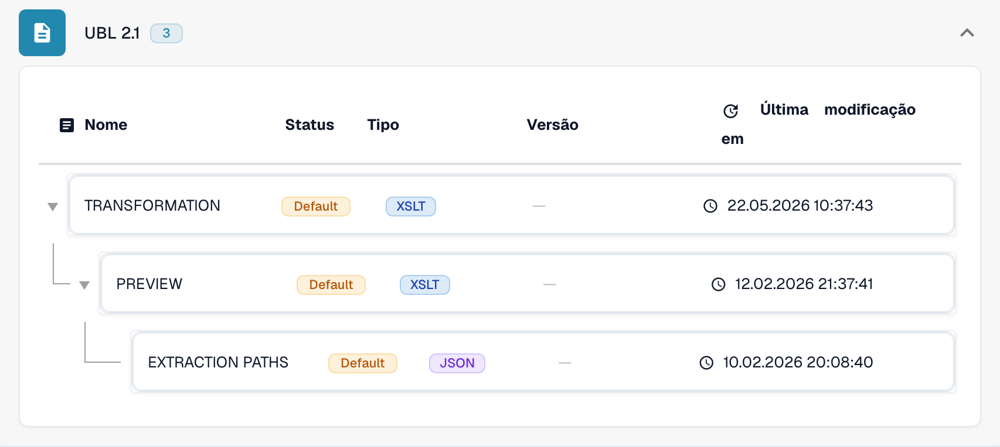

# Internacional

Utilize este guia para identificar a família configurada e o âmbito das versões antes de testar um ficheiro de origem.

[Todos os países e âmbito do suporte](../README.md)

## Vídeo explicativo do país

A narração e as legendas WebVTT traduzidas explicam a seleção do formato, a configuração e as verificações de aceitação.

Este percurso apenas de leitura mostra a configuração existente do país no DocBits. Verifique a fonte utilizada e a versão ativa e teste faturas, notas de crédito e exportações representativas na sua organização.



[Internacional — Vídeo explicativo do país](https://docbits-videos.fra1.cdn.digitaloceanspaces.com/settings-assistant/edocs_country_international/v2/pt.mp4)

[WebVTT](https://docbits-videos.fra1.cdn.digitaloceanspaces.com/settings-assistant/edocs_country_international/v2/pt.vtt)

## Variantes e limites das versões

As entradas internacionais incluem Peppol BIS 3.0, UBL 2.1, CII puro, EDI, INVOIC02, cXML, OCI, BOD e SPS Commerce RSX 7.7.4.

**Sintaxe:** UBL / CII / EDI / cXML

Os mapeamentos de faturas, encomendas, respostas e expedições são distintos. O processamento de ficheiros, por si só, não disponibiliza um ponto de acesso Peppol nem conectividade com parceiros comerciais.

As tabelas registam uma verificação do catálogo de desenvolvimento realizada em 17 de outubro de 2026 e o código de processamento correspondente. Descrevem as regras e os componentes de configuração disponíveis; não certificam todos os ficheiros, requisitos legais ou implementações em produção. A sua organização pode sobrepor-se às predefinições.

## Matriz de regras e componentes examinados

| Designação exata do formato | Chave do documento na regra | Componentes disponíveis |
| --- | --- | --- |
| `BOD` | `PURCHASE_ORDER` | C / — / — / — |
| `CXML ORDER CONFIRMATION` | `ORDER_CONFIRMATION` | C / T / P / E |
| `CXML PURCHASE ORDER` | `PURCHASE_ORDER` | C / T / P / E |
| `EDI` | `PURCHASE_ORDER` | C / T / P / E |
| `EDI` | `ORDER_CONFIRMATION` | C / T / P / E |
| `EDI` | `INVOICE` | C / T / P / E |
| `INVOIC02` | `INVOICE` | C / T / P / E |
| `OCI CATALOG ORDER` | `PURCHASE_ORDER` | C / T / P / E |
| `PEPPOL BIS 3.0` | `INVOICE` | C / T / P / E |
| `PEPPOL DESPATCH ADVICE 3.0` | `DELIVERY_NOTE` | C / T / P / E |
| `PEPPOL ORDER 3.0` | `PURCHASE_ORDER` | C / T / P / E |
| `PEPPOL ORDER RESPONSE 3.0` | `ORDER_CONFIRMATION` | C / T / P / E |
| `PURCHASE ORDER BOD` | `PURCHASE_ORDER` | C / T / P / E |
| `PURE CII D16B EU` | `INVOICE` | C / T / P / E |
| `PURE CII D16B EU CREDITNOTE` | `CREDIT_NOTE` | C / T / P / E |
| `PURE CII D16B NON-EU` | `INVOICE` | C / T / P / E |
| `PURE CII D16B NON-EU CREDITNOTE` | `CREDIT_NOTE` | C / T / P / E |
| `PURE CII D22B EU` | `INVOICE` | C / T / P / E |
| `PURE CII D22B EU CREDITNOTE` | `CREDIT_NOTE` | C / T / P / E |
| `PURE CII D22B NON-EU` | `INVOICE` | C / T / P / E |
| `PURE CII D22B NON-EU CREDITNOTE` | `CREDIT_NOTE` | C / T / P / E |
| `PURE CII D23B EU` | `INVOICE` | C / T / P / E |
| `PURE CII D23B EU CREDITNOTE` | `CREDIT_NOTE` | C / T / P / E |
| `PURE CII D23B NON-EU` | `INVOICE` | C / T / P / E |
| `PURE CII D23B NON-EU CREDITNOTE` | `CREDIT_NOTE` | C / T / P / E |
| `PURE CII D24B EU` | `INVOICE` | C / T / P / E |
| `PURE CII D24B EU CREDITNOTE` | `CREDIT_NOTE` | C / T / P / E |
| `PURE CII D24B NON-EU` | `INVOICE` | C / T / P / E |
| `PURE CII D24B NON-EU CREDITNOTE` | `CREDIT_NOTE` | C / T / P / E |
| `PURE CII V1 EU` | `INVOICE` | C / T / P / E |
| `PURE CII V1 EU CREDITNOTE` | `CREDIT_NOTE` | C / T / P / E |
| `PURE CII V1 NON-EU` | `INVOICE` | C / T / P / E |
| `PURE CII V1 NON-EU CREDITNOTE` | `CREDIT_NOTE` | C / T / P / E |
| `SPS COMMERCE RSX 7.7.4` | `PURCHASE_ORDER_ACKNOWLEDGMENT` | C / T / P / E |
| `SPS COMMERCE RSX 7.7.4` | `ADVANCE_SHIP_NOTICE` | C / T / P / E |
| `SPS COMMERCE RSX 7.7.4` | `PURCHASE_ORDER` | C / T / P / E |
| `SPS COMMERCE RSX 7.7.4` | `INVOICE` | C / T / P / E |
| `SPS COMMERCE RSX 7.7.4` | `PURCHASE_ORDER_CHANGE` | C / T / P / E |
| `UBL 2.1` | `INVOICE` | C / T / P / E |
| `UBL 2.1 CREDITNOTE` | `CREDIT_NOTE` | C / T / P / E |
| `UBL 2.1 DESPATCH ADVICE` | `DELIVERY_NOTE` | C / T / P / E |
| `UBL 2.1 ORDER` | `PURCHASE_ORDER` | C / T / P / E |
| `UBL 2.1 ORDER RESPONSE` | `ORDER_CONFIRMATION` | C / T / P / E |

C = classificação, T = Transformation, P = Preview, E = Extraction Paths. A chave do documento é a chave de consulta da regra ou da configuração; não garante o valor final guardado em invoice_type. Uma transformação pode classificar uma nota de crédito através de um mapeamento INVOICE.

Um travessão significa que a verificação de estado não indicou um componente dedicado para esta combinação exata de formato e chave do documento. Isso não exclui a utilização de um mapeamento partilhado ou de recurso. Verifique o mecanismo de resolução efetivo e um ficheiro representativo antes de depender desse caminho.

## Encontrar o mapeamento no DocBits

<figure><figcaption>
Interface real de desenvolvimento: o formato representativo e os respetivos componentes de configuração disponíveis. As outras versões estão indicadas na matriz.
</figcaption></figure>

## Verificações de aceitação

Uma verificação de componentes confirma a presença da configuração. Não é um teste de processamento de ponta a ponta de todas as versões. Teste o conteúdo exato e o caminho de fatura ou nota de crédito exigido pela sua integração.

## Verificar um formato na sua organização

1. Conserve o XML original ou o PDF com o XML incorporado. Consulte o espaço de nomes, o esquema ou o identificador de personalização e a versão ou o perfil declarados.

2. Abra Definições → Tipos de documento → E-Doc para o documento de negócio aplicável. Procure o formato de documento eletrónico exato indicado no guia.

3. Verifique a origem efetiva, Default ou Custom, e a respetiva versão de configuração ativa. Examine Transformation, Preview e Extraction Paths. Guardar um rascunho não o ativa.

4. Teste ficheiros de origem representativos de cada sintaxe, versão e documento de negócio de que necessita. Verifique os campos principais, os montantes, os impostos, a classificação como fatura ou nota de crédito e a exportação para o ERP.

5. Confirme separadamente a política de validação e a transmissão. Preserve os mapeamentos personalizados e verifique as aprovações e o histórico de exportação antes de reiniciar documentos existentes.

## Referência de formato relacionada

- [INVOIC02](../invoic02.md)
- [🇪🇺 PEPPOL BIS 3.0](../peppol-bis-3-0.md)
- [SPS COMMERCE RSX 7.7.4](../sps-commerce-rsx-7-7-4.md)
- [UBL 2.1](../ubl-2-1.md)
