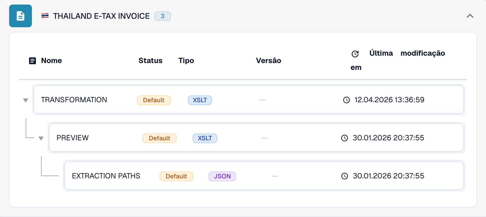

# Tailândia

Utilize este guia para identificar a família configurada e o âmbito das versões antes de testar um ficheiro de origem.

[Todos os países e âmbito do suporte](../README.md)

## Variantes e limites das versões

Thailand E-Tax Invoice é a família configurada.

**Sintaxe:** XML

A designação não indica uma edição. Confirme a estrutura XML de origem; a verificação de assinaturas e a entrega à plataforma fiscal exigem verificações separadas.

As tabelas registam uma verificação do catálogo de desenvolvimento realizada em 17 de outubro de 2026 e o código de processamento correspondente. Descrevem as regras e os componentes de configuração disponíveis; não certificam todos os ficheiros, requisitos legais ou implementações em produção. A sua organização pode sobrepor-se às predefinições.

## Matriz de regras e componentes examinados

| Designação exata do formato | Chave do documento na regra | Componentes disponíveis |
| --- | --- | --- |
| `THAILAND E-TAX INVOICE` | `INVOICE` | C / T / P / E |

C = classificação, T = Transformation, P = Preview, E = Extraction Paths. A chave do documento é a chave de consulta da regra ou da configuração; não garante o valor final guardado em invoice_type. Uma transformação pode classificar uma nota de crédito através de um mapeamento INVOICE.

Um travessão significa que a verificação de estado não indicou um componente dedicado para esta combinação exata de formato e chave do documento. Isso não exclui a utilização de um mapeamento partilhado ou de recurso. Verifique o mecanismo de resolução efetivo e um ficheiro representativo antes de depender desse caminho.

## Encontrar o mapeamento no DocBits

<figure><figcaption>
Interface real de desenvolvimento: o formato representativo e os respetivos componentes de configuração disponíveis. As outras versões estão indicadas na matriz.
</figcaption></figure>

## Vídeo explicativo do país

O filme narrado deste país ainda não está disponível.

## Verificações de aceitação

Uma verificação de componentes confirma a presença da configuração. Não é um teste de processamento de ponta a ponta de todas as versões. Teste o conteúdo exato e o caminho de fatura ou nota de crédito exigido pela sua integração.

## Verificar um formato na sua organização

1. Conserve o XML original ou o PDF com o XML incorporado. Consulte o espaço de nomes, o esquema ou o identificador de personalização e a versão ou o perfil declarados.

2. Abra Definições → Tipos de documento → E-Doc para o documento de negócio aplicável. Procure o formato de documento eletrónico exato indicado no guia.

3. Verifique a origem efetiva, Default ou Custom, e a respetiva versão de configuração ativa. Examine Transformation, Preview e Extraction Paths. Guardar um rascunho não o ativa.

4. Teste ficheiros de origem representativos de cada sintaxe, versão e documento de negócio de que necessita. Verifique os campos principais, os montantes, os impostos, a classificação como fatura ou nota de crédito e a exportação para o ERP.

5. Confirme separadamente a política de validação e a transmissão. Preserve os mapeamentos personalizados e verifique as aprovações e o histórico de exportação antes de reiniciar documentos existentes.

## Referência de formato relacionada

- [🇹🇭 THAILAND E-TAX INVOICE](../thailand-e-tax-invoice.md)
