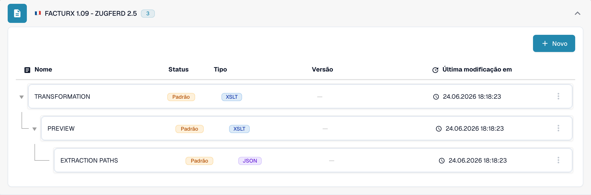

# 🇫🇷 FACTURX 1.09 - ZUGFERD 2.5

<!-- edocs-country-scope -->


Consulte o guia do país para conhecer os limites das versões, a configuração efetiva e o vídeo explicativo. [França](countries/france.md). O marcador XML 1p0 e Factur-X XMP Version 1.0 não identificam uma edição da publicação. Mantenha a designação genérica quando a edição for desconhecida.


| Propriedade | Valor |
|----------|-------|
| **País / Região** | França / Alemanha |
| **Tipos de documento** | Fatura, nota de crédito (verificar o mapeamento efetivo) |
| **Formato** | XML CII incorporado num PDF/A-3 |
| **Padrão** | Factur-X 1.09 / ZUGFeRD 2.5 |
| **Baseado em** | EN 16931 |

ZUGFeRD 2.5 e Factur-X 1.09 são publicações equivalentes. O formato híbrido incorpora XML CII D22B num PDF/A-3; UBL não é a sua sintaxe XML. Consulte a [referência da publicação FeRD](https://www.ferd-net.de/publikationen-produkte/publikationen/detailseite/zugferd-25-english).

A norma define os perfis MINIMUM, BASIC WL, BASIC, EN16931 e EXTENDED. Um nome de perfil no catálogo não comprova a deteção automática nem a cobertura completa dos campos. MINIMUM e BASIC WL podem omitir informações das linhas necessárias à sua integração.

Esta página descreve a publicação de junho de 2026. A [publicação posterior Factur-X 1.09.2 / ZUGFeRD 2.5.2](https://fnfe-mpe.org/factur-x/factur-x_en/) deve ser identificada separadamente; o identificador de família `1p0`, por si só, não basta.

## Status de suporte

A verificação apenas de leitura do catálogo de desenvolvimento, em 31 de outubro de 2026, encontrou `FACTURX 1.09 - ZUGFERD 2.5` para `INVOICE`.

| Componente | Configuração observada |
|-----------|-------------------------|
| Pré-visualização | `PREVIEW` (XSLT) |
| Extração de campos | `EXTRACTION_PATHS` (JSON) |
| Transformação | `TRANSFORMATION` (XSLT) |

Estas entradas confirmam uma configuração disponível, não o processamento bem-sucedido de cada ficheiro ou perfil. Verifique a origem predefinida ou personalizada e a versão ativa na sua organização. A retrocompatibilidade da norma não garante resultados de extração ou transformação inalterados. Teste separadamente faturas e notas de crédito representativas, os campos necessários e a exportação ERP; a validação legal e os requisitos da rede de transmissão exigem testes de aceitação próprios.

<figure><figcaption>
Interface de desenvolvimento em português, consultada apenas para leitura em 31 de outubro de 2026: a entrada do catálogo para INVOICE e os componentes predefinidos disponíveis. Esta captura de ecrã não mostra um teste de processamento de ficheiros.
</figcaption></figure>

## Relacionado

- [ZUGFeRD 2.5](zugferd-2-5.md)
- [Configuração do ZUGFeRD](../zugferd/configuration.md)
- [Mapeamento de campos do ZUGFeRD](../zugferd/README.md)
- [Documentos Eletrônicos Suportados](./)
