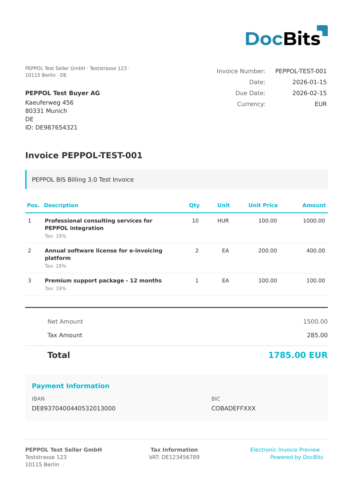

# 🇪🇺 PEPPOL BIS 3.0

| Propriedade          | Valor                                          |
| -------------------- | ---------------------------------------------- |
| **País / Região**    | União Europeia / Internacional (mais de 40 países) |
| **Tipos de documento** | Fatura, Nota de crédito                      |
| **Formato**          | UBL 2.1 XML                                    |
| **Padrão**           | Peppol BIS Billing 3.0                         |

O Peppol BIS Billing 3.0 é o padrão pan-europeu de faturação eletrônica utilizado em toda a rede Peppol. Baseia-se no OASIS UBL 2.1 e implementa a Norma Europeia EN 16931 para faturação eletrônica. O Peppol permite a troca transfronteiriça de faturas B2B e B2G em mais de 40 países através de Access Points certificados.

## Status de suporte

| Componente          | Status       |
| ------------------- | ------------ |
| Pré-visualização    | ✅ Suportado |
| Extração de campos  | ✅ Suportado |
| Transformação       | ✅ Suportado |

## Pré-visualização padrão

<figure><figcaption>
Pré-visualização padrão do DocBits para uma fatura Peppol BIS 3.0
</figcaption></figure>

## Relacionados

* [Documentos eletrônicos suportados](./)
* [Peppol BIS Billing 3.0](../peppol-bis-billing-3.0)
