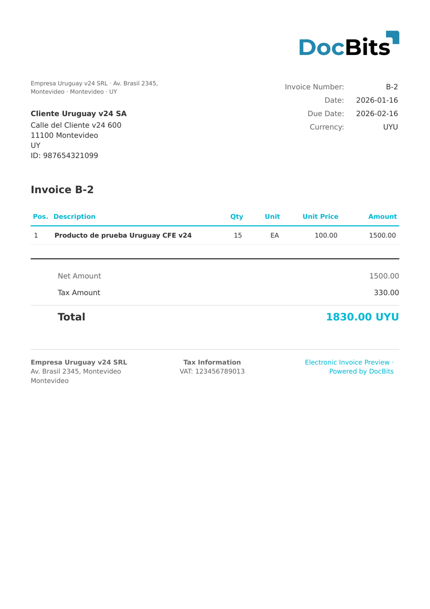

# 🇺🇾 URUGUAY CFE 24

| Propriedade          | Valor                        |
| -------------------- | ---------------------------- |
| **País / Região**    | Uruguai                      |
| **Tipos de documento** | e-Fatura, Nota de crédito  |
| **Formato**          | XML                          |
| **Padrão**           | CFE, versão de esquema 24    |

O Uruguay CFE 24 refere-se à versão 24 do esquema do sistema uruguaio CFE. Esta versão é usada por muitos documentos eletrônicos existentes e inclui todos os campos necessários para a conformidade com a DGI, entre eles o CAE (Código de Autorización Electrónico).

## Status de suporte

| Componente          | Status       |
| ------------------- | ------------ |
| Visualização        | ✅ Suportado |
| Extração de campos  | ✅ Suportado |
| Transformação       | ✅ Suportado |

## Visualização padrão

<figure><figcaption>
Visualização padrão do DocBits para uma fatura Uruguay CFE v24
</figcaption></figure>

## Veja também

* [Documentos eletrônicos suportados](./)
