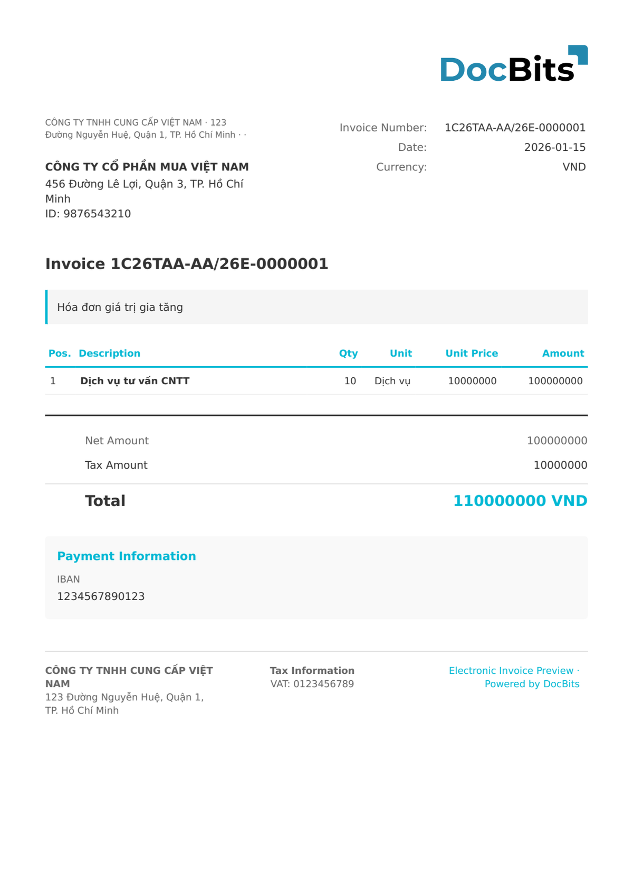

# 🇻🇳 VIETNAM E-INVOICE

<!-- edocs-country-scope -->


Consulte o guia do país para conhecer os limites das versões, a configuração efetiva e o vídeo explicativo. [Vietname](countries/vietnam.md). A designação não indica uma edição. Verifique o espaço de nomes e o esquema de origem, em vez de pressupor que todas as exportações da plataforma fiscal têm a mesma estrutura.


| Propriedade          | Valor                                                 |
| -------------------- | ----------------------------------------------------- |
| **País / Região**    | Vietnã                                                |
| **Tipos de documento** | Fatura                                              |
| **Formato**          | XML                                                   |
| **Padrão**           | Vietnamese E-Invoice (General Department of Taxation) |

O Vietnam E-Invoice é o padrão de faturamento eletrônico exigido pelo General Department of Taxation, conforme o Decreto 123/2020 e a Circular 78/2021. Todas as empresas do Vietnã devem usar faturas eletrônicas, que são transmitidas ao sistema da autoridade tributária e validadas por ele. Cada fatura inclui um código de verificação exclusivo.

## Status de suporte

| Componente          | Status       |
| ------------------- | ------------ |
| Visualização        | ✅ Suportado |
| Extração de campos  | ✅ Suportado |
| Transformação       | ✅ Suportado |

## Visualização padrão

<figure><figcaption>
Visualização padrão do DocBits para uma Vietnam E-Invoice
</figcaption></figure>

## Veja também

* [Documentos eletrônicos suportados](./)
