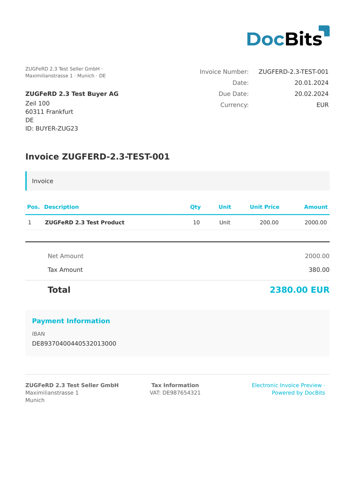

# 🇩🇪 ZUGFERD 1.0 COMFORT

<!-- edocs-country-scope -->


Consulte o guia do país para conhecer os limites das versões, a configuração efetiva e o vídeo explicativo. [Alemanha](countries/germany.md). A sintaxe, a versão da publicação e o perfil são escolhas diferentes. Não deduza uma edição Factur-X a partir do marcador partilhado 1p0.


| Propriedade | Valor |
| --- | --- |
| **País / Região** | Alemanha |
| **Tipos de documento** | Fatura, Nota de crédito |
| **Formato** | CII (incorporado em PDF/A-3) |
| **Padrão** | ZUGFeRD 1.0, perfil Comfort |
| **Baseado em** | Especificação ZUGFeRD 1.0 |

O perfil Comfort do ZUGFeRD 1.0 amplia o perfil Basic com campos adicionais para condições de pagamento, informações de entrega e detalhamentos fiscais completos. Permite o processamento totalmente automatizado de faturas, sem entrada manual de dados.

## Estado do suporte

| Componente | Estado |
| --- | --- |
| Pré-visualização | ✅ Suportado |
| Extração de campos | ✅ Suportado |
| Transformação | ✅ Suportado |

## Pré-visualização padrão

<figure><figcaption>
Pré-visualização padrão do DocBits para uma fatura ZUGFeRD 1.0 Comfort da Alemanha
</figcaption></figure>

## Relacionados

* [Configuração do ZUGFeRD](../zugferd/)
* [Mapeamento de campos do ZUGFeRD](../zugferd/README.md)
* [Documentos eletrônicos suportados](./)
