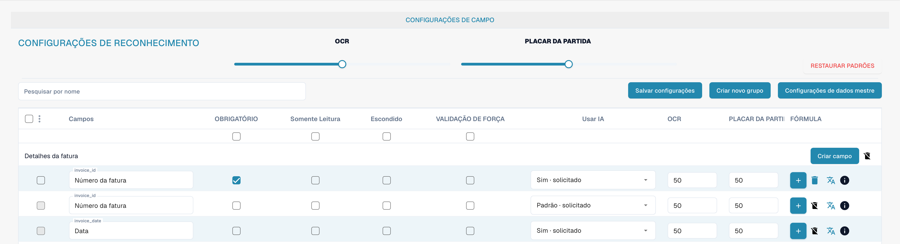

# Campos

Os campos definem os dados recolhidos para um tipo de documento e a forma de os verificar. Abra o tipo de documento nas definições e consulte os respetivos campos.

<figure><figcaption>
Campos do tipo de documento Fatura. PLACAR DA PARTIDA significa aqui limite de correspondência (Match Score), não um resultado desportivo.
</figcaption></figure>

## Propriedades e reconhecimento

* **Obrigatório** exige um valor para a validação.
* **Apenas leitura** impede a edição; **Oculto** retira o campo da vista habitual.
* A **validação forçada** exige uma verificação explícita do campo. Não cria regras de comparação nem expressões regulares; configure separadamente as regras de validação personalizadas.
* **OCR** define um limite numérico de confiança do reconhecimento. Não é um controlo para ativar ou desativar OCR.
* **Limite de correspondência** define um limite numérico de correspondência. Não é um texto de referência nem uma lista de valores.
* A opção **IA** controla a extração solicitada para o campo.

Pesquise o campo pelo nome e verifique a respetiva linha antes de alterar propriedades. Pode organizar grupos, adicionar campos e abrir opções de fórmulas ou dados mestre. As ações disponíveis dependem do campo e das permissões; a eliminação de campos predefinidos pode ser limitada.

Guarde apenas as alterações pretendidas e verifique a validação com documentos representativos. As imagens não comprovam alterações guardadas.

Consulte as [propriedades dos campos](configuring-field-properties-1.md), [validação e Match Score](setting-validation-and-match-score.md) e os [campos com encargos adicionais](new-fields-with-charges.md).
