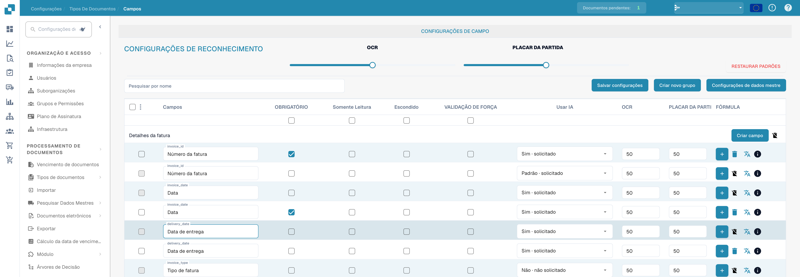
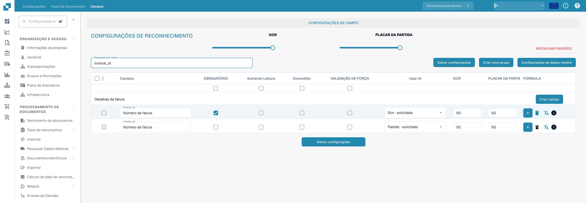

# Configurando propriedades de campo

Abra **Definições → Tipos de documentos → Campos** e selecione o tipo de documento. As imagens mostram Fatura na interface em português; os identificadores técnicos como `invoice_id` permanecem inalterados.

<figure><figcaption>
Propriedades dos campos: obrigatório, apenas leitura, oculto e validação forçada. PLACAR DA PARTIDA significa aqui limite de correspondência (Match Score), não um resultado desportivo.
</figcaption></figure>

## Encontrar um campo e alterar suas propriedades

1. Em **Pesquisar por nome**, digite o nome ou o rótulo do campo. Isso filtra a lista; não altera o campo.
2. Localize a linha do campo. Por exemplo, **Número da fatura** tem o nome técnico `invoice_id`.
3. Ajuste os controles dessa linha e depois selecione **Salvar configurações**. O mesmo botão de salvar está disponível acima e abaixo da tabela.

<figure><figcaption>
Campos filtrados por invoice_id com limites de OCR e Match Score. PLACAR DA PARTIDA significa aqui limite de correspondência (Match Score), não um resultado desportivo.
</figcaption></figure>

| Controle | Para que serve |
| --- | --- |
| **Obrigatório** | Marque as informações que precisam estar presentes para a validação. Verifique o resultado da validação do documento depois de alterar esta configuração. |
| **Somente leitura** | Exibe um campo sem permitir que os usuários editem o valor dele. |
| **Escondido** | Mantém o campo fora da visualização normal do documento. |
| **Forçar validação** | Exige uma verificação explícita do campo. Não cria regras de comparação nem expressões regulares; configure separadamente as regras de validação personalizadas. |
| **Usar IA** | Solicita ou interrompe a extração por IA para este campo. A linha mostra se a extração está solicitada. |
| **OCR** | Informe o limite de confiança do OCR do campo. É um número, não um interruptor de ligar/desligar nem uma configuração de idioma. |
| **Limite de correspondência** | Informe o limite de correspondência do campo. É um número, não um interruptor de ligar/desligar. |

Os controles deslizantes **OCR** e **Limite de correspondência** em **Definições de reconhecimento** aplicam valores a toda a lista de campos. As caixas de seleção logo abaixo dos títulos das colunas aplicam **Obrigatório**, **Somente leitura**, **Escondido** ou **Forçar validação** a toda a lista. Revise as linhas afetadas antes de selecionar **Salvar configurações**. **Restaurar predefinições** redefine a configuração dos campos; use somente quando quiser substituir as suas alterações.

## Outros controles nesta visualização

- **Criar novo grupo** e **Criar campo** adicionam um grupo ou um campo. Consulte [Adicionando e editando campos](adding-and-editing-fields.md).
- **Configurações de dados mestre** abre a [configuração de dados mestres](master-data-settings.md).
- As caixas de seleção mais à esquerda selecionam campos. O menu ao lado oferece **Reatribuir Grupo de Campo** para os campos selecionados.
- O botão de mais de **Fórmula** abre o editor de fórmulas desse campo. O ícone de **informações** mostra as informações do campo. O ícone de exclusão não está disponível para campos padrão.

Para saber mais sobre validação e correspondência, consulte [Definindo validação e Match Score](setting-validation-and-match-score.md).
