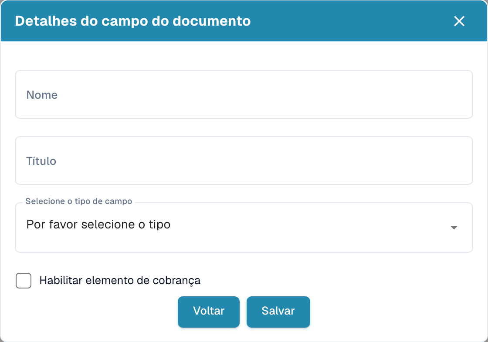
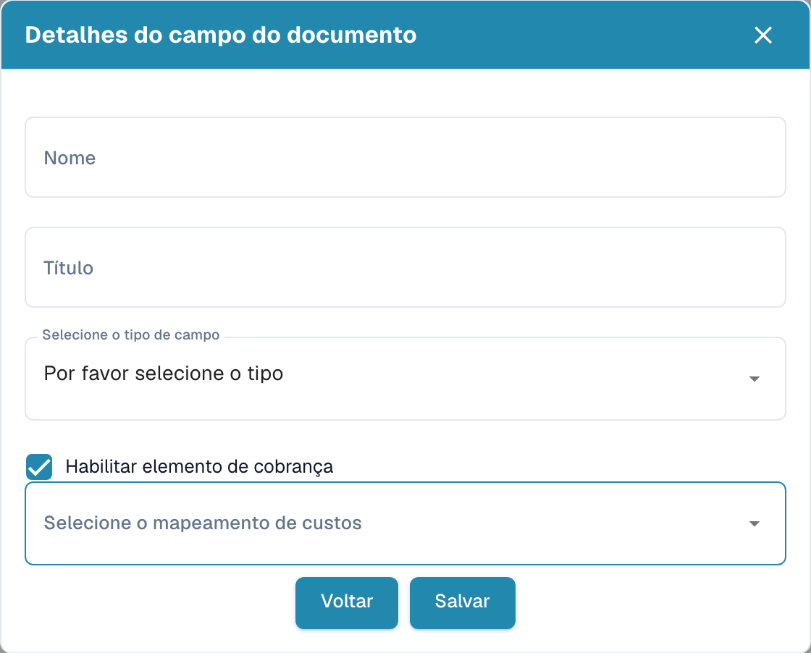

# Criar campos com encargos adicionais

Abra o tipo de documento e os respetivos campos nas definições. No grupo pretendido, escolha a opção para criar um campo.

<figure><figcaption>
Dados do campo antes de criar um novo campo.
</figcaption></figure>

1. Introduza um nome técnico e um título legível.
2. Selecione o tipo de dados.
3. Ative a opção de encargos adicionais para mostrar a associação dos encargos.
4. Escolha a associação pretendida. As opções disponíveis dependem da configuração da organização.

<figure><figcaption>
Rascunho de campo com a opção de encargos adicionais ativa.
</figcaption></figure>

O exemplo é um rascunho sem guardar. Guardar cria o campo; volte atrás se não pretender criá-lo. Depois verifique separadamente obrigatório, validação forçada, OCR e Match Score na lista de campos.
