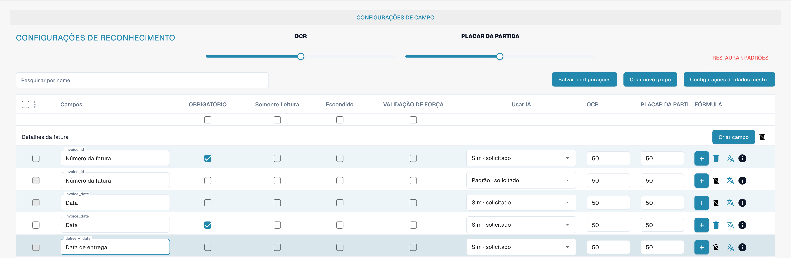
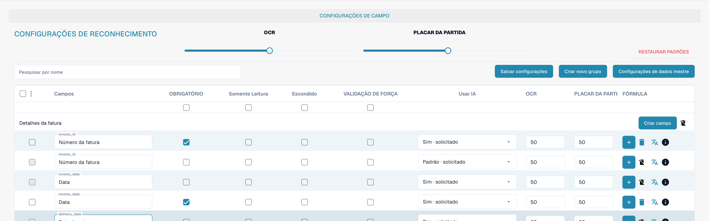
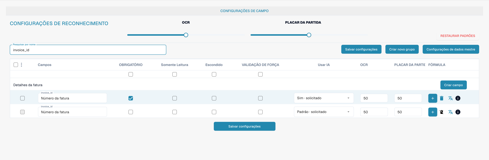

# Validação e limite de correspondência

Obrigatório, validação forçada, OCR e Match Score são propriedades diferentes de um campo. Consulte os campos do tipo de documento para as verificar.

<figure><figcaption>
Colunas separadas para validação forçada, OCR e Match Score. PLACAR DA PARTIDA significa aqui limite de correspondência (Match Score), não um resultado desportivo.
</figcaption></figure>

## Validação forçada

A validação forçada exige uma verificação explícita do campo. Por si só, esta opção não cria uma expressão regular nem uma regra de comparação. Configure as regras de validação personalizadas separadamente.

<figure><figcaption>
Configuração separada da validação e do reconhecimento de cada campo. PLACAR DA PARTIDA significa aqui limite de correspondência (Match Score), não um resultado desportivo.
</figcaption></figure>

## OCR e Match Score

OCR determina o limite de reconhecimento do campo. Match Score é um limite numérico de correspondência. Não é um texto de referência nem uma lista de seleção do valor a comparar.

<figure><figcaption>
Número da fatura filtrado com validação forçada e Match Score. PLACAR DA PARTIDA significa aqui limite de correspondência (Match Score), não um resultado desportivo.
</figcaption></figure>

Verifique o comportamento com documentos representativos antes de guardar as definições. Um campo obrigatório não substitui a validação forçada.
