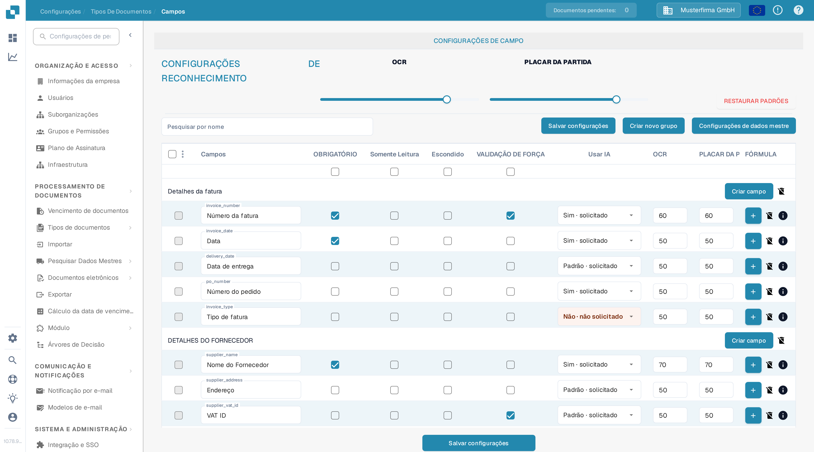
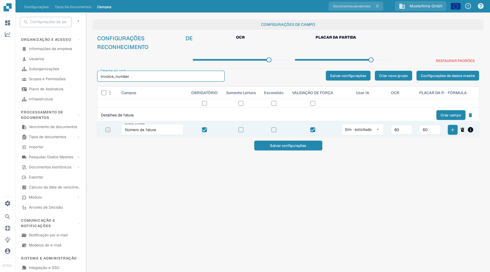

# Definição de Validação e Pontuação de Correspondência

Em **Campos**, você pode definir os limites de validação e de reconhecimento de um tipo de documento. Esta página usa **Fatura** em uma organização de teste da documentação. Ela explica a caixa de seleção **VALIDAÇÃO DE FORÇA** atual e os controles **PLACAR DA PARTIDA**.

## Abrir as configurações dos campos

1. Vá para **Configurações → Tipos de Documentos → Fatura → Campos**.
2. Use **Pesquisar por nome** para localizar um campo, por exemplo `invoice_id` (exibido como **Número da fatura**).
3. Verifique a linha do campo antes de alterar uma configuração. **OBRIGATÓRIO**, **Somente Leitura**, **Escondido** e **VALIDAÇÃO DE FORÇA** são caixas de seleção separadas.

<figure><figcaption>
Os controles de reconhecimento aparecem acima da lista de campos.
</figcaption></figure>

## VALIDAÇÃO DE FORÇA

Selecione **VALIDAÇÃO DE FORÇA** na linha do campo para aplicar uma validação mais rigorosa a esse campo. A caixa de seleção é separada de **OBRIGATÓRIO**: marcar um campo como obrigatório não seleciona VALIDAÇÃO DE FORÇA automaticamente. A caixa de seleção pode ficar indisponível quando um campo está escondido ou é somente leitura. Depois de alterar a configuração do campo, clique em **Salvar configurações**.

As instruções antigas sugeriam inserir aqui limites numéricos ou expressões regulares. A tabela Campos atual não mostra um editor de regras na célula de VALIDAÇÃO DE FORÇA. Para regras específicas de um campo, consulte [Configurando Propriedades de Campo](configuring-field-properties-1.md).

## PLACAR DA PARTIDA

**PLACAR DA PARTIDA** é um limite numérico, não um valor de referência fixo. O controle deslizante **PLACAR DA PARTIDA** em **CONFIGURAÇÕES DE RECONHECIMENTO** aplica o próprio valor às linhas de campos do tipo de documento; use a entrada **PLACAR DA PARTIDA** de uma linha de campo para um valor individual. Na organização de teste, o controle deslizante e `invoice_id` mostram ambos **50**. Revise os campos afetados e, em seguida, clique em **Salvar configurações**.

<figure><figcaption>
Pesquise um campo para verificar sua caixa de VALIDAÇÃO DE FORÇA e o valor de PLACAR DA PARTIDA.
</figcaption></figure>

**OCR** é um limite de reconhecimento separado, ao lado de PLACAR DA PARTIDA. **RESTAURAR PADRÕES** redefine as configurações; use-o apenas quando pretende descartar seus limites personalizados. Para outras opções de campos, consulte a visão geral de [Campos](README.md).
