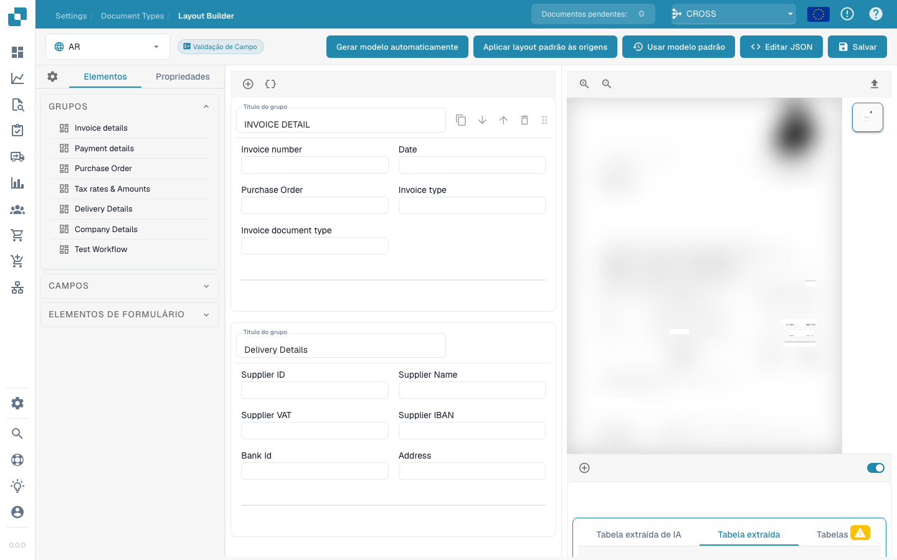

# Gestor de Layouts

<figure><figcaption></figcaption></figure>

#### Visão geral

O Gestor de Layouts permite aos administradores configurar e alterar visualmente o layout dos tipos de documento, definindo as propriedades dos campos e grupos de dados. Esta interface ajuda a alinhar os modelos de extração e os pontos de introdução manual de dados com a estrutura do documento digitalizado ou carregado no DocBits.

#### Componentes principais

1. **Grupos e campos**:
   * **Grupos**: unidades organizativas de um tipo de documento que reúnem campos relacionados, como os dados da fatura ou do pagamento. Podem ser expandidos, recolhidos e ordenados para reproduzir o agrupamento lógico do documento.
   * **Campos**: dados individuais em cada grupo, como o número da fatura ou as condições de pagamento. É possível personalizar a forma como os dados de cada campo são capturados, apresentados e processados.
2. **Painel de propriedades**:
   * Este painel apresenta as propriedades do campo ou grupo selecionado e permite configurar, por exemplo:
     * **Label** (rótulo): texto do campo apresentado na interface.
     * **Field Name** (nome do campo): identificador técnico utilizado pelo sistema.
     * **Element Width in Percentage** (largura do elemento em percentagem): largura do campo em relação ao layout do documento.
     * **Tab Index** (índice de tabulação): ordem de navegação com a tecla Tab.
     * **Run Script on Change** (executar script ao alterar): define se um script é executado quando o valor do campo muda.
     * **Display Label On Left** (apresentar rótulo à esquerda): define se o rótulo aparece à esquerda do campo ou por cima dele.
     * **Is Textarea** (área de texto): define se o campo deve aceitar blocos de texto mais extensos.
     * **Select Model Type** (selecionar tipo de modelo): permite escolher o tipo de modelo que extrai este campo.
     * **Field Length** (comprimento do campo): comprimento máximo dos dados aceites no campo.
     * **Banned Keywords** (palavras proibidas): palavras-chave que não são permitidas no campo.
3. **Pré-visualização do modelo**:
   * Apresenta uma pré-visualização em tempo real do documento com a configuração de layout atual. Permite verificar se o layout corresponde à estrutura do documento e testar e aperfeiçoar a configuração do processamento.



