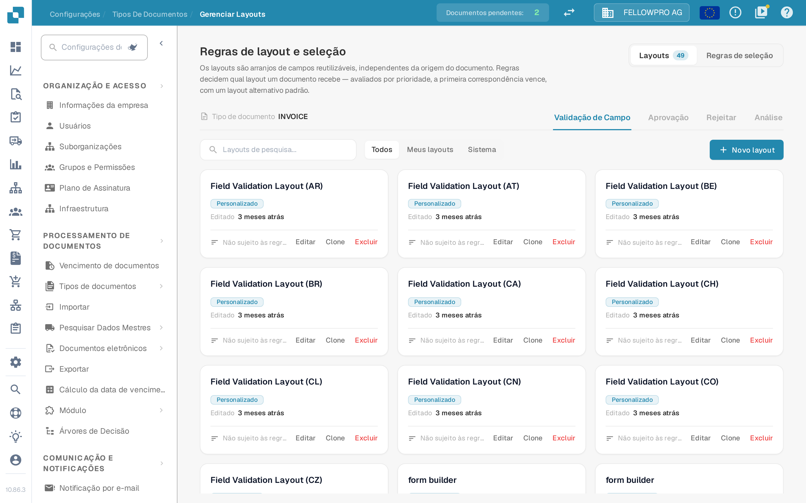

# Gestor de Layouts

<figure><figcaption>O gestor de layouts para o tipo de documento Invoice.</figcaption></figure>

O **gestor de layouts** determina o aspeto de um tipo de documento para quem valida, aprova, rejeita e analisa documentos: que campos e grupos aparecem no ecrã, por que ordem e como se comporta cada campo. Cada tipo de documento tem os seus próprios layouts.

A página abre como **Regras de layout e seleção**: os layouts são arranjos de campos reutilizáveis, independentes da origem do documento, e as regras decidem que layout um documento recebe.

#### Ecrãs e tipos de layout

Validação, aprovação, rejeição e análise são ecrãs distintos, e cada um tem os seus próprios layouts, as suas próprias regras e o seu próprio layout predefinido — uma regra de aprovação nunca altera o ecrã de validação. Mude de ecrã com as abas **Validação de Campo**, **Aprovação**, **Rejeitar** e **Análise**.

#### Cartões de layout

Na aba **Layouts**, cada layout do ecrã selecionado é um cartão. O cartão mostra o nome do layout, se pertence à sua organização (**Personalizado**) ou é o layout predefinido do sistema, quando foi editado pela última vez e se alguma regra de seleção o utiliza. **Editar** abre o layout no Layout Builder, **Clone** copia-o com o nome que escolher e **Excluir** remove-o — o layout predefinido do sistema só pode ser consultado, não alterado nem eliminado. **Novo layout** pede um nome e abre o Layout Builder com o novo layout vazio. O filtro acima dos cartões alterna entre **Todos**, **Meus layouts** e **Sistema**.

#### O Layout Builder

**Editar** abre o [Layout Builder](navigating-the-layout-manager.md):

* **Estrutura**, **Campos** e **Elementos** à esquerda — o layout em forma de árvore, cada campo do tipo de documento com um contador dos campos já colocados, e os grupos e elementos de formulário que arrasta para a área de trabalho.
* A **área de trabalho** ao centro mostra o layout tal como o utilizador o vê. **Layout principal** e **Tabela** alternam entre a página e uma tabela de linhas, e **Documento** abre o documento de exemplo ao lado.
* O painel **Propriedades** à direita acompanha o elemento selecionado; as definições estão agrupadas em apresentação, comportamento, valores e listas, automação, e limites e espaçamento.

**Salvar** no cabeçalho guarda o layout. Para as restantes ações do cabeçalho, consulte [Salvar e aplicar alterações](save-and-apply-changes.md).

#### Que layout um documento recebe

A aba **Regras de seleção** de cada ecrã contém as regras que escolhem o layout: são avaliadas por prioridade, a primeira correspondência vence e aplica-se um layout alternativo padrão quando nenhuma regra corresponde. Consulte [Regras de seleção de layout](layout-selection-rules.md).
