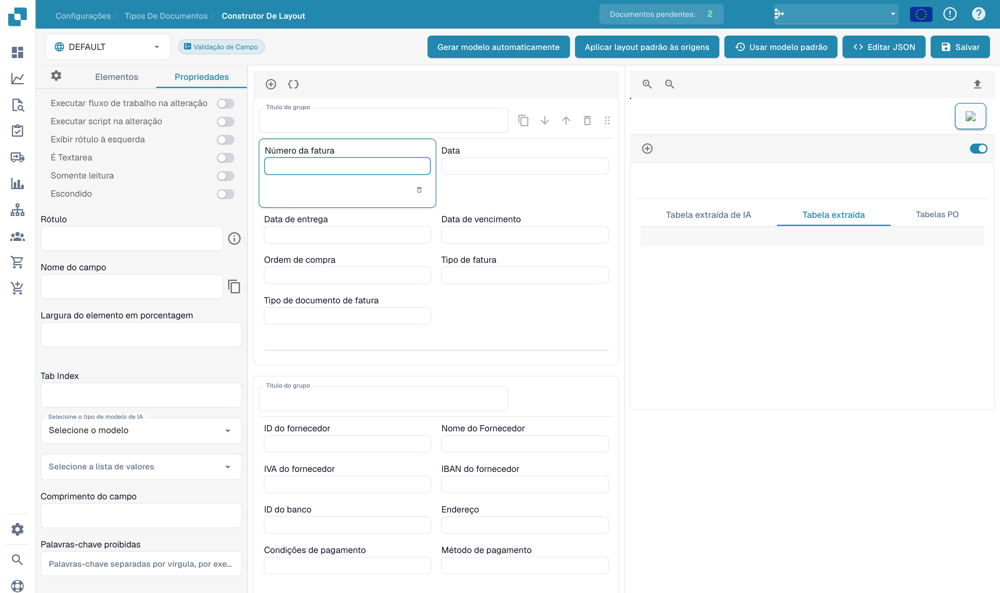

# Configurar propriedades dos campos

Abra um layout existente no construtor e selecione um campo na pré-visualização. O painel de propriedades mostra as opções do elemento selecionado.

<figure><figcaption>
Propriedades de um campo no construtor de layouts.
</figcaption></figure>

Verifique o rótulo, nome técnico, largura percentual e ordem de tabulação. Conforme o elemento, também pode definir apenas leitura, visibilidade, posição do rótulo, texto com várias linhas ou execução de um fluxo ou script quando o valor muda.

Selecione o modelo AI ou a lista de valores adequada, se necessário. O comprimento e as palavras proibidas acrescentam restrições. Os nomes técnicos e os nomes configurados das origens não mudam com o idioma da interface.

Verifique a pré-visualização após cada alteração. Guarde as alterações pretendidas e teste a validação com documentos representativos. As regras de validação e os limites de reconhecimento do tipo de documento são definidos separadamente.
