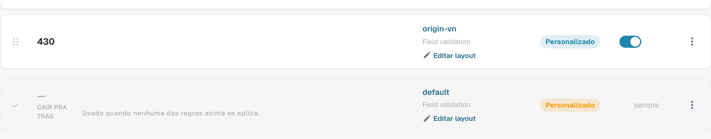
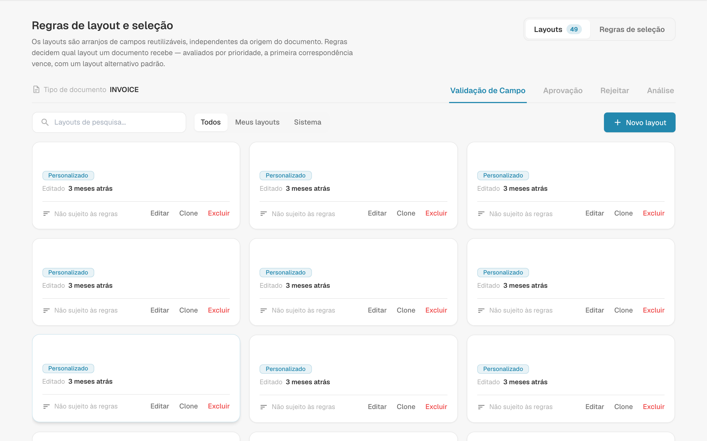
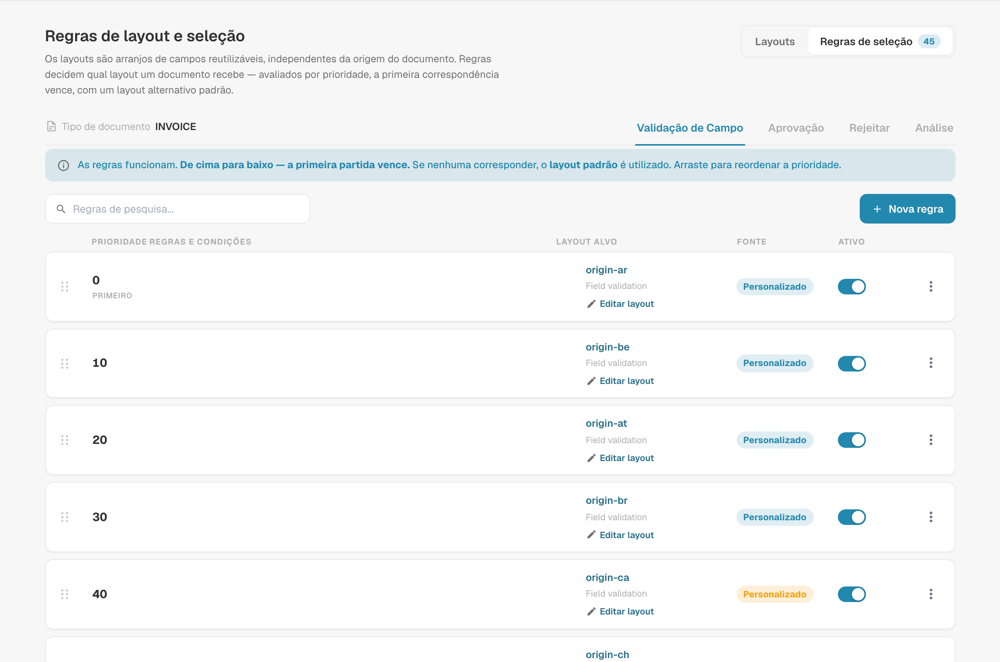
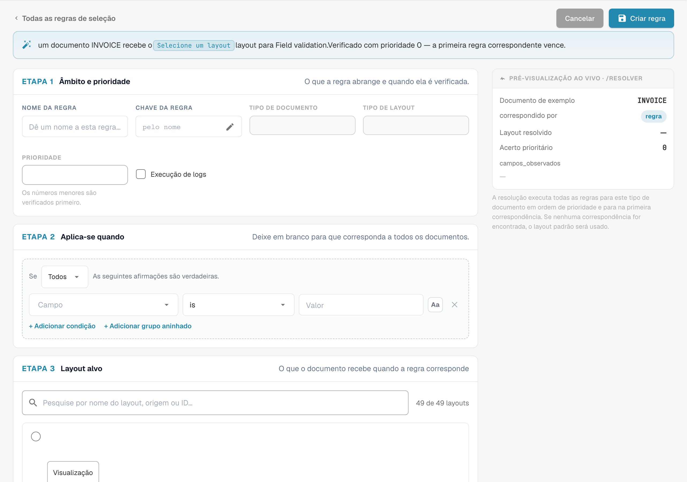
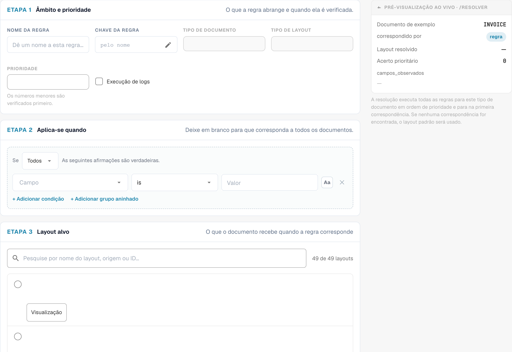

# Regras de Seleção de Layout

## Visão geral

Um **layout** decide quais campos e grupos um usuário vê — e em que ordem — nas telas de **validação**, **aprovação**, **rejeição** e **revisão** de um documento. Você cria os layouts no [Layout Manager](README.md).

Classicamente, o DocBits escolhia o layout pela **origem** do documento: o país ou a região obtidos das configurações de idioma do documento, como `DE` ou `US`. Cada origem tinha sua própria cópia do layout, e nada mais podia influenciar a escolha.

Com as **regras de seleção de layout**, os layouts passam a ser blocos reutilizáveis, independentes da origem, e as **regras** decidem qual layout um documento recebe:

> *Quando* o documento atende a uma condição, *então* ele recebe este layout. As regras são verificadas de cima para baixo; **a primeira regra que corresponder vence**. Se nenhuma regra corresponder, é usado o **layout padrão**.

A origem continua disponível — como uma condição entre muitas. Uma regra também pode considerar o fornecedor, o valor, o status do documento, o método de extração ou qualquer campo do cabeçalho.

### Problemas que elas resolvem

| Requisito | Layouts clássicos baseados na origem | Com regras de seleção |
| --- | --- | --- |
| As faturas de um fornecedor precisam de campos extras (projeto, número aduaneiro) | impossível sem uma nova origem | regra *Supplier ID is 20723* → layout "Invoice with project fields" |
| Os documentos de DE, AT e CH devem ter a mesma aparência | três cópias do mesmo layout para manter | um layout, uma regra por origem (ou um grupo ANY) apontando para ele |
| As faturas eletrônicas precisam de uma tela mais simples do que os PDFs digitalizados | não é possível | regra *Extraction Method is ELECTRONIC_DOCUMENT* → layout "E-invoice" |
| As faturas de alto valor precisam de mais campos na tela de aprovação | não é possível | regra de Approval *Total Amount greater than 10000* → layout "High value approval" |
| O segundo aprovador deve ver uma tela diferente da do primeiro | tipo de layout separado "segunda aprovação" | regra de Approval *Document Status is Pending second approval* → layout "Second approval" |

## Ativar os layouts baseados em regras

Os layouts baseados em regras são ativados **por tipo de documento** por um **administrador da organização**.

1. Acesse **Definições → Definições gerais → Tipos de documento**.
2. Clique no ícone de **configurações** (engrenagem) no card do tipo de documento.
3. Abra **Gerenciar layouts** e ative o interruptor.

<figure><figcaption>
O interruptor Manage Layouts nas configurações adicionais de um tipo de documento
</figcaption></figure>

O link **Layouts** no card do tipo de documento agora abre **Regras de layout e seleção**.

### O que acontece quando você o ativa

O DocBits converte seus layouts existentes baseados em origem em regras — uma única vez, para este tipo de documento e para cada tela:

* O layout da origem **DEFAULT** passa a ser o **layout padrão** (o fallback).
* Cada layout de uma origem específica passa a ser uma regra **"Layout for XX"**, com a condição *Document Origin is XX*, apontando para esse layout. Essas regras recebem prioridades em intervalos de 10 (por exemplo 2000, 2010, 2020 …), para que você possa posicionar suas próprias regras antes, entre ou depois delas.

<figure><figcaption>
Layout de recurso no final da lista de regras de seleção. O tipo de layout Field validation permanece em inglês e refere-se à validação de campos. CAIR PRA TRÁS identifica o layout de recurso usado quando nenhuma regra corresponde.
</figcaption></figure>

Nada é excluído nem alterado nos próprios layouts. Logo após a ativação, portanto, cada documento recebe exatamente o layout que recebia antes. O comportamento só muda quando você adiciona ou altera regras.

**Desativá-lo** faz o tipo de documento voltar imediatamente à seleção baseada em origem. As regras são mantidas, mas não são usadas, e voltam a valer quando você reativa o interruptor.

## A tela Layouts & Selection Rules

<figure><figcaption>
Resumo dos layouts e das regras de seleção. O tipo de layout Field validation permanece em inglês e refere-se à validação de campos.
</figcaption></figure>

* **Layouts / Selection rules** (canto superior direito) alternam entre a lista de layouts e a lista de regras. Os números mostram quantos existem.
* **Field Validation / Approval / Reject / Review** alternam a **tela**. Cada tela tem seus próprios layouts, suas próprias regras e seu próprio layout padrão — uma regra de Approval nunca altera a tela de validação.
* Na aba **Layouts** você pode criar, editar, clonar e excluir layouts. Cada card mostra se uma regra usa o layout ("Not targeted by rules" quando nenhuma o usa). Filtre com **All / My layouts / System**; os layouts de sistema vêm com o DocBits e podem ser visualizados e clonados, mas não alterados.


A primeira e a segunda aprovação compartilham os layouts e as regras de **Aprovação**. Para dar à segunda etapa de aprovação uma tela própria, adicione uma regra de Approval com a condição *Document Status is Pending second approval* — veja o [exemplo](#telas-diferentes-para-a-primeira-e-a-segunda-aprovacao).


## Como um layout é escolhido

Cada vez que um documento é aberto, e novamente depois que é salvo, o DocBits decide o layout para a tela atual:

1. As **regras ativas** da tela são verificadas em ordem de **prioridade** (o menor número primeiro). **A primeira regra cuja condição for verdadeira vence**, e seu layout é usado.
2. Se nenhuma regra corresponder, é usado o **layout padrão**.
3. Se também não houver um layout padrão, o DocBits volta à escolha clássica baseada em origem.

As regras cujo layout foi excluído ou está vazio são ignoradas.

### Um exemplo prático

Regras da tela **Validação de Campo**:

| Prioridade | Regra | Condição | Layout |
| --- | --- | --- | --- |
| 5 | Example Supplier invoices | *Supplier ID is HP0000278* | Invoice with project fields |
| 10 | E-invoices | *Extraction Method is ELECTRONIC_DOCUMENT* | E-invoice |
| 2020 | Layout for DE | *Document Origin is DE* | Field Validation Layout (DE) |
| — | Layout padrão | — | Field Validation Layout (Base) |

Qual layout cada documento recebe:

| Documento | Fornecedor | Extração | Origem | Layout | Porque |
| --- | --- | --- | --- | --- | --- |
| 1 | HP0000278 | fatura eletrônica | DE | Invoice with project fields | a prioridade 5 corresponde primeiro; as regras seguintes não são verificadas |
| 2 | 10040 | fatura eletrônica | DE | E-invoice | a prioridade 5 não corresponde, a 10 sim |
| 3 | 10040 | PDF digitalizado | DE | Field Validation Layout (DE) | apenas a regra de origem corresponde |
| 4 | 10040 | PDF digitalizado | US | Field Validation Layout (Base) | nenhuma regra corresponde → padrão |

**A ordem importa**: coloque as regras específicas (um fornecedor) acima das regras gerais (um país).

### Quando um usuário altera um campo que as regras consideram

O layout é sempre escolhido a partir dos valores **atuais** do documento. Se um usuário corrigir, por exemplo, o fornecedor na tela de validação, o DocBits escolhe o layout novamente após o salvamento, e a tela pode passar para outro layout. Nenhum dado é perdido: um campo que não faz parte do novo layout mantém seu valor; ele apenas não é exibido até que volte a ser aplicado um layout que o contenha.

## Gerenciar as regras de seleção

<figure><figcaption>
Regras de seleção com nomes configurados ocultos. O tipo de layout Field validation permanece em inglês e refere-se à validação de campos.
</figcaption></figure>

Cada linha mostra a **prioridade** (a primeira linha é marcada como **FIRST**), o **nome e a chave da regra** com suas **condições**, o **layout de destino**, o selo de **origem** e um interruptor **Ativo**.

| Tarefa | Como |
| --- | --- |
| Criar uma regra | **Nova regra** |
| Editar uma regra | Clique na linha |
| Alterar a ordem | Arraste a alça à esquerda de uma linha para cima ou para baixo. A nova ordem é salva imediatamente. |
| Desativar uma regra | Interruptor **Ativo**. As regras inativas são ignoradas. |
| Duplicar ou excluir | Menu **⋮** da linha |
| Encontrar uma regra | **Search rules…** |

O selo de **origem** indica de onde vem uma regra: as regras **Sistema** vêm com o DocBits. Editar uma delas cria uma cópia para a sua organização, exibida como **Personalizado**; o original permanece intacto e pode ser restaurado. As regras que você cria são **Personalizado**.

### O layout padrão

A última linha, marcada como **FALLBACK** e **is_default**, é o layout padrão: ele é usado sempre que nenhuma regra acima corresponde e não tem condição. É criado quando você ativa o recurso (a partir do layout da origem DEFAULT).


Para usar outro layout de fallback, crie uma regra **sem nenhuma condição** e atribua-lhe o maior número de prioridade, para que seja verificada por último. Ela corresponde a todos os documentos que nenhuma regra anterior atendeu, antes de se chegar ao padrão.


## Criar uma regra

Clique em **Nova regra** na aba Selection rules da tela que você quer alterar.

<figure><figcaption>
Âmbito, condições e layout de destino de uma regra de seleção. O tipo de layout Field validation permanece em inglês e refere-se à validação de campos.
</figcaption></figure>

A frase no topo resume a regra à medida que você a constrói — "When header.supplier_id = HP0000278, an INVOICE document gets the Field Validation Layout (Base) layout for Field validation. Checked at priority 5 — the first matching rule wins."

### Etapa 1 — Escopo e prioridade

| Configuração | O que faz |
| --- | --- |
| **Nome da regra** | Exibido na lista de regras. Descreva o caso de negócio: "Example Supplier invoices", "E-invoices", "High value approval". |
| **Chave da regra** | Gerada a partir do nome; permanece a mesma quando você renomeia a regra. |
| **Tipo de documento** / **Tipo de layout** | O tipo de documento e a tela para os quais a regra vale. Obtidos do local onde você clicou em **Nova regra**. |
| **Prioridade** | Os números menores são verificados primeiro. Deixe intervalos (5, 10, 20 …) para poder inserir regras depois. |

### Etapa 2 — Applies when

A condição que um documento deve atender. Você pode usar:

* **atributos do documento**: Document Origin, Extraction Method, Document Status, Sub Document Type,
* **campos do cabeçalho**: Supplier ID, Total Amount, Currency, Purchase Order e todos os demais campos do tipo de documento,
* um **caminho JSON personalizado** (Advanced).

As colunas de tabela não estão disponíveis: o layout é escolhido uma única vez para o documento inteiro.

Deixe a etapa vazia para corresponder a todos os documentos nessa prioridade. Como as condições funcionam — ALL / ANY, grupos aninhados, todos os operadores, valores vazios, maiúsculas/minúsculas — é explicado em [Condições da regra (Applies when)](../rule-conditions-applies-when.md).

### Etapa 3 — Layout de destino

Clique no layout que o documento deve receber. A lista mostra seus próprios layouts e os layouts de sistema da tela selecionada. Um layout não pode ser excluído enquanto uma regra ainda apontar para ele.

### Live preview · /resolve

O painel à direita mostra o que a regra faz com um documento de exemplo que tem os valores das suas condições:

| Linha | Significado |
| --- | --- |
| **Documento de exemplo** | Os valores usados na pré-visualização, obtidos das suas condições |
| **matched_by** | `rule` se uma regra correspondeu; caso contrário, o padrão |
| **Layout resolvido** | O layout que o documento de exemplo receberia |
| **Prioridade da regra correspondente** | A prioridade da regra que correspondeu |
| **watched_fields** | Os campos dos quais a escolha do layout depende. Quando um usuário altera um deles, o layout é escolhido novamente. |

Clique em **Criar regra** (ou **Regra de salvar**, ao editar) para salvar. **Cancelar** volta à lista de regras.

## Exemplos

### Campos extras para um fornecedor

Tela **Validação de Campo** · prioridade **5** · *Supplier ID is HP0000278* · destino *Invoice with project fields* (um clone do seu layout padrão com os campos adicionais de projeto e centro de custo).

### Um layout para vários países

Tela **Validação de Campo** · prioridade **100** · **Qualquer uma das condições**: *Document Origin is Deutsch*, *Document Origin is Austria*, *Document Origin is Switzerland* · destino *DACH invoice*. Desative as regras migradas "Layout for AT" e "Layout for CH" se elas apontarem para cópias mais antigas.

### Uma tela mais simples para faturas eletrônicas

Tela **Validação de Campo** · prioridade **10** · *Extraction Method is ELECTRONIC_DOCUMENT* · destino *E-invoice* (sem campos relacionados ao OCR).

### Uma tela de aprovação mais rigorosa para valores altos

Tela **Aprovação** · prioridade **10** · *Total Amount greater than 10000* · destino *High value approval* (exibindo centro de custo, responsável pelo orçamento e número do contrato).

### Telas diferentes para a primeira e a segunda aprovação

Tela **Aprovação** · prioridade **5** · *Document Status is Pending second approval* · destino *Second Approval Layout*. Os documentos na primeira etapa de aprovação não correspondem e recebem o layout padrão de Approval.

<figure><figcaption>
Rascunho de regra de seleção de layout sem guardar. O tipo de layout Field validation permanece em inglês e refere-se à validação de campos.
</figcaption></figure>

### Uma tela de rejeição especial para alguns fornecedores

Tela **Rejeitar** · prioridade **10** · *Supplier ID is one of* `10040, 10041` · destino *Reject with reason codes*.

## Boas práticas

* **O específico antes do geral.** Regras de fornecedor acima das regras de país, regras de país acima do padrão.
* **Deixe intervalos de prioridade** (5, 10, 20 …) para que novas regras caibam sem renumeração.
* **Baseie as condições em campos confiáveis.** Fornecedor e origem são definidos cedo e raramente mudam. Condições sobre campos que os usuários editam com frequência fazem a tela trocar de layout enquanto eles trabalham.
* **Clone, não comece do zero.** Clone seu layout padrão e ajuste-o, para que todos os layouts mantenham a mesma estrutura básica.
* **Verifique a pré-visualização em tempo real** e abra um documento real de cada tipo após alterar as regras.
* **Mantenha um padrão útil** para cada tela, para que nenhum documento fique sem layout.

## Solução de problemas

| Sintoma | O que verificar |
| --- | --- |
| Um documento recebe o layout errado | Uma regra anterior corresponde primeiro. Veja as regras acima dela, ou o **Prioridade da regra correspondente** na pré-visualização. |
| O padrão é usado embora uma regra devesse corresponder | A regra está **Ativo**? A condição corresponde ao valor exato (maiúsculas/minúsculas, espaços)? A regra está na aba de **tela** correta? |
| O layout muda enquanto um usuário trabalha | Um campo em **watched_fields** foi alterado. Baseie a regra em um campo mais estável. |
| Um layout não pode ser excluído | Uma regra ainda aponta para ele. Redirecione ou exclua essa regra primeiro. |
| Nenhum layout é exibido | Nenhuma regra correspondeu, não há padrão e não existe layout baseado em origem para esta tela. Adicione uma regra sem condição como coringa. |
| Nada mudou após a ativação | Esperado: a ativação reproduz a escolha anterior baseada em origem. Adicione suas próprias regras. |
| A segunda aprovação mostra o layout da primeira aprovação | Adicione uma regra de Approval com *Document Status is Pending second approval* acima das outras regras de Approval. |

## Relacionados

* [Condições da regra (Applies when)](../rule-conditions-applies-when.md)
* [Regras de Validação Personalizadas](../custom-validation-rules.md)
* [Regras de Transformação](../transformation-rules.md)
* [Navegando no Layout Manager](navigating-the-layout-manager.md)
