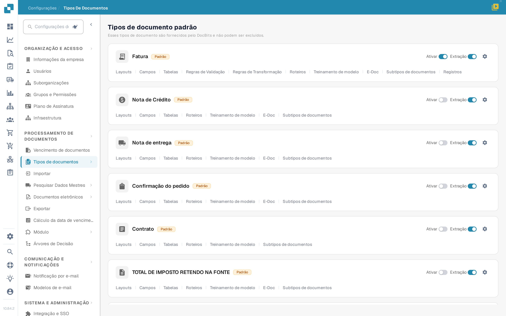
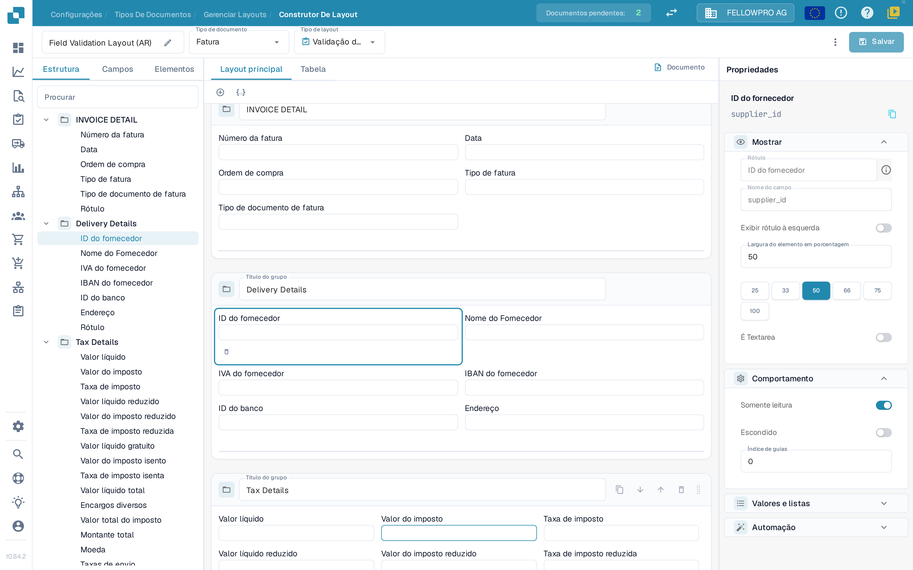
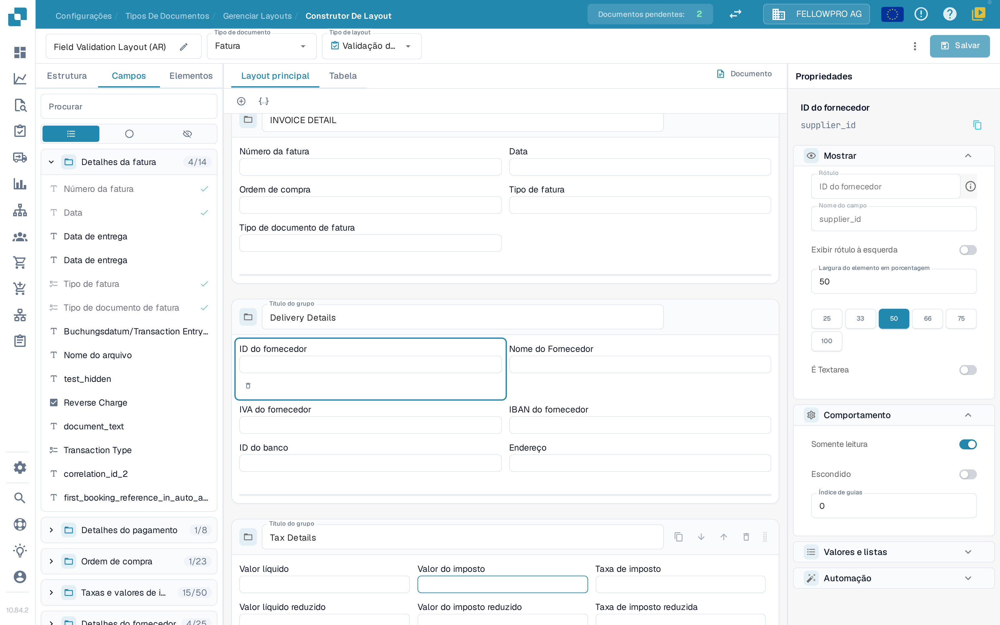
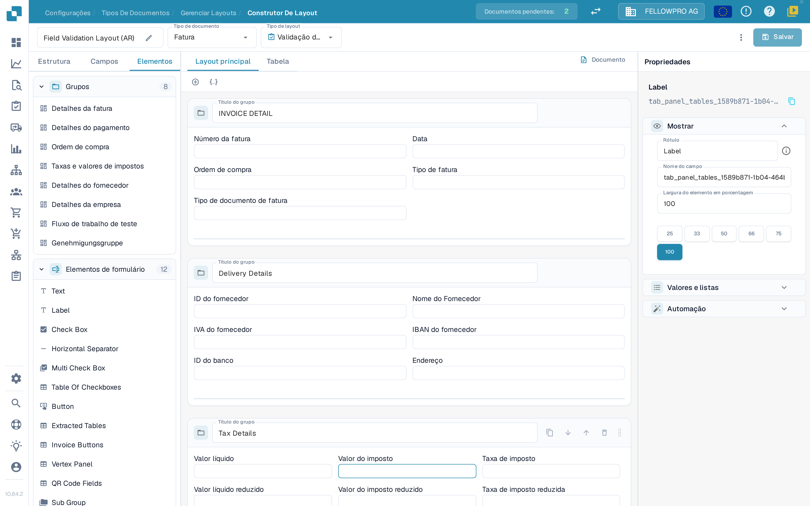

# Navegando no Construtor de Layout

Use o **Construtor de Layout** para organizar os grupos e os campos que as pessoas veem num documento. Este guia usa o layout de Fatura numa organização de teste, e as capturas de ecrã mostram a interface em português.

## Abrir o layout de Fatura

1. Acesse **Configurações → Tipos de documentos**.
2. Encontre a Fatura e selecione **Layouts** no cartão dela. O Construtor de Layout abre para esse tipo de documento.
3. A barra superior mostra o nome do layout (editável com o lápis), o **Tipo de documento** e o **Tipo de layout**. Use **Tipo de layout** para mudar para outro layout do mesmo tipo de documento.

<figure><figcaption>
Abra <strong>Layouts</strong> no cartão da Fatura.
</figcaption></figure>

## Trabalhar com os três separadores do painel

O painel à esquerda tem três separadores: **Estrutura**, **Campos** e **Elementos**. O Construtor de Layout abre em **Campos**.

**Estrutura** mostra o layout em árvore, na mesma ordem em que os grupos e os campos aparecem no documento. Expanda um grupo pela seta para ver os campos que ele contém; o nome técnico do campo aparece no painel **Propriedades**. A caixa **Procurar** filtra a árvore, e selecionar uma linha seleciona o mesmo elemento no canvas.

<figure><figcaption>
A árvore de Estrutura, o canvas e o painel Propriedades.
</figcaption></figure>

**Campos** lista todos os campos que o tipo de documento oferece, organizados pelos seus grupos. O contador ao lado do nome de um grupo indica quantos dos seus campos já estão colocados, por exemplo **4/14**. Os três botões por baixo da caixa de pesquisa são apenas ícones e alternam entre todos os campos, apenas os campos ainda não utilizados e apenas os campos ocultos. Cada linha mostra o rótulo do campo; um visto verde à direita assinala os campos que já estão no layout, que aparecem a cinzento.

<figure><figcaption>
Filtre os campos e identifique os já colocados pelo visto.
</figcaption></figure>

**Elementos** contém os blocos que arrasta para o canvas: **Grupos**, com os grupos deste layout, e **Elementos de formulário**, com Text, Label, Check Box, Horizontal Separator, Multi Check Box, Table Of Checkboxes, Button, Extracted Tables, Invoice Buttons, Vertex Panel, QR Code Fields e Sub Group. Os nomes destes elementos aparecem em inglês na interface em português.

<figure><figcaption>
As paletas Grupos e Elementos de formulário.
</figcaption></figure>

## Colocar e organizar elementos

- Arraste um campo de **Campos**, ou um elemento de **Elementos**, para o grupo onde deve aparecer. Os campos já colocados ficam assinalados com um visto no separador **Campos**.
- Arraste um campo dentro de um grupo ou entre grupos para alterar a ordem.
- O **+** acima do canvas adiciona um grupo vazio; o ícone de JSON ao lado cria um grupo a partir de uma definição em JSON.
- No cabeçalho de um grupo pode mudar o nome do grupo em **Título do grupo**, copiar o JSON dele, mover o grupo para baixo ou para cima, ou eliminá-lo. Use a alça de arrastar à direita do cabeçalho para deslocar o grupo.
- Selecione um campo no canvas para abrir as propriedades dele à direita. A pequena barra de ferramentas que aparece por baixo do campo selecionado remove-o do layout.

## O painel Propriedades

O painel à direita está sempre aberto e acompanha o elemento que selecionou. As configurações dele estão organizadas em **Mostrar**, **Comportamento**, **Valores e listas** e **Automação**. **Mostrar** contém o rótulo, o tipo de campo e a **Largura do elemento em porcentagem**, que escolhe entre os valores predefinidos 25, 33, 50, 66, 75 e 100. Veja [Configurando Propriedades de Campos](configuring-field-properties.md) para cada uma das opções.

As configurações de validação, OCR e correspondência pertencem ao próprio campo e não ao layout: configure-as nas [Configurações de Campos](../fields/configuring-field-properties-1.md) separadas.

## Pré-visualizar e salvar

O canvas mostra o layout tal como ficará no documento. Use os separadores **Layout principal** e **Tabela** para alternar entre a página e a tabela de itens, e **Documento** para abrir o documento de exemplo ao lado do canvas. Veja [Usando a Pré-visualização do Modelo](using-the-template-preview.md).

Selecione **Salvar** na barra superior quando terminar. Veja [Salvar e Aplicar Alterações](save-and-apply-changes.md) para as outras ações da barra superior, incluindo a geração de modelos, os modelos padrão e a aplicação de um layout às origens.
