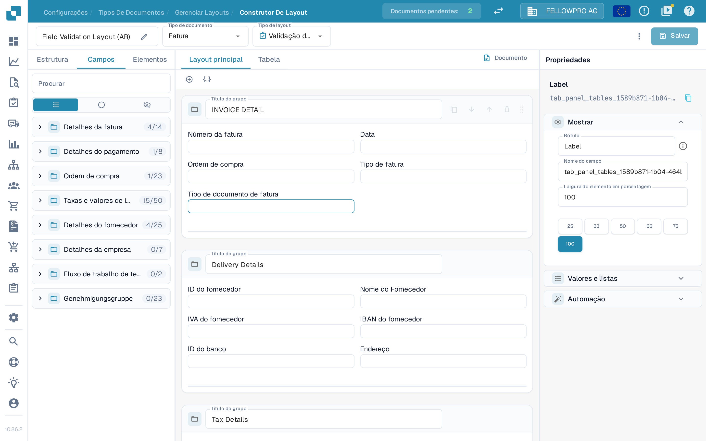
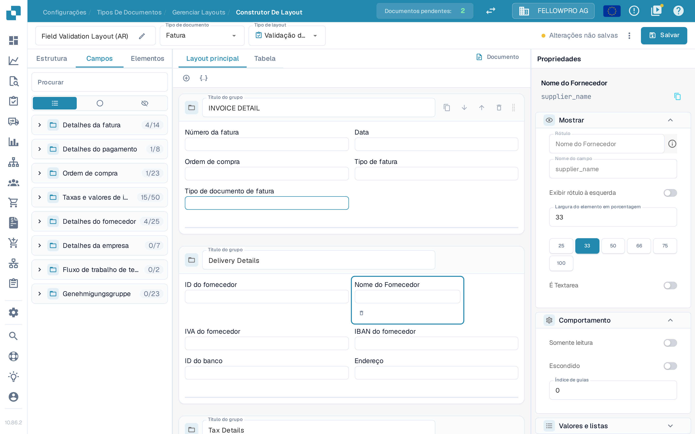
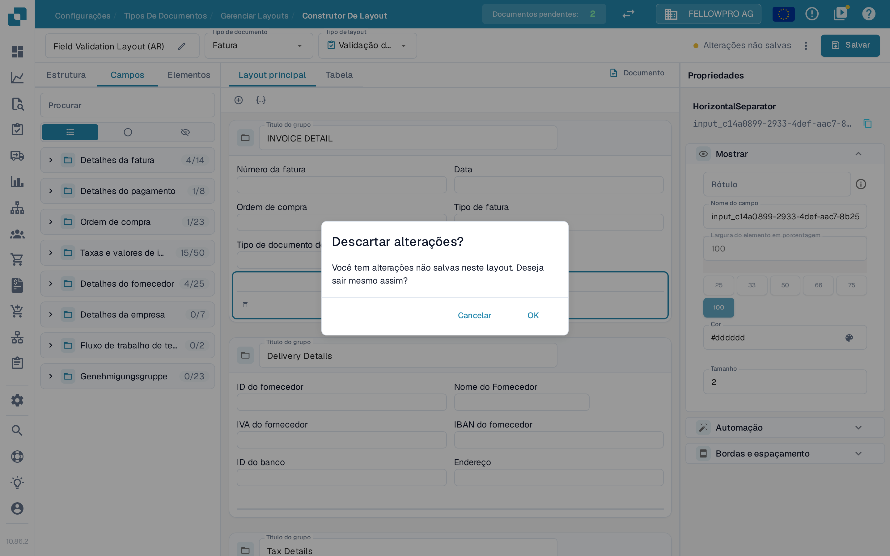
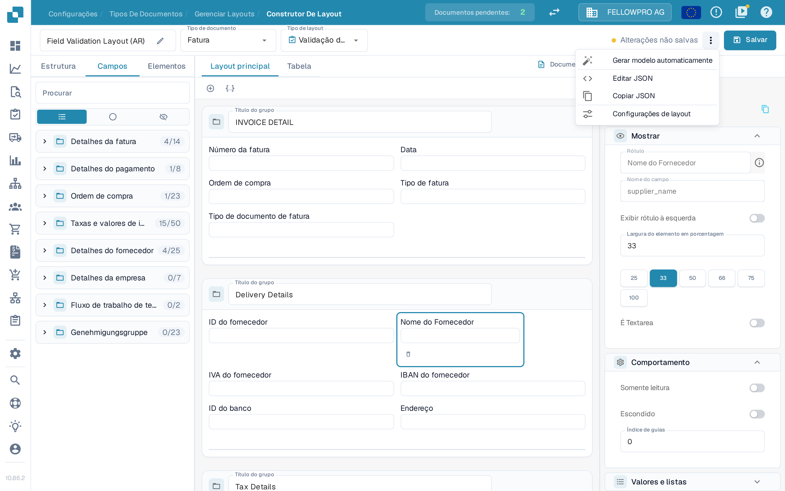

# Salvar e aplicar alterações

As alterações feitas no Layout Builder só entram em vigor depois de salvas. Ao salvar, o layout fica associado ao tipo de documento, para que os novos documentos o utilizem.

## Salvar as alterações

Depois de editar o layout, selecione **Salvar** no canto superior direito do cabeçalho.

<figure><figcaption>O botão **Salvar** fica no canto superior direito do Layout Builder.</figcaption></figure>

Enquanto você trabalha, o cabeçalho mostra o estado das suas alterações:

- Um botão **Salvar** sem mensagem ao lado significa que o layout não foi alterado.
- **Alterações não salvas** aparece assim que você modifica o layout. Selecione **Salvar** para guardar as alterações.

<figure><figcaption>A indicação **Alterações não salvas** aparece enquanto o layout ainda não foi salvo.</figcaption></figure>

Após salvar com êxito, a indicação é substituída pela hora em que o layout foi salvo pela última vez. Selecionar **Salvar** novamente não traz riscos: se nada mudou desde o último salvamento, nada é gravado.

Se você sair do Layout Builder com alterações não salvas, o DocBits pergunta **Descartar alterações?**. Selecione **Cancelar** para permanecer e salvar, ou **OK** para sair sem salvar.

<figure><figcaption>Confirmação exibida ao sair com alterações não salvas.</figcaption></figure>

## Outras ações do cabeçalho

O menu de três pontos ao lado de **Salvar** reúne as demais ações de layout:

- **Gerar modelo automaticamente** – cria um layout automaticamente a partir dos campos do tipo de documento.
- **Editar JSON** – edita a definição do layout diretamente em JSON.
- **Copiar JSON** – copia a definição do layout para a área de transferência.
- **Configurações de layout** – abre as configurações gerais do layout.

**Gerar modelo automaticamente** substitui o layout existente, portanto verifique antes qual layout está aberto. **Editar JSON** destina-se a usuários avançados e deve ser usado apenas se você conhecer o formato do modelo.

<figure><figcaption>As ações disponíveis no menu de três pontos.</figcaption></figure>

## Aplicar as alterações

Depois de salvo, o layout é usado pelo fluxo de trabalho de processamento de documentos para esse tipo de documento:

- Os novos documentos processados com este tipo de documento usam o layout atualizado.
- Os documentos já processados mantêm o layout com o qual foram capturados.

## Testar as alterações

Depois de salvar, abra um documento desse tipo de documento e verifique se os campos e os grupos aparecem como esperado. Se algo estiver faltando, volte ao Layout Builder, ajuste o layout e salve novamente.
