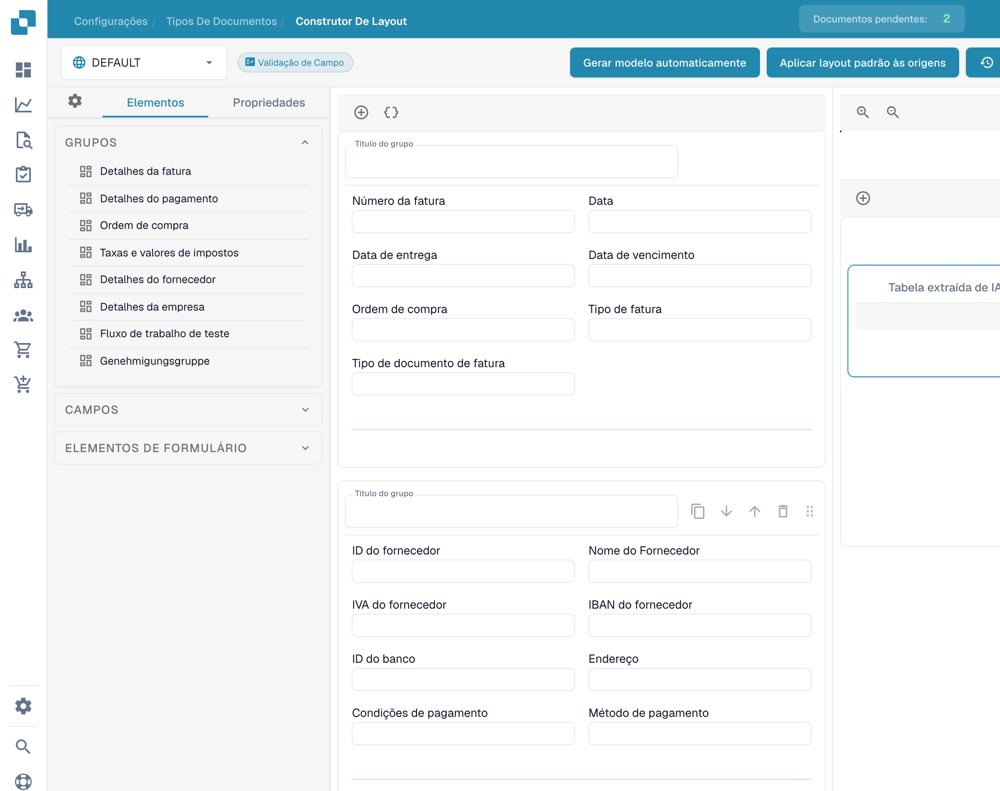

# Utilizar a pré-visualização do modelo

A pré-visualização do construtor mostra a disposição dos grupos, campos e tabelas de um layout existente.

<figure><figcaption>
Pré-visualização de um modelo no construtor de layouts.
</figcaption></figure>

Abra o tipo de documento e o layout adequados. Consulte os elementos disponíveis e selecione um campo para verificar rótulos, larguras e visibilidade.

A seleção de origem permite consultar o contexto configurado. Os nomes das origens permanecem inalterados. A pré-visualização não comprova um novo layout guardado nem a sua aplicação a outras origens.

Guarde as alterações pretendidas e verifique a vista do documento resultante.
