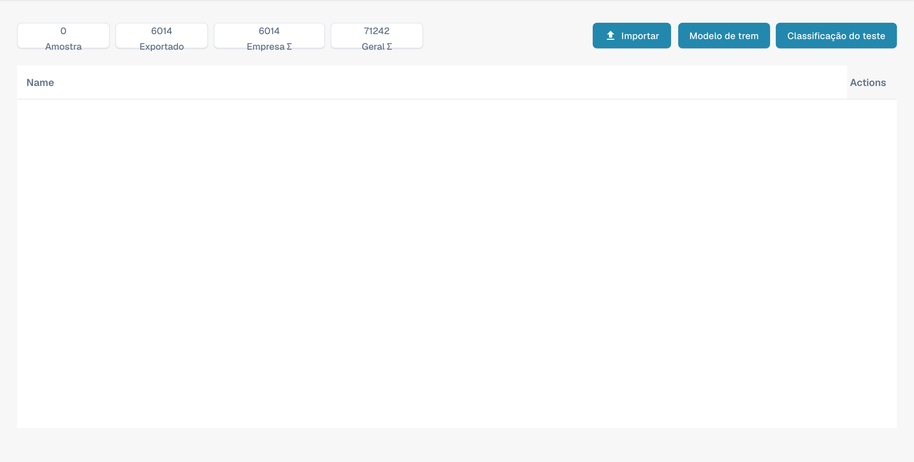

# Treino de modelos

Esta vista permite gerir exemplos e verificar a classificação por tipo de documento. Não é o editor de campos de extração.

<figure><figcaption>
Resumo do treino de modelos em português. Modelo de trem refere-se ao treino do modelo, não a um comboio.
</figcaption></figure>

## Contadores e ações

Na parte superior aparecem exemplos, documentos exportados e contadores da organização e globais. Considere este âmbito ao interpretá-los.

* A importação adiciona exemplos de treino.
* A ação de treino inicia o treino do modelo de classificação.
* O teste de classificação verifica a classificação de novos documentos.

Esta vista não cria campos; utilize as definições dos campos do tipo de documento. As imagens não comprovam a execução de treino nem de teste de classificação. Alguns rótulos do produto podem permanecer em inglês ou estar incorretamente traduzidos.
