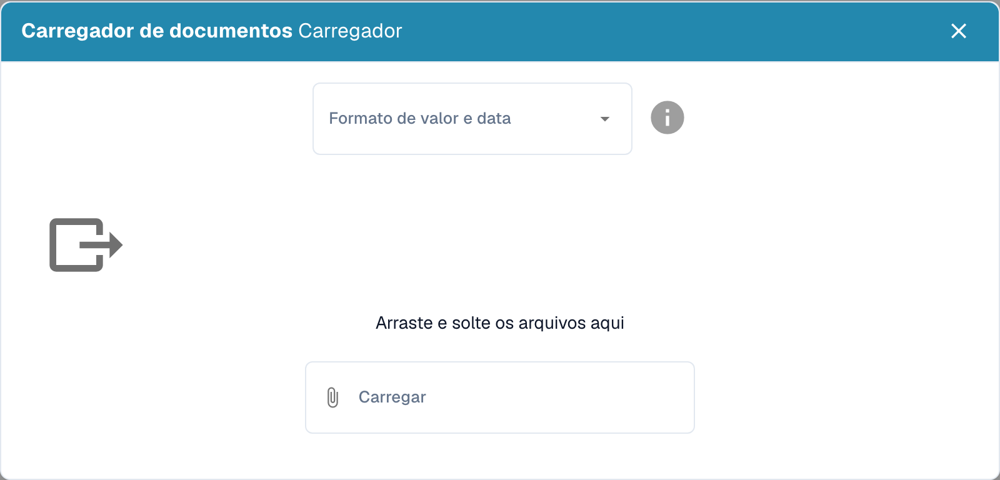

# Importar Dados: Treinamento do Modelo

Prepare documentos representativos dos formatos, idiomas e tipos que a organização precisa de processar. Use apenas os formatos de ficheiro aceites pela sua instalação. Evite duplicados e separe os documentos de treino dos documentos reservados para avaliação.

## Abrir a importação

Nas configurações do tipo de documento pretendido, abra o treino do modelo e escolha a função de importação.

<figure><figcaption>
Importação, treino do modelo e teste de classificação. Na versão ilustrada, a ação de teste apresenta a designação confusa Classificação do teste. Não foi iniciado nenhum treino ou teste.
</figcaption></figure>

## Escolher o formato e os ficheiros

Selecione os formatos de números e datas correspondentes aos ficheiros e escolha os documentos a importar. Por exemplo, `1.234,56` e `1,234.56` usam separadores diferentes. Uma data como `05/06/2026` também deve ser interpretada segundo o formato selecionado.

<figure><figcaption>
Importação de documentos com seleção do formato dos montantes e das datas; nenhum ficheiro foi enviado.
</figcaption></figure>

Verifique a seleção antes de iniciar a importação. Aguarde o fim do processamento e verifique os erros e o tipo de documento atribuído. Corrija as classificações e extrações incorretas antes de utilizar os exemplos no treino.

## Treinar e avaliar

Treine o modelo de acordo com as funções e permissões da sua versão. Depois, avalie o resultado numa amostra separada. Adicionar documentos não garante, por si só, maior exatidão. Consulte [Testar o modelo](testing-the-model.md).
