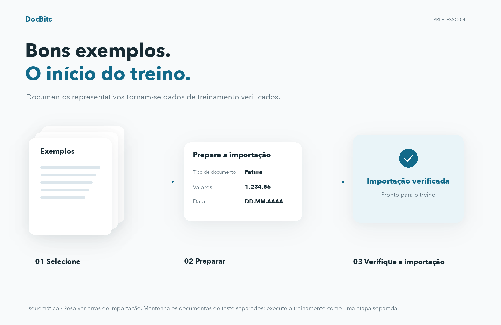
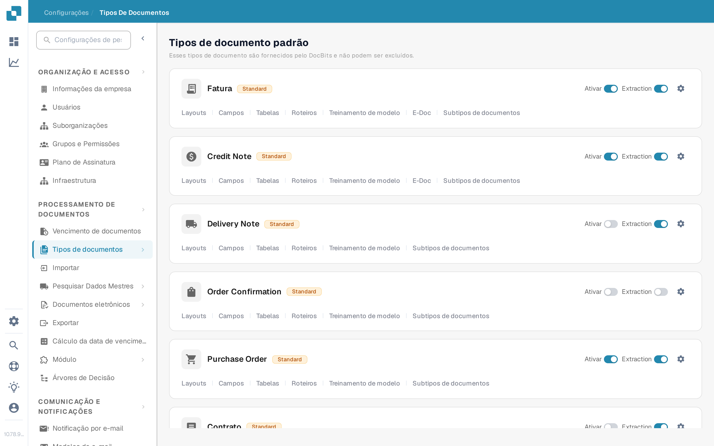
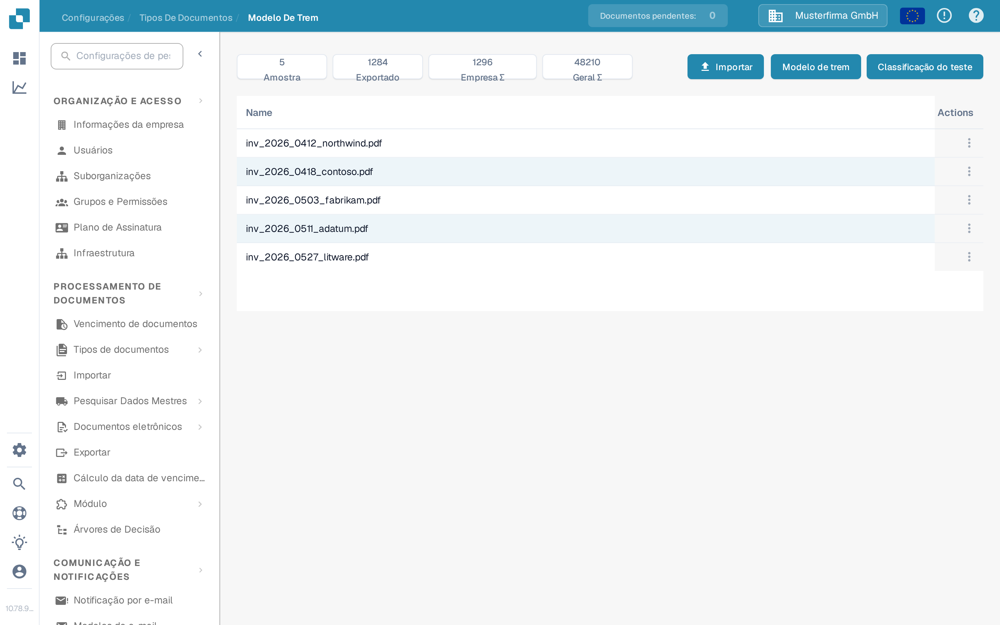
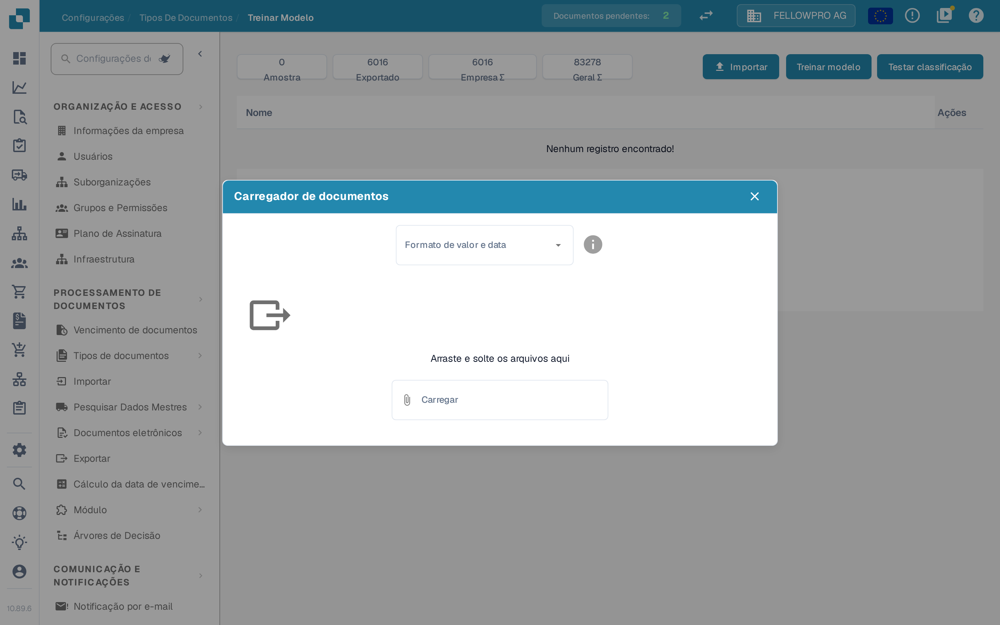
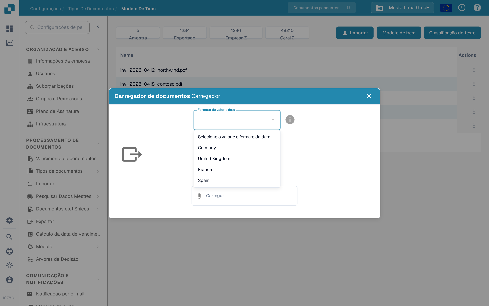
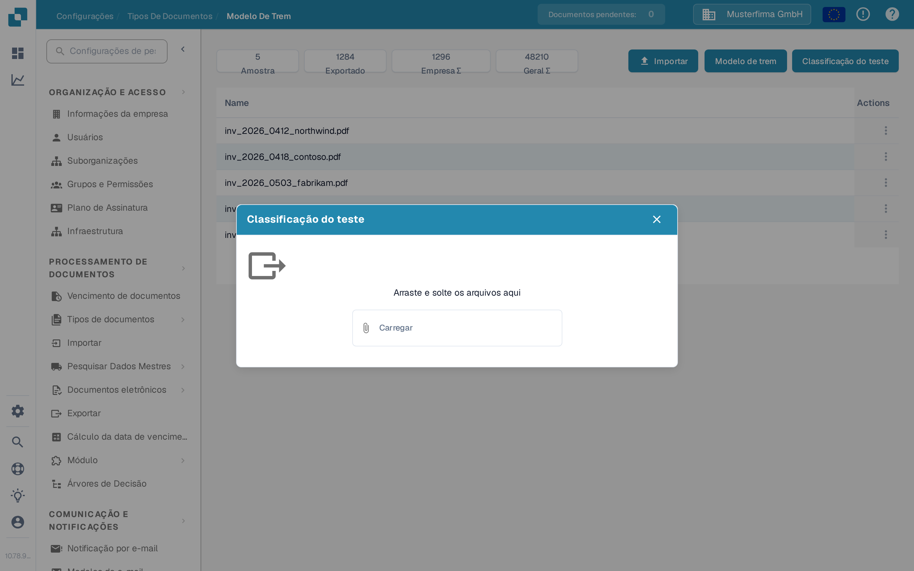

# Importar documentos de exemplo para o treinamento do modelo

## Preparar, importar e verificar documentos de amostra

<figure><figcaption>
Preparar, importar e verificar documentos de amostra
</figcaption></figure>

Escolha documentos de amostra representativos, prepare as opções de importação disponíveis e verifique o status da importação. Somente amostras importadas com sucesso estão prontas para treinamento subsequente. Resolva erros de importação antes da próxima etapa e mantenha os documentos de teste independentes separados do conjunto de dados de treinamento.

Use esta página para adicionar PDFs de exemplo a um tipo de documento e, em seguida, treinar ou testar seu modelo de classificação. Você precisa de acesso a **Configurações** e **Tipos de Documentos**. Para a finalidade das funções de treinamento, consulte [Propósito e uso: Treinamento do Modelo](purpose-and-use-model-training.md).

## Abrir o tipo de documento

1. Vá para **Configurações → Tipos de Documentos**.
2. Encontre o tipo de documento que deseja treinar. Em sua linha, selecione **Treinamento de modelo**. O exemplo abaixo usa **Fatura**.

<figure><figcaption>
Abra o Treinamento de modelo a partir do tipo de documento escolhido.
</figcaption></figure>

Os outros controles deste cartão servem para outras finalidades: **Ativar** habilita o tipo de documento, **Extraction** alterna o modo de extração, a engrenagem abre suas configurações, e os demais links abrem outras áreas de configuração. Você não precisa alterá-los apenas para abrir o Treinamento de modelo.

A página **Modelo De Trem** mostra a contagem de amostras e a lista de documentos de treinamento enviados. Na organização de exemplo, a lista contém documentos; sua organização pode exibir outros documentos e contagens.

<figure><figcaption>
As três ações ficam no canto superior direito da lista de treinamento.
</figcaption></figure>

## Importar PDFs de exemplo

1. Selecione **Importar**.
2. Escolha o **Formato de valor e data** que corresponde ao documento de exemplo. Por exemplo, escolha **Germany** para as convenções alemãs de números e datas. Esta seleção informa ao DocBits como interpretar os valores no documento enviado; ela não altera o idioma do aplicativo.
3. Arraste os arquivos PDF para a caixa de diálogo ou use **Carregar** para selecioná-los. O importador atual de documentos de exemplo aceita **arquivos PDF**; ele rejeita outros tipos de arquivo. Selecionar os arquivos inicia o envio.
4. Feche a caixa de diálogo e verifique se os documentos aparecem na lista de treinamento. Se o DocBits relatar um erro de envio ou um documento já existente, corrija o arquivo ou escolha outro exemplo antes de continuar.

<figure><figcaption>
Escolha um formato antes de selecionar os PDFs de exemplo.
</figcaption></figure>

<figure><figcaption>
Escolha o formato usado no documento, não o seu idioma de interface preferido.
</figcaption></figure>

Para ações sobre as amostras importadas, consulte [Gerenciar dados de treinamento](manage-training-data.md).

## Treinar e verificar o modelo

Quando os PDFs de exemplo desejados estiverem na lista, selecione **Modelo de trem**. O DocBits pode processar o treinamento em segundo plano; aguarde a mensagem de conclusão antes de considerar o novo modelo pronto. A contagem de amostras e qualquer limite de plano exibidos nesta página pertencem à sua organização.

Para verificar a classificação, selecione **Classificação do teste** e, em seguida, envie um arquivo de exemplo separado na caixa de diálogo. Após o processamento, o DocBits mostra se o tipo de documento previsto corresponde a esta página e relata os detalhes da classificação. A caixa de diálogo de teste vazia abaixo é mostrada sem enviar um arquivo.

<figure><figcaption>
Use a Classificação do teste para verificar o modelo com outro documento.
</figcaption></figure>

Para interpretar o resultado, consulte [Testando o modelo](testing-the-model.md). Se o resultado for ruim, revise os [dados de treinamento](manage-training-data.md) e o [guia de solução de problemas](troubleshooting.md) antes de adicionar mais amostras.
