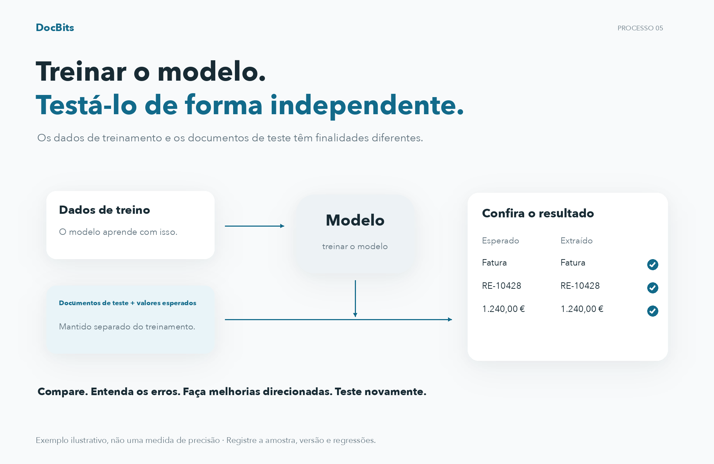
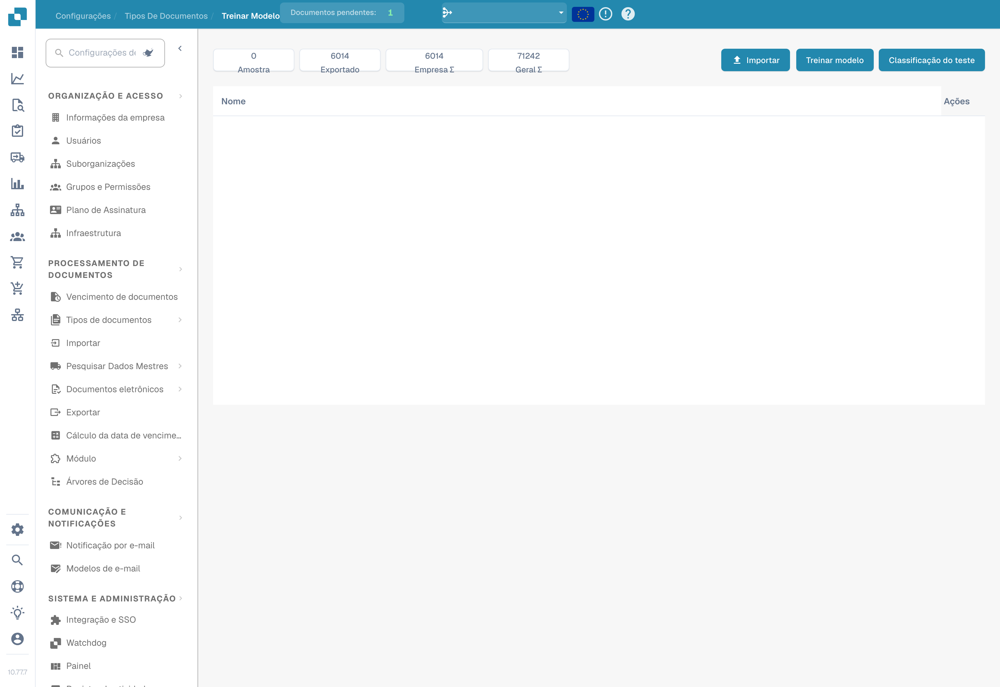

# Testando o modelo

## Avalie com documentos de teste independentes

<figure><figcaption>
Avalie com documentos de teste independentes
</figcaption></figure>

Os dados de treinamento e os documentos de teste têm finalidades diferentes. Para documentos de teste independentes, defina os tipos de documentos e valores de campo esperados e compare-os com as previsões. Registre a versão do modelo, amostra, discrepâncias e falhas técnicas. Faça melhorias direcionadas e repita o teste com o mesmo protocolo de avaliação. Os valores mostrados são um exemplo e não uma medida de precisão.

O teste deve avaliar os resultados em documentos representativos que não tenham sido usados no treino. Prepare as respostas esperadas para cada documento: o tipo e, para avaliar a extração, os valores dos campos.

## Executar o teste

1. Abra o treino do modelo para o tipo de documento a avaliar.
2. Escolha o teste de classificação, quando essa função estiver disponível na sua versão.
3. Selecione a amostra e inicie a avaliação com as opções disponíveis.
4. Aguarde a conclusão e registe os resultados e os erros. Uma falha técnica ou um teste incompleto não equivale a uma classificação correta.

<figure><figcaption>
Importação, treino do modelo e teste de classificação. Na versão ilustrada, a ação de teste apresenta a designação confusa Classificação do teste. Não foi iniciado nenhum treino ou teste.
</figcaption></figure>

## Interpretar os resultados

Compare as previsões com as respostas esperadas e analise os erros por tipo e formato. Se calcular exatidão, precisão, sensibilidade ou pontuação F1, indique também o tamanho da amostra e as categorias avaliadas. Não atribua ao produto métricas que a sua versão não apresenta. Pode calculá-las separadamente a partir dos resultados exportados ou registados.

As regras de classificação e extração são configurações distintas do treino. Verifique o seu efeito quando intervêm no processamento. Não altere uma regra apenas para ocultar um erro na amostra de teste.

## Corrigir e repetir

Corrija os dados de treino, as etiquetas ou as configurações efetivamente disponíveis na sua instalação e volte a treinar o modelo, se necessário. Repita o teste com o mesmo protocolo e mantenha uma amostra independente. Documente a versão, os dados, os resultados e as regressões. Um bom resultado na amostra não garante o mesmo desempenho em todos os documentos futuros.
