# Altre impostazioni

## Visão Geral

**Mais configurações** reúne as opções que pertencem a um tipo de documento, por exemplo a Fatura. Uma configuração que você ativa aqui se aplica somente a esse tipo de documento. A página é composta por cartões recolhíveis, um por tema. Abra um cartão para ver as configurações dele.

<figure>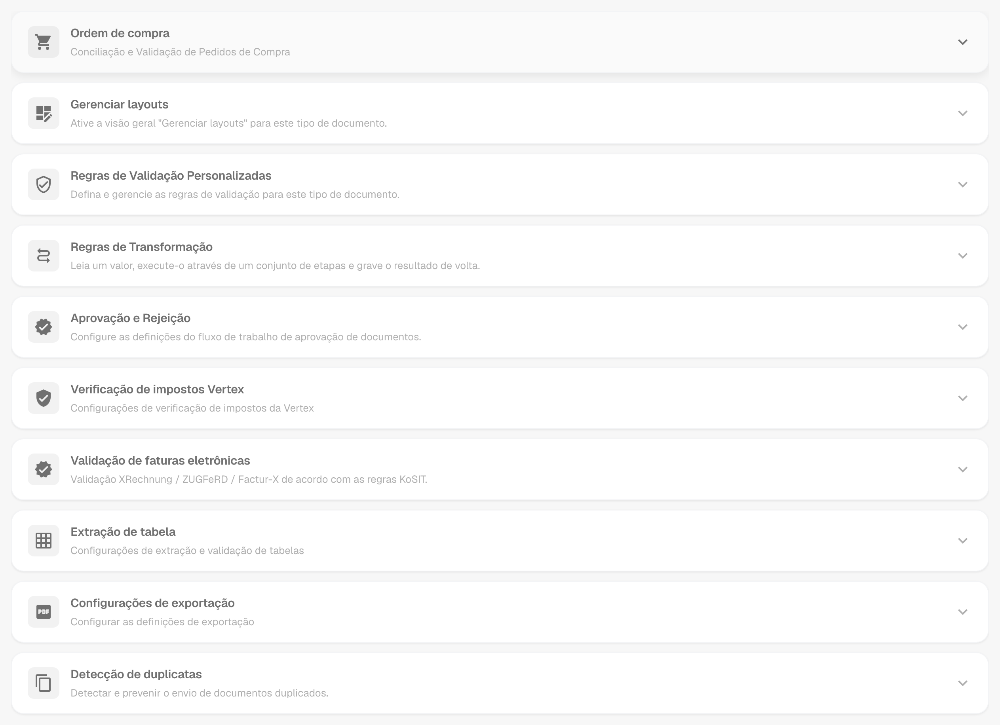<figcaption>
Os cartões da página Mais configurações, todos recolhidos.
</figcaption></figure>

## Como Acessar

1. Navegue até **Configurações** → **Configurações globais** → **Tipos de documentos**.
2. Selecione o tipo de documento e clique em **Mais configurações**.

O caminho de navegação no topo da página mostra **Configurações / Tipos de documentos / Mais configurações**. O Assistente de Configurações, à direita da página, explica as configurações do cartão aberto.

| Cartão                                                       | O que você define ali                                                                         |
| ------------------------------------------------------------ | --------------------------------------------------------------------------------------------- |
| Ordem de compra                                              | Correspondência de PO, tolerâncias, exportação de linhas de PO, números de item do fornecedor |
| Gerenciar layouts                                            | Interruptor para a visão geral do Gerenciar layouts                                           |
| Regras de Validação Personalizadas                           | Suas próprias regras de validação para este tipo de documento                                 |
| Regras de Transformação                                      | Regras que leem um valor, alteram-no em etapas e o gravam de volta                            |
| Aprovação e Rejeição                                         | Fluxo de aprovação e os formulários em revisão e de rejeição                                  |
| [Verificação de impostos Vertex](vertex-tax-verification.md) | Desenhar o formulário da verificação de impostos Vertex                                       |
| Validação de faturas eletrônicas                             | Validação de faturas XRechnung, ZUGFeRD e Factur-X                                            |
| Extração de tabela                                           | Ignorar a validação de tabelas extraídas                                                      |
| Configurações de exportação                                  | Exportação múltipla, formato PDF, exportação alternativa                                      |
| Detecção de duplicatas                                       | Detectar e bloquear documentos duplicados                                                     |

## Ordem de compra

O cartão **Ordem de compra** (**Conciliação e Validação de Pedidos de Compra**) controla como os documentos deste tipo são correspondidos aos pedidos de compra.

<figure>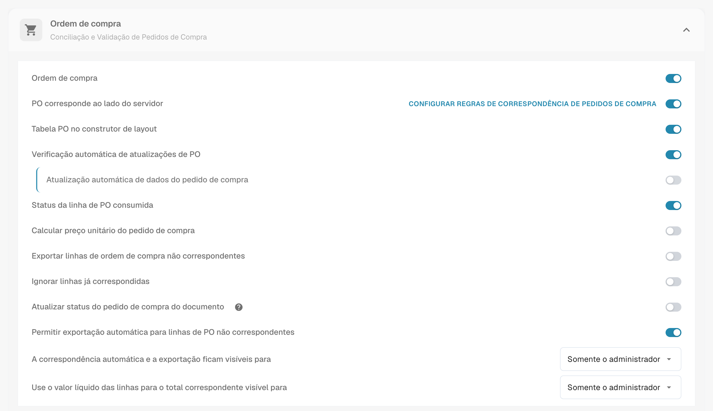<figcaption>
O cartão Ordem de compra com suas opções.
</figcaption></figure>

* [**Ordem de compra**](purchase-order/purchase-order.md): Alterna se o documento é processado na tela de Correspondência de Ordem de Compra. Você também pode especificar em qual quantidade a correspondência se baseia.
* [**PO corresponde ao lado do servidor**](purchase-order/purchase-order-matching-rules.md): Faz a correspondência com o conjunto de regras configurável. **Configurar regras de correspondência de pedidos de compra** abre a [página de regras](purchase-order/purchase-order-matching-rules.md).
* [**Tabela PO no construtor de layout**](purchase-order/po-table-in-layout-builder.md): Permite a inclusão de tabelas de ordem de compra no construtor de layout para layouts de documentos personalizados.
* [**Verificação automática de atualizações de PO**](purchase-order/auto-check-for-po-updates.md): Mostra um indicador visual na tela de Correspondência de Ordem de Compra quando um pedido de compra foi atualizado, solicitando que os usuários atualizem.
* **Atualização automática de dados do pedido de compra**: Atualiza os dados do PO automaticamente quando novos dados estão disponíveis. Este interruptor pertence a **Verificação automática de atualizações de PO**.
* [**Status da linha de PO consumida**](purchase-order/consumed-po-line-status.md): Aplica codificação de cores às linhas do pedido de compra na tela de correspondência.
* [**Calcular preço unitário do pedido de compra**](purchase-order/calculate-po-unit-price.md): Calcula o preço unitário do PO usando o valor líquido e a quantidade, em vez de extraí-lo.
* [**Exportar linhas de ordem de compra não correspondentes**](purchase-order/export-not-matched-po-lines.md): Quando desativado, somente as linhas correspondidas são exportadas. Quando ativado, todas as linhas do pedido de compra são exportadas, mesmo que não estejam correspondidas.
* **Ignorar linhas já correspondidas**: Pula as linhas que já foram correspondidas durante um novo processo de correspondência.
* [**Atualizar status do pedido de compra do documento**](purchase-order/update-document-purchase-order-status.md): Atualiza a coluna Status do PO no painel sempre que o status do pedido de compra muda.
* [**Permitir exportação automática para linhas de PO não correspondentes**, **A correspondência automática e a exportação ficam visíveis para** e **Use o valor líquido das linhas para o total correspondente visível para**](purchase-order/auto-match-and-export-options.md): Definem quem vê os atalhos de Auto Match & Export e quais documentos podem ser exportados automaticamente.

### Veja as regras de correspondência como um diagrama

As regras de correspondência de PO são mais do que uma lista. O DocBits pode desenhar o conjunto de regras ativo como um fluxograma. Você vê em que ordem as regras são tentadas e onde a correspondência termina.

1. No cartão **Ordem de compra**, ative **PO corresponde ao lado do servidor** e clique em **Configurar regras de correspondência de pedidos de compra**.
2. Clique em **Conjunto de regras como um diagrama** no topo da página. O diagrama abre em um painel ao lado das regras.

<figure>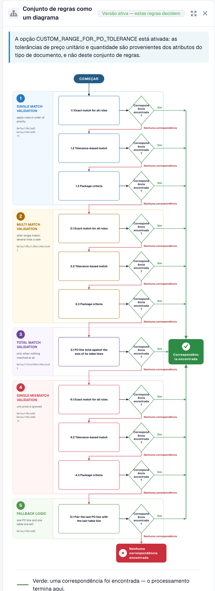<figcaption>
O conjunto de regras como um diagrama. Cinco estágios, de cima para baixo.
</figcaption></figure>

Leia o gráfico de cima para baixo. O DocBits tenta os estágios nesta ordem: **Single match validation**, **Multi match validation**, **Total match validation**, **Single mismatch validation** e **Fallback logic**. Cada estágio tenta até três passagens: **Exact match for all rules**, **Tolerance-based match** e **Package criteria**. Uma seta verde significa que uma correspondência foi encontrada e o processamento termina. Uma seta vermelha significa que não houve correspondência, e o DocBits continua com o próximo passo. No final, o resultado é **Correspondência encontrada** ou **Nenhuma correspondência encontrada**.

Sob o gráfico, o painel lista **Regras por prioridade, por etapa**. Para cada regra você vê as colunas que ela compara, a tolerância e as opções **Correspondência automática**, **Combinação manual** e **Cair pra trás**.

<figure>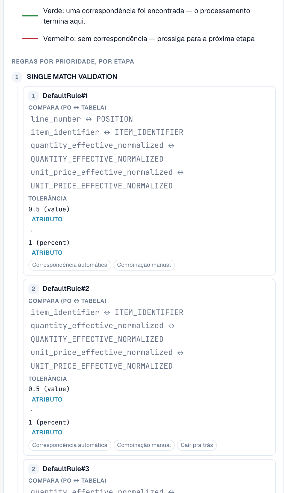<figcaption>
Sob o gráfico: as regras de cada estágio com as colunas que elas comparam.
</figcaption></figure>

**Exemplo.** Uma linha da fatura tem o número de item 4711, quantidade 10 e preço unitário 10,40. A linha do pedido de compra tem o número de item 4711, quantidade 10 e preço unitário 10,00. A tolerância para o preço unitário é de 5 %.

* A passagem **1.1 Exact match for all rules** falha, porque 10,40 não é 10,00. A seta vermelha leva à próxima passagem.
* A passagem **1.2 Tolerance-based match** tem êxito. A diferença é de 4 %, o que está dentro de 5 %. A seta verde leva a **Correspondência encontrada**, e o processamento termina.

No diagrama, este é o caminho 1.1, depois 1.2, depois **Correspondência encontrada**. Para o caminho que um único documento percorreu, veja [Touchless Intelligence: diagnóstico de PO Matching](../../../../analytics-dashboard/touchless-intelligence/touchless-po-matching-diagnosis.md). Para todos os detalhes da página de regras, veja [Regras de Correspondência de Pedido de Compra](purchase-order/purchase-order-matching-rules.md).

### Configuração de tolerância PO

<figure>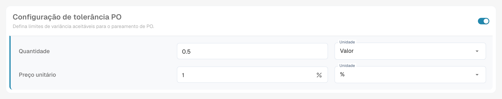<figcaption>
Tolerância para quantidade e preço unitário.
</figcaption></figure>

A [**Configuração de tolerância PO**](purchase-order/purchase-order-tolerance-settings-additional-purchase-order-tolerance.md) permite definir níveis de tolerância para quantidade e preço unitário, para que pequenas discrepâncias não sejam marcadas como incompatibilidades. Para cada valor, você escolhe a quantidade e a unidade: um **Valor** absoluto ou uma percentagem (**%**). O bloco também contém a [**Configuração de tolerância PO adicional**](purchase-order/purchase-order-tolerance-settings-additional-purchase-order-tolerance.md#configuracao-para-configurar-configuracoes-adicionais-de-tolerancia-de-pedido-de-compra) para frete, encargos e impostos, e os [**Status de desativação de PO**](purchase-order/purchase-order-disable-statuses.md).


Quando o atributo do tipo de documento `CUSTOM_RANGE_FOR_PO_TOLERANCE` está ativado, as tolerâncias de preço unitário e de quantidade vêm destas configurações do tipo de documento e não do conjunto de regras. O diagrama de regras na [página de regras de correspondência de PO](purchase-order/purchase-order-matching-rules.md) mostra uma nota quando este é o caso.


### Mapa de Números de Itens do Fornecedor

<figure>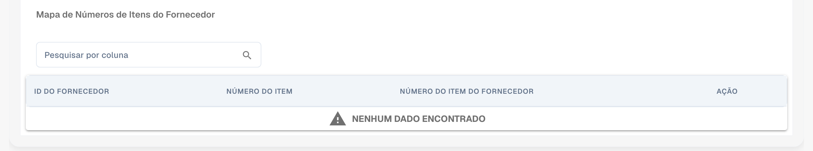<figcaption>
O Mapa de Números de Itens do Fornecedor.
</figcaption></figure>

O [**Mapa de Números de Itens do Fornecedor**](purchase-order/supplier-item-number-map-admin-documentation.md) mapeia os números de item do fornecedor para os seus números de item internos, para que as linhas sejam correspondidas mesmo quando o fornecedor usa números próprios. Pesquise por coluna para encontrar uma entrada.

## Gerenciar layouts, Regras de Validação Personalizadas e Regras de Transformação

Três cartões ficam logo abaixo do cartão Ordem de compra:

* **Gerenciar layouts** ativa a visão geral do Gerenciar layouts para este tipo de documento. Veja o [Layout Manager](../layout-manager/).
* **Regras de Validação Personalizadas** ativa suas próprias regras de validação. **Gerenciar regras de validação** as abre. Veja [Regras de Validação Personalizadas](../custom-validation-rules.md).
* **Regras de Transformação** ativa as regras de transformação. **Gerenciar regras de transformação** as abre. Veja [Regras de Transformação](../transformation-rules.md).

<figure>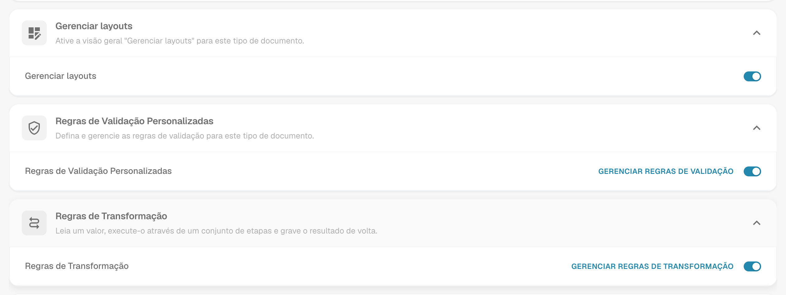<figcaption>
Os três cartões com seus interruptores.
</figcaption></figure>

## Aprovação e Rejeição

O cartão **Aprovação e Rejeição** contém o fluxo de aprovação e os formulários que os usuários veem ao revisar ou rejeitar um documento.

<figure>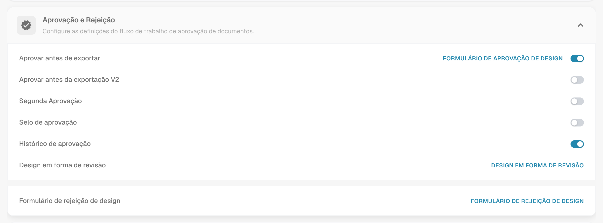<figcaption>
O cartão Aprovação &#x26; Rejeição.
</figcaption></figure>

* **Aprovar antes de exportar**: Os documentos precisam ser aprovados antes de poderem ser exportados. **Formulário de Aprovação de Design** abre o **Construtor de layout** para a tela de aprovação.
* **Aprovar antes da exportação V2**: Ativa a Aprovação V2, que suporta campos dinâmicos no lugar de campos estáticos.
* **Segunda Aprovação**: Adiciona uma camada adicional de aprovação.
* [**Selo de aprovação**](approval/approval-stamp.md): Adiciona um selo ao documento quando ele é aprovado.
* [**Histórico de aprovação**](approval/approval-history.md): Mostra o histórico de aprovação na tela de aprovação e na validação de campos.
* **Design em forma de revisão**: Configura o layout do formulário de revisão com o **Construtor de layout**.
* **Formulário de rejeição de design**: Configura o layout do formulário de rejeição com o **Construtor de layout**.

Para o **Construtor de layout**, veja o [Layout Manager](../layout-manager/).

## Verificação de impostos Vertex

O cartão **Verificação de impostos Vertex** contém **Verificação de impostos do Design Vertex**. Ele abre o Construtor de layout para o formulário que os usuários veem quando o DocBits compara o imposto do fornecedor com o imposto calculado pela Vertex. Veja [Verificação de impostos Vertex](vertex-tax-verification.md) para a integração, a tolerância e o resultado.

## Validação de faturas eletrônicas

O cartão **Validação de faturas eletrônicas** ativa a validação das faturas eletrônicas recebidas e permite decidir se o fornecedor é notificado quando uma fatura é rejeitada. Veja [Validação de faturas eletrônicas](../../../document-processing/e-documents/validation-rules/).

## Extração de tabela

<figure>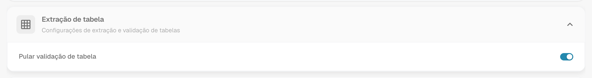<figcaption>
O cartão Extração de tabela.
</figcaption></figure>

* **Pular validação de tabela**: Ignora a validação padrão dos dados de tabela. Use-a quando for necessário um manuseio flexível dos dados ou quando certas etapas de validação puderem ser puladas para melhorar o desempenho.

## Configurações de exportação

<figure>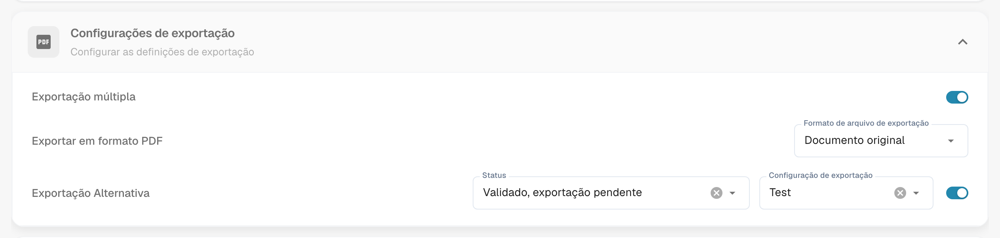<figcaption>
O cartão Configurações de exportação.
</figcaption></figure>

* **Exportação múltipla**: Permite que um documento seja exportado mais de uma vez.
* **Exportar em formato PDF**: **Formato de arquivo de exportação** define o formato PDF usado quando os documentos são exportados, por exemplo **Documento original**.
* [**Exportação Alternativa**](purchase-order/alternate-export.md): Configura uma exportação alternativa para um status de documento escolhido. Escolha o **Status** e a **Configuração de exportação** que é executada para ele e, em seguida, ative a configuração.

## Detecção de duplicatas

<figure>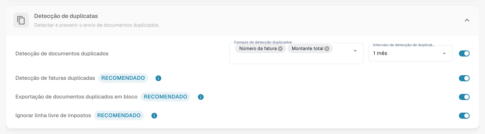<figcaption>
O cartão Detecção de duplicatas.
</figcaption></figure>

O cartão contém **Detecção de documentos duplicados** com os campos que decidem o que conta como duplicata e o intervalo em que os documentos são comparados, além das opções **Detecção de faturas duplicadas**, **Exportação de documentos duplicados em bloco** e **Ignorar linha livre de impostos**. As três têm um rótulo **Recomendado**. Veja [Detecção de duplicatas](duplicate-document-handling.md) para saber como um documento sinalizado é tratado.
