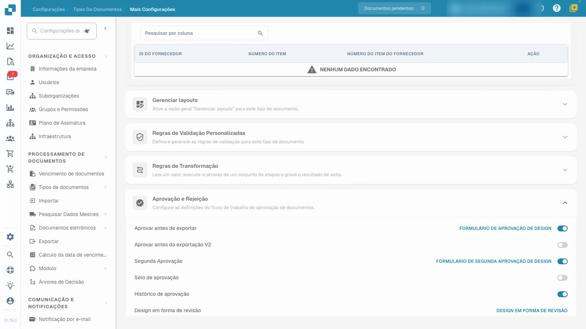
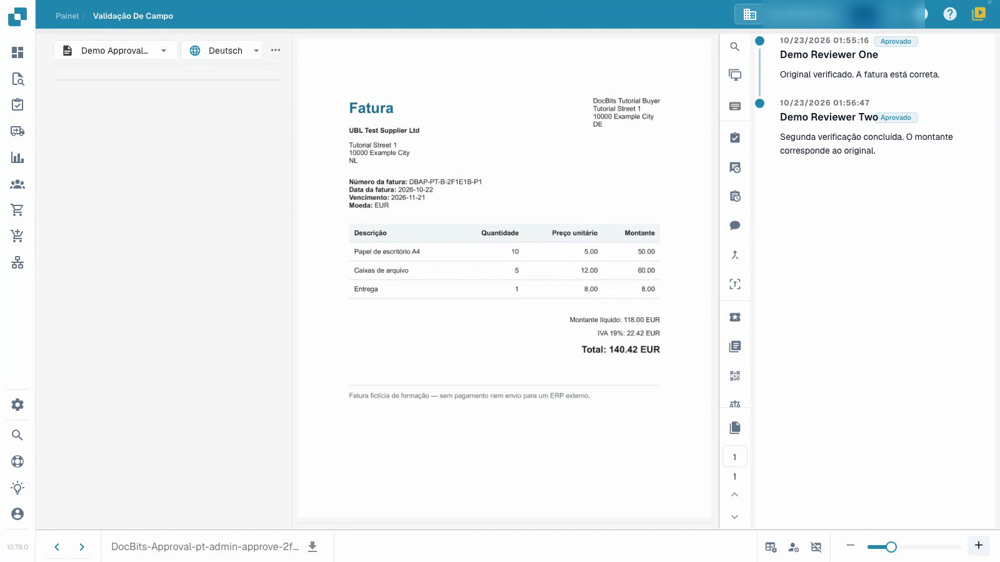

# Configurar e testar aprovações de faturas

Este vídeo mostra a configuração e o teste de aprovações.


Configurar e testar aprovações de faturas


[Ver vídeo com legendas](https://docbits-videos.fra1.cdn.digitaloceanspaces.com/settings-assistant/invoice-approval-admin/v1/pt.html)

A aplicação real é mostrada; a redação das opções pode depender da versão implementada.

Configure a aprovação para o tipo de documento utilizado pelo seu processo. Identifique os revisores pretendidos e decida se necessita de uma segunda revisão independente. O vídeo utiliza um tipo de teste separado, faturas sintéticas e contas temporárias de revisão sem permissões de administração; o seu apresentador é fictício.

## Configurar o tipo de documento

Abra **Configurações → Tipos de documentos**, selecione o tipo pretendido e abra **Mais configurações → Aprovação e Rejeição**. Escolha as definições de que o seu processo necessita e, em seguida, recarregue a página para verificar o que foi guardado.

| Definição | Objetivo |
| --- | --- |
| Aprovar antes de exportar | Exigir uma decisão de aprovação antes de o documento prosseguir para exportação. |
| Segunda Aprovação | Adicionar uma segunda fase de aprovação ao processo configurado. |
| Histórico de aprovação | Manter as decisões registadas disponíveis para revisão. |
| Selo de aprovação | Configurar uma marca num documento aprovado; consulte o guia de carimbos separado. |

A opção V2 adicional e os editores de formulários são definições separadas. Este tutorial utiliza formulários de aprovação padrão preparados.

## Testar com as funções pretendidas

1. Atribua ao primeiro e ao segundo revisor grupos separados e o acesso pretendido aos documentos atribuídos. Neste exemplo, a primeira conta tem permissão de aprovação de primeira fase e a segunda conta tem permissão de segunda fase. Um interruptor por si só não atribui uma pessoa nem concede essa permissão.
2. Utilize a primeira conta normal de revisão para verificar a fatura atribuída e já validada, adicione uma nota e dê a primeira aprovação. Verifique se o documento guardado ainda aguarda a segunda aprovação. Verifique se esta conta não pode executar a segunda fase quando as suas permissões o proíbem.
3. Atribua a fatura em espera ao outro revisor autorizado. Utilize essa segunda conta normal de revisão para a verificar e dar a segunda aprovação com uma nota separada.
4. Reabra o histórico e verifique ambos os revisores diferentes, horas e notas. Rejeite também uma fatura de teste separada com um motivo e verifique essa decisão após recarregar.

<figure><figcaption>
Definições de aprovação guardadas no próprio tipo de teste.
</figcaption></figure>

<figure><figcaption>
Dois revisores diferentes e ambas as notas guardadas.
</figcaption></figure>

## Verificar o resultado

Mantenha a primeira aprovação, a segunda aprovação pendente e a rejeição como resultados diferentes. Confirme que os valores da fatura se mantêm inalterados após cada decisão. Neste exemplo, o canal de teste aguarda que os dados sejam recolhidos e não tem um ERP externo como destino. O estado técnico `pending_data_fetch`, quando apresentado, significa aguardar a recolha de dados. O histórico de aprovação por si só não prova uma transferência ERP.

Teste as funções configuradas, a atribuição e o caminho de decisão completo antes de aplicar o processo a documentos reais.

## Páginas relacionadas

- [Grupos, utilizadores e permissões](../../../groups-users-and-permissions/README.md)
- [Histórico de aprovação](approval-history.md)
- [Carimbo de aprovação](approval-stamp.md)
