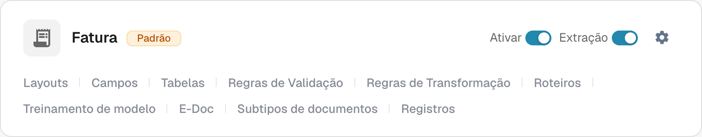
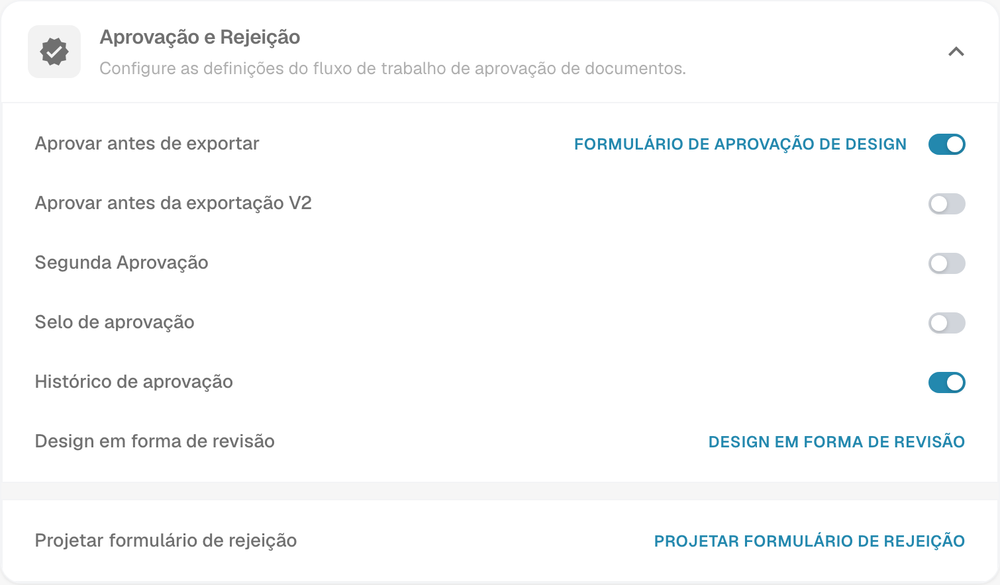

# Selo de Aprovação

Um selo de aprovação é uma anotação usada no fluxo de aprovação do documento quando a opção está ativada para esse tipo de documento. Ajuda o revisor a verificar quem aprovou o documento e quando. Confirme a anotação e o resultado do PDF com uma fatura de teste no fluxo de trabalho que a sua organização utiliza.

## Encontrar a opção

1. Com uma conta de administrador, abra **Configurações → Tipos de Documentos**. Encontre o tipo que deseja configurar, como **Fatura**, e selecione o **ícone de engrenagem** nesse cartão. A engrenagem abre **Mais configurações** para esse tipo de documento.

   <figure><figcaption>
Cartão real de Fatura no ambiente Dev em português. A engrenagem abre Mais configurações; nenhum controlo foi alterado.
</figcaption></figure>

   **Ativar** controla a disponibilidade do tipo e **Extração** ajusta o seu modo de extração. Os links no rodapé abrem áreas próprias: **Layouts**, **Campos**, **Tabelas**, **Regras de Validação**, **Regras de Transformação**, **Roteiros**, **Treinamento de modelo**, **E-Doc**, **Subtipos de documentos** e **Registros**. Os links disponíveis dependem dos módulos e das definições do tipo. Para localizar o selo, utilize a engrenagem.

2. Em **Mais configurações**, expanda **Aprovação e Rejeição**. Localize **Selo de aprovação** junto a **Aprovar antes de exportar**, **Segunda Aprovação** e **Histórico de aprovação**. A imagem mostra a definição existente do selo **desativada**; este estado pode ser diferente na sua organização. A imagem não mostra um documento aprovado.

   <figure><figcaption>
Vista real da secção Aprovação e Rejeição no ambiente Dev em português. O estado dos controlos foi apenas lido.
</figcaption></figure>

   **Aprovar antes de exportar**, a opção **Aprovar antes da exportação V2**, **Segunda Aprovação** e **Histórico de aprovação** são definições do fluxo separadas do selo. Os links de design apresentados abrem os editores dos formulários de aprovação, revisão ou rejeição correspondentes. Não é necessário abrir esses editores para consultar a definição do selo.

3. Altere **Selo de aprovação** somente depois de acordar como as aprovações e exportações funcionam na sua organização. **A mudança do interruptor guarda a definição imediatamente.** Guarde um registo da definição anterior para poder verificar o efeito numa fatura de teste.

## Verificar uma aprovação

Envie uma fatura sintética deste tipo de documento pelo fluxo de trabalho de aprovação configurado. No passo de aprovação desse fluxo, aprove-a com uma conta de teste autorizada. Reabra o documento aprovado e verifique se a anotação apresenta o nome do aprovador e a data esperados. Examine também o PDF transferido que o seu fluxo de trabalho realmente utiliza. Se o selo estiver ausente, verifique o tipo de documento, o estado de aprovação, a definição e a configuração de exportação.

Um selo de aprovação é separado de **Segunda Aprovação** e **Histórico de aprovação**. Ativar um não prova que os outros estão configurados. As ações de download disponíveis no painel e o formato de exportação IDM dependem do ambiente e não foram verificados para esta página, por isso este guia não promete etiquetas específicas de menu de download nem saída IDM automática.

As duas capturas mostram vistas reais do ambiente Dev em português. Nenhum interruptor foi alterado e nenhum documento foi aprovado ou exportado durante esta verificação. O resultado final com selo precisa de uma fatura sintética aprovada dedicada ao teste.
