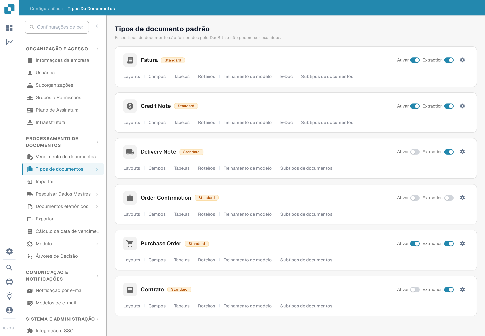
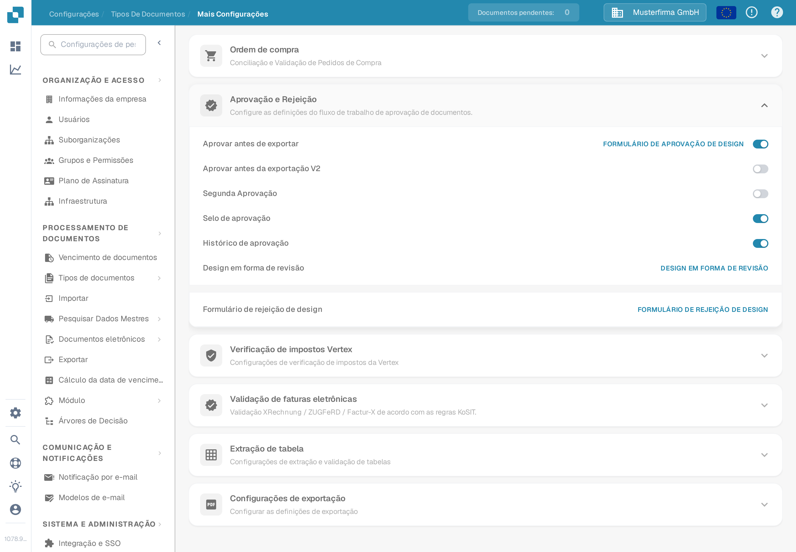

# Selo de Aprovação

Um selo de aprovação é uma anotação adicionada durante a aprovação do documento quando a opção está ativada para esse tipo de documento. É útil quando um revisor precisa de ver quem aprovou um documento e quando. A página anterior mostrava seis capturas de ecrã de uma interface antiga e tratava o selo, a exportação IDM e as opções de download de PDF como já verificadas em conjunto. Verifique cada resultado no seu próprio fluxo de trabalho antes de confiar nele.

## Encontrar a opção

1. Com uma conta de administrador, abra **Configurações → Tipos de Documentos**. Encontre o tipo que deseja configurar, como **Fatura**, e selecione o **ícone de engrenagem** nesse cartão. A engrenagem abre **Mais Configurações** para esse tipo de documento; **Layouts** e **Campos** abrem editores diferentes.

   <figure><figcaption>
Abra a engrenagem no tipo de documento relevante.
</figcaption></figure>

2. Em **Mais Configurações**, expanda **Aprovação e Rejeição**. Localize o interruptor **Selo de aprovação** junto a **Aprovar antes da exportação**, **Segunda Aprovação** e **Histórico de aprovação**. A captura de ecrã mostra a organização sintética **DocBits Documentation Test A** com o selo **desativado**. Não mostra um documento com selo.

   <figure><figcaption>
Verifique a definição de Selo de aprovação do tipo de documento selecionado.
</figcaption></figure>

3. Ative o interruptor somente depois de acordar como as aprovações e exportações funcionam na sua organização. Guarde um registo da definição anterior para poder verificar o efeito numa fatura de teste.

## Verificar uma aprovação

Envie uma fatura sintética deste tipo de documento pelo fluxo de trabalho de aprovação configurado. No ecrã **Pronto para aprovação**, aprove-a com uma conta de teste autorizada. O cliente web atual do DocBits verifica a opção Selo de aprovação durante a aprovação e adiciona uma anotação de selo com o nome do aprovador e a data. Reabra o documento aprovado e examine a anotação e o PDF transferido que o seu fluxo de trabalho realmente utiliza. Se o selo estiver ausente, verifique o tipo de documento, o estado de aprovação, a definição e a configuração de exportação.

Um selo de aprovação é separado de **Segunda Aprovação** e **Histórico de aprovação**. Ativar um não prova que os outros estão configurados. As ações de download disponíveis no painel e o formato de exportação IDM dependem do ambiente e não foram verificados para esta página, por isso este guia não promete etiquetas específicas de menu de download nem saída IDM automática.

As duas novas capturas de ecrã foram verificadas visualmente na Sandbox Test A em português. Nenhum interruptor foi alterado e nenhum documento foi aprovado ou exportado durante esta verificação; o estado final com selo precisa de uma fatura aprovada sintética dedicada.
