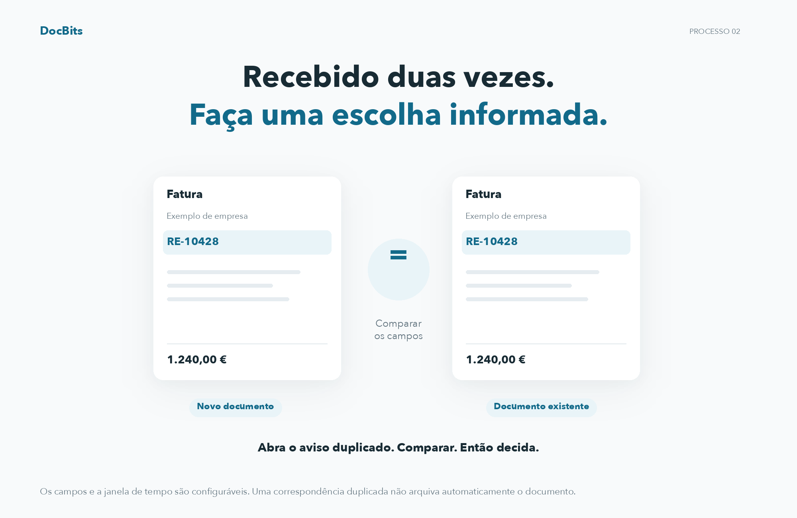
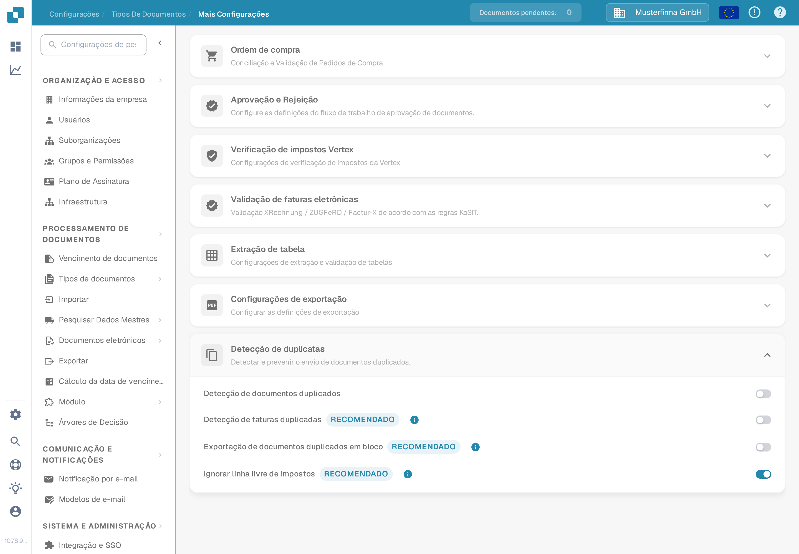
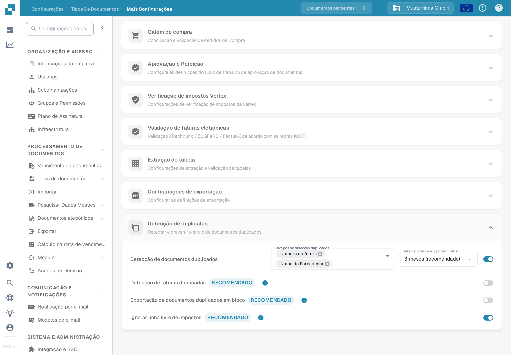
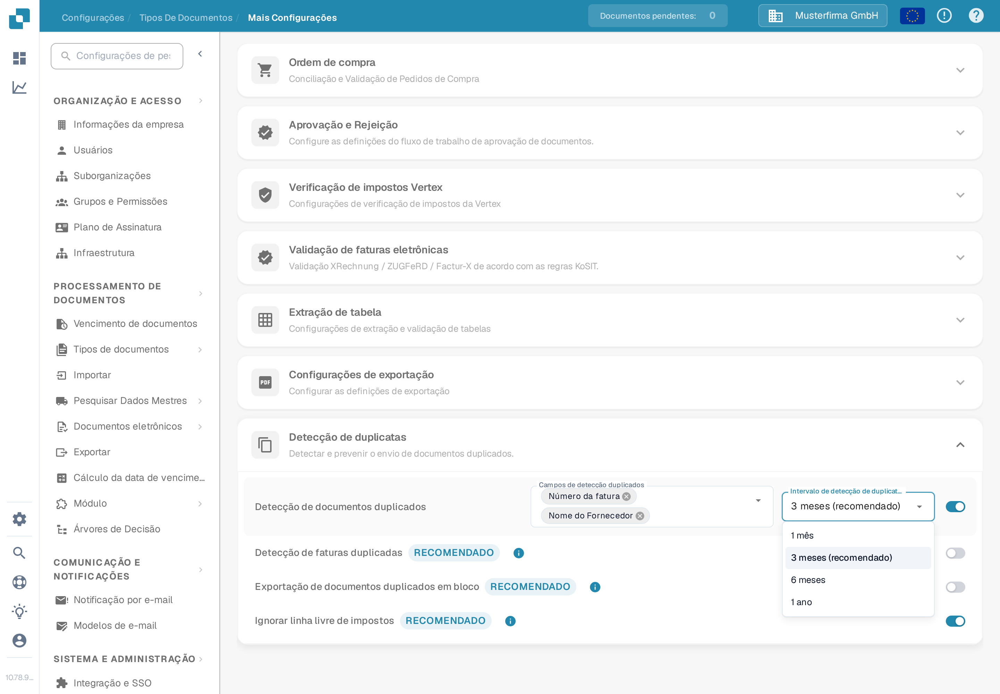

# Detecção de duplicatas

## Detecte duplicatas e tome uma decisão informada

<figure><figcaption>
Detecte duplicatas e tome uma decisão informada
</figcaption></figure>

DocBits compara os campos configurados dentro da janela de tempo selecionada. Quando uma correspondência for encontrada, abra o aviso de duplicata e compare os documentos antes de continuar ou arquivar. O bloqueio de exportações duplicadas é uma configuração separada; uma correspondência não arquiva automaticamente um documento.

Use a **Detecção de duplicatas** para marcar documentos que coincidem com outro documento em campos selecionados dentro de um período escolhido. As opções pertencem a cada tipo de documento.

## Abrir as configurações

1. Abra **Configurações → Tipos de documentos**.
2. No tipo de documento que deseja configurar, selecione **Configurações**.
3. Em **Mais configurações**, abra **Detecção de duplicatas**.

<figure><figcaption>
As configurações da fatura apresentam quatro interruptores separados. Os seletores de campos e de intervalo aparecem quando a deteção está ativada.
</figcaption></figure>

## Escolher o que conta como duplicata

1. Ative **Detecção de documentos duplicados**. Os seletores **Campos de deteção duplicados** e **Intervalo de deteção de duplicatas** aparecem.
2. Selecione os campos que devem coincidir. Para uma fatura, pode escolher **ID do fornecedor** e **Número da fatura**. Escolha os campos que distinguem os documentos no seu próprio processo.
3. Escolha um intervalo: **1 mês**, **3 meses (recomendado)**, **6 meses** ou **1 ano**. Um intervalo mais longo verifica um período maior e pode demorar mais a carregar.

Cada alteração é guardada ao fazê-la; não existe um botão Guardar separado nesta secção. Se desativar a deteção, os seletores de campos e de intervalo ficam ocultos.

<figure><figcaption>
Ative a deteção antes de selecionar os campos de comparação e o intervalo de tempo.
</figcaption></figure>

<figure><figcaption>
O intervalo de três meses está assinalado como recomendado no menu.
</figcaption></figure>

Para **Fatura**, esta secção oferece também **Detecção de faturas duplicadas**, **Exportação de documentos duplicados em bloco** e **Ignorar linha livre de impostos**. São interruptores separados; ative apenas o comportamento de que o seu processo de faturas necessita. Os interruptores adicionais não aparecem para os outros tipos de documento.

## Rever um documento marcado

Quando o DocBits encontra uma correspondência, a linha do documento no **Painel** mostra um ícone de duplicata. Selecione o ícone para comparar os registos correspondentes no painel lateral. O ícone aparece apenas quando existe uma correspondência.

Ao abrir um documento marcado, o aviso de duplicata oferece **Ver duplicata**, **Continuar mesmo assim** e, se o documento ainda não tiver sido arquivado, **Arquivar**. Reveja os registos correspondentes antes de escolher uma ação. Consulte [o guia do Painel](../../dashboard/README.md) para a lista de documentos.
