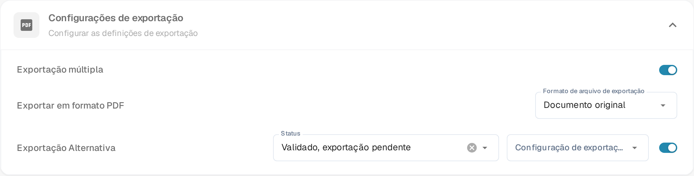

# Exportação Alternativa

## Visão Geral

Você pode configurar uma opção de exportação alternativa para aparecer no menu suspenso de exportação dentro da seção de ordem de compra quando um documento estiver em um status específico.\
Esta página explica como configurar essa opção. A definição está na secção **Configurações de exportação** do tipo de documento.

## Etapas de Ativação

1. Vá para **Configurações** -> **Configurações globais** -> **Tipos de documentos**
2.  Localize o cartão do tipo de documento e abra as definições com a engrenagem (**Mais configurações**).

    
3.  Abra a secção **Configurações de exportação** e ative **Exportação Alternativa**.

    <figure><figcaption>
O interruptor <strong>Exportação Alternativa</strong> em <strong>Configurações de exportação</strong>. Com ele ativo aparecem <strong>Status</strong> e <strong>Configuração de exportação</strong> ao lado.
</figcaption></figure>

## Como configurar

Uma vez que a configuração esteja ativada, você pode escolher um status de documento e atribuir uma configuração de exportação predefinida.

* **Status** - o status do documento em que a opção de exportação adicional é oferecida.
* **Configuração de exportação** - a configuração de exportação usada por esta opção.

Mais informações sobre como configurar as configurações de exportação podem ser encontradas [aqui](../../../../document-processing/export.md).

Você pode escolher entre os seguintes status:

* Classificado
* Confirmação pendente
* Aprovação pendente
* Pendente segunda aprovação
* Validado, exportação pendente
* Exportação pendente aprovada
* Rejeitado
* Concluído
* Exportado
* Em espera
* Fluxo de trabalho
* Erro
* Em revisão

Após a configuração, uma opção de exportação adicional aparecerá na correspondência de opções de exportação da ordem de compra. Esta opção utiliza a configuração de exportação especificada quando o documento corresponde ao status definido.

